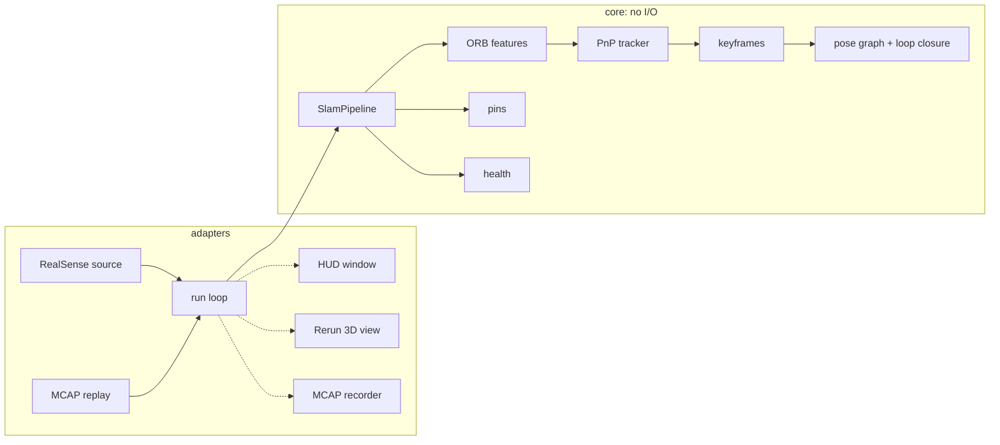

# relnav

**Relative navigation with an Intel RealSense D435i.** relnav tracks where the camera is
(6-DoF pose relative to where it started) and where things are: drop a pin on an object and
it reports live distance and bearing to it, and distances between pins.

Built like flight software: ports-and-adapters architecture, requirement IDs traced to tests,
deterministic record and replay, and hardware-free tests on a ray-cast synthetic room.

## Architecture



Layers point inward only: `app → adapters → ports → core → domain` (checked by import-linter).

## Quick start

```bash
uv sync
uv run pytest -m "not hardware"           # all hardware-free tests
uv run relnav viewer                      # Rerun viewer (normal user)
scripts/relnav-sudo live                  # live tracking (root needed on macOS)
scripts/relnav-sudo record recordings/home.mcap
uv run relnav replay recordings/home.mcap --realtime
uv run relnav verify results/home recordings/truth.yaml
```

Keys in the HUD: `p` drops a pin at the crosshair, `q` quits.

## Requirements

See [docs/requirements.md](docs/requirements.md), the [design spec](docs/specs/2026-10-02-relnav-design.md),
and the decision records in [docs/adr](docs/adr).

## macOS notes

- librealsense needs root on macOS; `scripts/relnav-sudo` runs relnav under sudo and returns
  any written files to your user.
- The PyPI `pyrealsense2-macosx` wheel crashes as root, so relnav uses bindings built from
  source (`scripts/build_pyrealsense2.sh`).
- Color and IMU streams do not work on macOS; relnav uses depth and left infrared.
