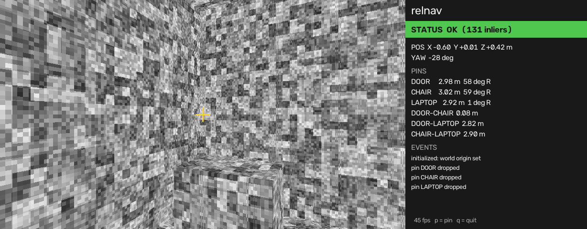
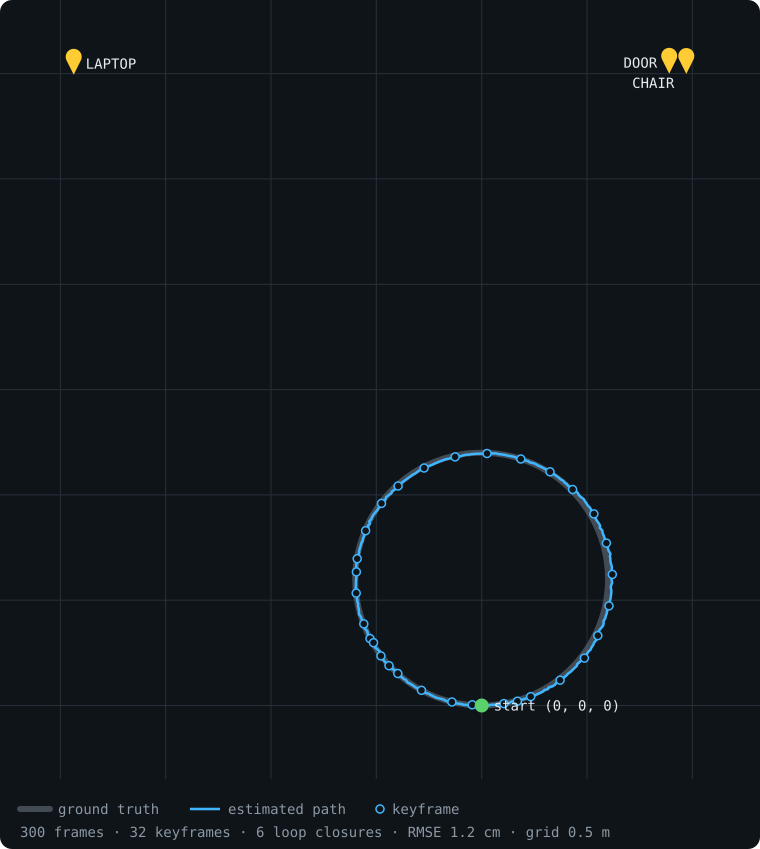
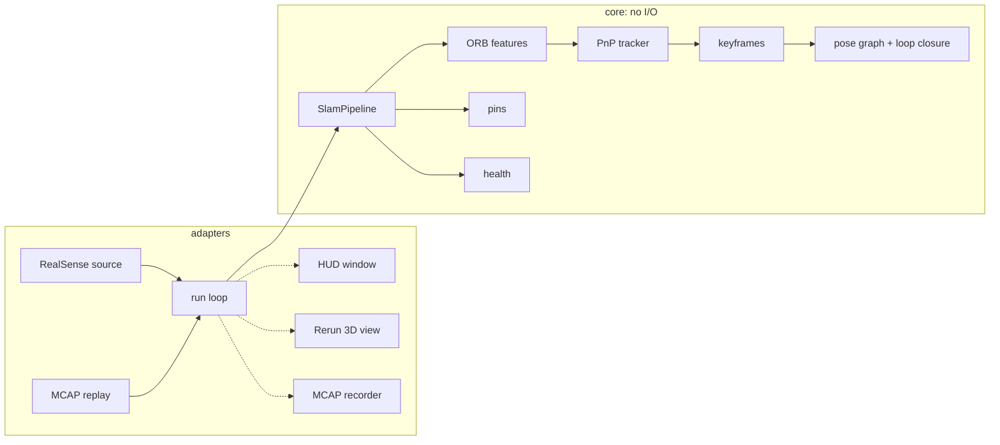

# relnav

**Relative navigation with an Intel RealSense D435i.** relnav tracks the camera's 6-DoF pose
relative to where it started and lets you drop 3D pins on real objects. It shows live
distance and bearing to each pin, and the distance between every pair of pins.


-lightgrey)




*The HUD replaying the synthetic test room. Tracking is OK, the camera is 0.6 m left of
where it started, and three pins carry live distance and bearing. Distances between pins
are listed below them.*

relnav is built the way flight software is built. It uses a ports-and-adapters
architecture, and every requirement ID is traced to a test. Recordings replay
deterministically, and the SLAM core is tested without hardware on a ray-cast synthetic
room.

---

## Contents

- [Features](#features)
- [Results](#results)
- [Quick start: no camera needed](#quick-start-no-camera-needed)
- [Running with the camera](#running-with-the-camera)
- [CLI reference](#cli-reference)
- [How it works](#how-it-works)
- [Architecture](#architecture)
- [Project layout](#project-layout)
- [Configuration](#configuration)
- [Requirements and verification](#requirements-and-verification)
- [Development](#development)
- [macOS and hardware notes](#macos-and-hardware-notes)
- [Documentation](#documentation)

## Features

- **Markerless 6-DoF tracking.** ORB features on the left infrared image and depth-backed
  PnP. No QR codes, fiducials or room setup are needed. The world origin is the first
  tracked frame.
- **3D pins.** Aim the crosshair at an object and press `p`. Each pin is anchored to a
  keyframe, so it moves with map corrections and does not drift with the camera.
- **Loop closure.** A pose-graph backend (Open3D) corrects accumulated drift when you
  return to a mapped area.
- **Tracking health.** States are `OK`, `DEGRADED` and `LOST`. Relocalization runs against
  the keyframe map.
- **Record and replay.** Frames and pin presses are stored in [MCAP](https://mcap.dev).
  A replay of the same recording always gives the same trajectory and pins.
- **Two views.** An OpenCV HUD shows the camera view and readouts. A
  [Rerun](https://rerun.io) 3D view shows the path, keyframe point clouds and pins.
- **Verification built in.** `relnav verify` checks measured pin-to-pin distances against
  tape-measured ground truth.

## Results



These numbers come from a replay of the synthetic recording on a MacBook Pro M1 Pro. The
map above shows a top-down view with a 0.5 m grid.

| Metric | Value | Target |
|---|---|---|
| Trajectory RMSE vs ground truth | 1.2 cm | < 2 cm (REQ-ACC-03) |
| Processing rate, 848×480 | ~42 fps (24 ms/frame mean) | ≥ 25 fps (REQ-PERF-01) |
| Keyframes / loop closures | 32 / 6 over 300 frames | — |

Real-room accuracy (REQ-ACC-01, REQ-ACC-02) is waiting for the field test. See
[Requirements and verification](#requirements-and-verification).

Both figures come from real pipeline output. To regenerate them:

```bash
uv run python scripts/synthetic_recording.py recordings/synthetic.mcap
uv run python scripts/readme_figures.py recordings/synthetic.mcap
```

## Quick start: no camera needed

Prerequisites: macOS on Apple silicon and [uv](https://docs.astral.sh/uv/). uv installs
Python 3.12 itself.

```bash
git clone https://github.com/saravanacode/relnav.git && cd relnav
uv sync
uv run pytest -m "not hardware"                                   # hardware-free test suite
uv run python scripts/synthetic_recording.py recordings/synthetic.mcap
```

Then run these in two terminals:

```bash
uv run relnav viewer                                              # terminal 1: Rerun 3D view
uv run relnav replay recordings/synthetic.mcap --realtime         # terminal 2: HUD + pipeline
```

The replay writes `results/synthetic/` with `trajectory.tum`, `pins.json`, `timing.json`
and `summary.json`.

## Running with the camera

> [!IMPORTANT]
> librealsense needs **root** on macOS. Run camera commands through `scripts/relnav-sudo`.
> The script runs relnav under sudo and gives the files it writes back to your user. Run
> the Rerun viewer as your normal user.

1. **Build the camera bindings once.** The PyPI wheel crashes as root, so relnav uses
   pyrealsense2 2.58.4 built from source:

   ```bash
   scripts/build_pyrealsense2.sh
   ```

2. **Connect the camera at USB 3.** Use a USB 3.1+ or Thunderbolt USB-C cable, 1 m or
   shorter, plugged straight into the Mac. Check the link:

   ```bash
   system_profiler SPUSBHostDataType | grep -A10 RealSense | grep "Link Speed"   # want 5 Gb/s
   ```

3. **Track live:**

   ```bash
   uv run relnav viewer                       # terminal 1, normal user
   scripts/relnav-sudo live --name first-live # terminal 2
   ```

   In the HUD, press `p` to drop a pin at the crosshair and `q` to quit. Pin labels come
   from `config/default.yaml`.

4. **Record now, analyse later:**

   ```bash
   scripts/relnav-sudo record recordings/home.mcap
   uv run relnav replay recordings/home.mcap --realtime --name home
   uv run relnav verify results/home recordings/truth.yaml
   ```

Aim pins at surfaces with texture or edges, such as a door frame, a chair corner or a
laptop edge. The infrared projector is off ([ADR 0005](docs/adr/0005-emitter-off.md)), so
plain painted walls give few features and no depth. The full real-room procedure is in
[docs/field-test.md](docs/field-test.md).

## CLI reference

| Command | Purpose | Camera / root |
|---|---|---|
| `uv run relnav viewer` | Open the Rerun viewer. | No |
| `scripts/relnav-sudo live` | Track live with HUD and Rerun, then write results. Use `--record x.mcap` to also record. | Yes |
| `scripts/relnav-sudo record OUT.mcap` | Record frames and pin presses only, without SLAM. | Yes |
| `uv run relnav replay REC.mcap` | Run the full pipeline on a recording. Use `--realtime` to play at recorded speed. | No |
| `uv run relnav verify RUN_DIR TRUTH.yaml` | Compare pin-to-pin distances with tape measurements. Exit code 0 means pass. | No |

Common options are `--config PATH`, `--results DIR`, `--name NAME`, `--no-hud` and
`--no-rerun`. Run `uv run relnav <command> --help` for the full list.

**Results folder.** Each `live` or `replay` run writes these files to `results/<name>/`:

| File | Contents |
|---|---|
| `trajectory.tum` | Camera poses in [TUM format](https://cvg.cit.tum.de/data/datasets/rgbd-dataset/file_formats) |
| `pins.json` | Pin labels and world positions (m) |
| `timing.json` | Per-stage timings (mean, p95, max) and fps |
| `summary.json` | Frames, timeouts, dropped frames, stop reason, keyframes, loop closures |

## How it works

Each frame from the D435i carries a left infrared image and an aligned depth image on the
same pixel grid. The frame goes through `SlamPipeline`:

1. **Features**: ORB keypoints spread over a grid, so one textured corner cannot take all
   the features.
2. **Tracking**: features are matched to the last keyframe. Their depth gives 3D points,
   and RANSAC PnP solves the camera pose.
3. **Keyframes**: a new keyframe is inserted when overlap with the current one drops.
4. **Backend**: keyframes form an Open3D pose graph. Loop-closure candidates are verified
   geometrically and then optimized.
5. **Pins**: a pin stores its point in its anchor keyframe's frame. Its world position is
   always computed from the corrected keyframe pose.
6. **Health**: inlier count and reprojection error decide between `OK` and `DEGRADED`.
   Three failed frames in a row give `LOST`. When tracking is `LOST`, the pipeline
   relocalizes against stored keyframes.

**Conventions.** Poses are written `T_a_b`, which maps frame *b* into frame *a*. Internal
axes follow OpenCV: x right, y down, z forward. The HUD shows X right, Y up, Z forward.

## Architecture



The code has five layers, and dependencies point inward only:

```
app  →  adapters  →  ports  →  core  →  domain
```

`relnav.core` and `relnav.domain` never import adapters, the app layer, `pyrealsense2`,
`rerun`, `mcap` or `typer` (REQ-ARCH-01). import-linter enforces this in the test suite
and in pre-commit. The rule is why the SLAM core runs unchanged against the camera, a
recording or the synthetic room. Design decisions are recorded in [docs/adr](docs/adr).

## Project layout

```
src/relnav/
  domain/      SE3, data types, geometry, commands             (pure numpy)
  core/        features, tracker, keyframes, backend, pins, health, SlamPipeline
  ports/       FrameSource, StateSink, CommandSource, Recorder protocols
  adapters/    realsense/, mcap/, hud/, rerun/, results/
  app/         CLI (Typer), config (pydantic + YAML), run loop, session, verify
config/        default.yaml, usb2.yaml
scripts/       relnav-sudo, build_pyrealsense2.sh, synthetic_recording.py, readme_figures.py
tests/         unit/, synthetic/, integration/, hardware/, support/ (ray-cast room)
vendor/        pyrealsense2 built from source (binaries git-ignored)
docs/          spec, plan, requirements, field test, ADRs, status
```

## Configuration

Config files are YAML and validated by pydantic. Every key is optional.

```yaml
camera:
  width: 848
  height: 480
  fps: 30
  emitter_enabled: false              # projector dots move with the camera and confuse tracking
slam:
  pins:
    labels: [DOOR, CHAIR, LAPTOP]     # names for the 1st, 2nd and 3rd pin
rerun_url: null                       # null = local viewer from `uv run relnav viewer`
rerun_spawn: false
```

`config/usb2.yaml` (640×480 @ 15 fps) is for a camera stuck on a USB 2 link. Pass it with
`--config config/usb2.yaml`.

## Requirements and verification

| ID | Requirement | Status |
|---|---|---|
| REQ-ACC-01 | Pin-to-pin distance error < 3 cm (pins 1–3 m away) | Waiting for field test |
| REQ-ACC-02 | Re-observed pin moves < 5 cm after a ~10 m loop | Waiting for field test |
| REQ-ACC-03 | Synthetic trajectory RMSE < 2 cm | Passing |
| REQ-PERF-01 | Mean ≥ 25 fps at 848×480 on an M1 Pro | ~42 fps synthetic; real recording pending |
| REQ-REL-01 | Timeouts and failed starts never crash | Passing |
| REQ-REL-02 | LOST is reported and tracking recovers | Passing |
| REQ-REP-01 | Same recording gives identical results | Passing |
| REQ-ARCH-01 | Core and domain are hardware-free | Passing |

Each requirement is traced to the test or procedure that verifies it in
[docs/requirements.md](docs/requirements.md). `tests/test_docs.py` fails if a spec
requirement is missing from that table, or if a test the table names does not exist.

## Development

```bash
uv sync                                        # install everything, including dev tools
uv run pytest -m "not hardware"                # unit, synthetic and integration tests (~30 s)
uv run ruff check . && uv run ruff format --check .
uv run pyright
uv run lint-imports                            # architecture contracts
```

The hardware tests need the camera and root:

```bash
sudo env RELNAV_HARDWARE=1 PYTHONDONTWRITEBYTECODE=1 "$(command -v uv)" run --no-sync pytest -m hardware -q
```

**Working rules**

- Use uv for everything: `uv add` and `uv run`. Never use pip or bare `python`. A test
  checks that the docs follow this rule.
- Work test-first: write the failing test, watch it fail, then write the code.
- Pre-commit runs ruff, ruff format and the import contracts on every commit.

**Test tiers**

- `tests/unit`: pure logic and adapters with fakes.
- `tests/synthetic`: the full pipeline on a ray-cast textured room with known ground
  truth.
- `tests/integration`: the CLI end to end on recordings.
- `tests/hardware`: the real camera. These tests are opt-in.

## macOS and hardware notes

- **Root:** librealsense needs raw USB access on macOS. Use `scripts/relnav-sudo`.
- **Streams:** color and IMU do not work on macOS, so relnav uses depth + left infrared
  only. Starting the color stream can leave the camera stuck until you replug it.
- **Bindings:** the PyPI `pyrealsense2-macosx` wheel segfaults as root. Use
  `scripts/build_pyrealsense2.sh`. The script also works around broken Command Line Tools
  headers.
- **USB 2 fallback:** a poor cable or plug drops the link to 480 Mb/s. There is no
  848×480 @ 30 fps mode at that speed and power is limited, so streams fail or stop. Use
  a short USB 3 cable, or `config/usb2.yaml` as a fallback.
- **`failed to set power state`:** this happens sometimes on the first start. The source
  retries 4 times. Replugging clears a stuck camera.

## Documentation

| Document | Purpose |
|---|---|
| [Design spec](docs/specs/2026-10-02-relnav-design.md) | Binding design and requirements |
| [Implementation plan](docs/plans/2026-10-02-relnav-implementation.md) | The 20 tasks the code was built from |
| [Requirements](docs/requirements.md) | Traceability from each requirement to its test |
| [Field test](docs/field-test.md) | Real-room procedure with a tape measure |
| [ADRs](docs/adr) | Architecture decision records 0001–0006 |
| [Status](docs/STATUS.md) | Current state, blockers and next steps |
