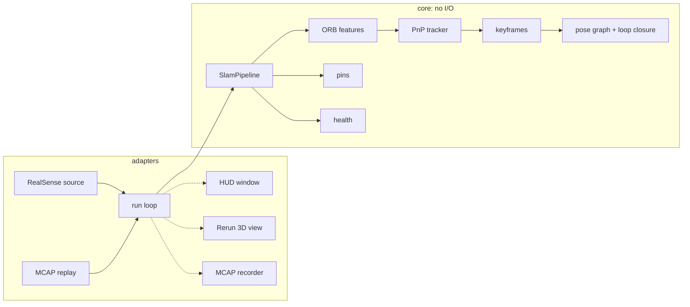

# relnav Implementation Plan

> **For agentic workers:** REQUIRED SUB-SKILL: Use superpowers:subagent-driven-development (recommended) or superpowers:executing-plans to implement this plan task-by-task. Steps use checkbox (`- [ ]`) syntax for tracking.

**Goal:** Build relnav, a ports-and-adapters visual SLAM system that tracks a RealSense D435i's 6-DoF pose and user-dropped 3D pins, records and replays deterministically, and drives a HUD plus a Rerun 3D view for a LinkedIn demo.

**Architecture:** Pure `domain` (types, SE3 math) and `core` (ORB features, PnP tracking, keyframes, pose-graph loop closure, pins, health) layers with no I/O. `ports` define Protocols. `adapters` implement them with RealSense, MCAP, Rerun and OpenCV. `app` wires everything behind a Typer CLI. Tests run hardware-free on a ray-cast synthetic room.

**Tech Stack:** Python 3.12, uv, NumPy, OpenCV 5, Open3D 0.20, rerun-sdk 0.38, mcap 1.5 (+zstandard), Typer, Pydantic 2, PyYAML, structlog; dev: pytest, Hypothesis, ruff, pyright, import-linter, pre-commit. pyrealsense2 2.58.4 built from source (vendored).

**Spec:** `docs/specs/2026-10-02-relnav-design.md`

## Global Constraints

- Python 3.12 only: `requires-python = ">=3.12,<3.13"`. Use uv for everything (`uv add`, `uv run`); never pip, never `.venv/bin/python` in docs.
- pyrealsense2 comes from `vendor/pyrealsense2` (2.58.4, built from source). Never add `pyrealsense2-macosx`.
- Camera streams: depth Z16 + infrared 1 Y8, 848×480 @ 30 fps. Emitter off by default.
- REQ-ARCH-01: `relnav.domain` and `relnav.core` never import `relnav.adapters`, `relnav.app`, `pyrealsense2`, `rerun`, `mcap`, or `typer`. Layers: `app → adapters → ports → core → domain`.
- Transform naming `T_a_b` maps points from frame b into frame a. Internal axes follow OpenCV (x right, y down, z forward). World = camera frame of the first tracked frame.
- No wall clock in core decisions. `cv2.setRNGSeed(0)` at pipeline construction (REQ-REP-01).
- Spec thresholds (Section 8): ORB 1000 features, 8×6 grid, depth 0.3–4.0 m, Lowe ratio 0.8; PnP RANSAC 3 px / 100 iterations, min 20 inliers; keyframe at > 0.15 m or > 15° or inliers < 50% of reference features or < 100; loop candidates ≤ 1.0 m and ≤ 45°, excluding 10 most recent, accepted with ≥ 60 inliers and RMSE ≤ 2 px; edge prune threshold 0.25; DEGRADED below 60 inliers or above 2 px RMSE; LOST after 3 consecutive failures; pin patch 9×9 with ≥ 30% valid depth.
- Live and record run as root through `scripts/relnav-sudo`; every file written under sudo is chowned back to `SUDO_UID:SUDO_GID`.
- Before every commit run `uv run ruff format . && uv run ruff check --fix .` (the pre-commit hooks enforce both).
- Line length 100. Every commit message ends with:
  `Co-Authored-By: Claude Opus 5.5 <noreply@anthropic.com>`

## Deviations from the spec (decided while planning)

- `DropPin` / `Quit` live in `relnav.domain.commands` (not `ports/commands.py`), because the core consumes them and the core may not import ports. `ports/commands.py` holds only the `CommandSource` protocol.
- `FrameSource` has no `intrinsics` attribute; every `Frame` already carries its intrinsics.
- `SlamConfig` lives in `core/pipeline.py`; each component's config dataclass lives next to the component.
- Shared display helpers (human-readable position, yaw, bearing text) live in `adapters/presentation.py`, used by both HUD and Rerun.
- `RealSenseConfig` lives in `adapters/realsense/config.py` so loading config never imports pyrealsense2 (replay works without the bindings).
- Dropped live frames are reported in `summary.json` (`dropped_frames`), not on the HUD.
- Timings are reported as `features_ms`, `tracking_ms` (matching + PnP + backend) and `total_ms`, not split further.
- OpenCV is not forced single-threaded during replay: the determinism tests pass without it (verified while planning).
- The replay golden-trajectory regression on a real recording is covered by the field test (`docs/field-test.md`) instead of an env-var-gated pytest.
- The tracker keeps a guided PnP result only when its refined error is within the RANSAC threshold; otherwise it re-solves unguided. Planning found that OpenCV's guided RANSAC can report success with a wrong pose when the guess is bad.

## Plan verification (done while planning)

Every file in this plan was extracted into a scratch uv project and checked: 116 hardware-free tests pass (including the 2 cm REQ-ACC-03 loop, LOST recovery and replay determinism), `ruff check` and `ruff format --check` are clean, `pyright` reports 0 errors, and `lint-imports` keeps both contracts. Expected test counts in each task match that run.

## Review Focus

1. **Recording cut off mid-write** (camera process killed): replay must process frames up to the cut, warn, and still write results. Pinned in Task 13 (`test_truncated_recording_replays_up_to_the_cut`).
2. **Pin dropped while INITIALIZING or LOST**: rejected with an event, never a crash. Pinned in Task 11 (`test_pin_rejected_before_initialization`).
3. **`truth.yaml` names a label missing from `pins.json`**: row shows MISSING, exit code 1, no traceback. Pinned in Task 14 (`test_missing_label_fails_without_crashing`) and Task 18 (`test_verify_reports_missing_label`).
4. **Camera unplugged mid-run**: run stops cleanly, sinks and recorder closed, summary says why. Pinned in Task 12 (`test_source_error_stops_cleanly`).
5. **Recording at a resolution other than 848×480**: pipeline uses the frame's intrinsics; nothing hard-codes 848×480. Pinned in Task 11 (`test_runs_at_other_resolution`).

## File Map

```
relnav/
  pyproject.toml, uv.lock, .python-version, .gitignore, .pre-commit-config.yaml, README.md
  config/default.yaml
  scripts/build_pyrealsense2.sh, scripts/relnav-sudo
  vendor/pyrealsense2/                    local package (binaries git-ignored)
  src/relnav/
    __init__.py
    domain/  __init__.py se3.py types.py geometry.py commands.py
    core/    __init__.py features.py tracker.py keyframes.py health.py pins.py backend.py pipeline.py
    ports/   __init__.py errors.py frame_source.py state_sink.py commands.py recorder.py
    adapters/__init__.py fs.py presentation.py
      mcap/      __init__.py codec.py recorder.py source.py
      results/   __init__.py writer.py
      realsense/ __init__.py config.py source.py
      hud/       __init__.py render.py window.py
      rerun/     __init__.py sink.py
    app/     __init__.py runner.py config.py session.py verify.py cli.py
  tests/
    __init__.py test_architecture.py
    support/   __init__.py synthetic.py
    unit/      __init__.py test_se3.py test_types.py test_geometry.py test_synthetic.py
               test_features.py test_tracker.py test_keyframes.py test_health.py test_pins.py
               test_backend.py test_runner.py test_mcap.py test_results.py test_verify.py
               test_realsense.py test_hud.py test_rerun.py test_config.py
    synthetic/ __init__.py test_pipeline.py
    integration/ __init__.py test_cli.py
    hardware/  __init__.py test_camera.py
  docs/ specs/ plans/ requirements.md field-test.md adr/0001…0006
```

All commands run from `/Users/saravana/self/relnav`.

---
### Task 1: Project scaffold, vendored pyrealsense2, tooling, architecture contract

**Files:**
- Create: `pyproject.toml` (via `uv init`, then edited), `.python-version`, `.gitignore`, `.pre-commit-config.yaml`
- Create: `scripts/build_pyrealsense2.sh`, `scripts/relnav-sudo`
- Create: `vendor/pyrealsense2/` (copied from `/Users/saravana/self/slam/vendor/pyrealsense2`)
- Create: `src/relnav/__init__.py`, `src/relnav/{domain,core,ports,adapters,app}/__init__.py`
- Create: `tests/__init__.py`, `tests/support/__init__.py`, `tests/unit/__init__.py`, `tests/synthetic/__init__.py`, `tests/integration/__init__.py`, `tests/hardware/__init__.py`
- Test: `tests/test_architecture.py`

**Interfaces:**
- Consumes: nothing.
- Produces: importable package `relnav` with layer subpackages; `uv run pytest`, `uv run ruff`, `uv run pyright`, `uv run lint-imports` all work; `tests.support` importable from tests.

- [ ] **Step 1: Initialise the uv package**

```bash
cd /Users/saravana/self/relnav
uv init --package --name relnav --build-backend uv --python 3.12
uv python pin 3.12
```

Then edit `pyproject.toml` so the `[project]` table reads exactly (keep whatever `[build-system]` uv wrote):

```toml
[project]
name = "relnav"
version = "0.1.0"
description = "Relative navigation: visual SLAM with an Intel RealSense D435i"
readme = "README.md"
requires-python = ">=3.12,<3.13"
dependencies = []

[project.scripts]
relnav = "relnav.app.cli:app"
```

- [ ] **Step 2: Vendor the locally built pyrealsense2 and add the rebuild script**

```bash
mkdir -p vendor scripts
cp -R /Users/saravana/self/slam/vendor/pyrealsense2 vendor/pyrealsense2
rm -rf vendor/pyrealsense2/src/pyrealsense2/__pycache__
ls vendor/pyrealsense2/src/pyrealsense2
```

Expected: `__init__.py  librealsense2.2.58.dylib  pyrealsense2.cpython-312-darwin.so`

Create `scripts/build_pyrealsense2.sh`:

```bash
#!/usr/bin/env bash
# Build pyrealsense2 from librealsense source for this Mac and install it into
# vendor/pyrealsense2. Needed because the PyPI pyrealsense2-macosx wheel segfaults
# when it opens the camera as root on macOS 26.
set -euo pipefail

VERSION="${1:-v2.58.4}"
ROOT="$(cd "$(dirname "$0")/.." && pwd)"
WORK="${ROOT}/.build/librealsense"
SDK="$(xcrun --show-sdk-path)"
PY="${ROOT}/.venv/bin/python"
DEST="${ROOT}/vendor/pyrealsense2/src/pyrealsense2"
MAJOR_MINOR="$(echo "${VERSION#v}" | cut -d. -f1-2)"

if [ ! -d "${WORK}" ]; then
  git clone --depth 1 --branch "${VERSION}" https://github.com/realsenseai/librealsense.git "${WORK}"
fi

# This machine's Command Line Tools lack the toolchain libc++ headers, so point
# clang at the SDK's copy.
cmake -S "${WORK}" -B "${WORK}/build" -DCMAKE_BUILD_TYPE=Release \
  -DCMAKE_OSX_SYSROOT="${SDK}" "-DCMAKE_CXX_FLAGS=-isystem ${SDK}/usr/include/c++/v1" \
  -DBUILD_PYTHON_BINDINGS=ON -DPYTHON_EXECUTABLE="${PY}" -DPython_EXECUTABLE="${PY}" \
  -DBUILD_EXAMPLES=OFF -DBUILD_GRAPHICAL_EXAMPLES=OFF -DBUILD_TOOLS=OFF \
  -DBUILD_UNIT_TESTS=OFF -DCHECK_FOR_UPDATES=OFF -DBUILD_WITH_OPENMP=OFF \
  -DCMAKE_POLICY_VERSION_MINIMUM=3.5
cmake --build "${WORK}/build" -j"$(sysctl -n hw.ncpu)"

REL="${WORK}/build/Release"
SO="$(ls "${REL}"/pyrealsense2.*.*.*.cpython-312-darwin.so | head -1)"
DYLIB="$(ls "${REL}"/librealsense2.*.*.*.dylib | head -1)"
mkdir -p "${DEST}"
cp "${SO}" "${DEST}/pyrealsense2.cpython-312-darwin.so"
cp "${DYLIB}" "${DEST}/librealsense2.${MAJOR_MINOR}.dylib"
cp "${WORK}/wrappers/python/pyrealsense2/__init__.py" "${DEST}/"
install_name_tool -delete_rpath "${REL}" "${DEST}/pyrealsense2.cpython-312-darwin.so" || true
install_name_tool -add_rpath @loader_path "${DEST}/pyrealsense2.cpython-312-darwin.so"
codesign -f -s - "${DEST}"/*.so "${DEST}"/*.dylib
echo "Installed pyrealsense2 ${VERSION} into ${DEST}"
```

Create `scripts/relnav-sudo`:

```bash
#!/usr/bin/env bash
# Run relnav as root (librealsense needs raw USB access on macOS) without leaving
# root-owned bytecode behind. Example: scripts/relnav-sudo live
set -euo pipefail
cd "$(dirname "$0")/.."
exec sudo env PYTHONDONTWRITEBYTECODE=1 "$(command -v uv)" run --no-sync relnav "$@"
```

```bash
chmod +x scripts/build_pyrealsense2.sh scripts/relnav-sudo
```

- [ ] **Step 3: Add dependencies**

```bash
uv add numpy opencv-python open3d rerun-sdk mcap zstandard typer pydantic pyyaml structlog
uv add --editable ./vendor/pyrealsense2
uv add --dev pytest hypothesis ruff pyright import-linter pre-commit
uv run python -c "import pyrealsense2, cv2, open3d, rerun, mcap, typer, pydantic, structlog; print(pyrealsense2.__version__, cv2.__version__, open3d.__version__, rerun.__version__)"
```

Expected last line: `2.58.4 5.0.0 0.20.0 0.38.1` (patch versions may be newer).

- [ ] **Step 4: Add tool configuration**

Append to `pyproject.toml`:

```toml
[tool.ruff]
line-length = 100
target-version = "py312"
extend-exclude = ["vendor", ".build"]

[tool.ruff.lint]
select = ["E", "F", "W", "I", "B", "UP", "SIM", "RUF"]
# Allow unicode such as the degree sign in docs and messages.
ignore = ["RUF001", "RUF002", "RUF003"]

[tool.pyright]
include = ["src", "tests"]
pythonVersion = "3.12"
typeCheckingMode = "basic"
reportMissingTypeStubs = false
reportMissingModuleSource = false

[tool.pytest.ini_options]
testpaths = ["tests"]
pythonpath = ["."]
addopts = "-ra"
markers = [
  "slow: end-to-end tests on the synthetic room (seconds each)",
  "hardware: needs the RealSense camera and root (RELNAV_HARDWARE=1)",
]

[tool.importlinter]
root_package = "relnav"
include_external_packages = true

[[tool.importlinter.contracts]]
name = "Layers point inward (app -> adapters -> ports -> core -> domain)"
type = "layers"
layers = ["relnav.app", "relnav.adapters", "relnav.ports", "relnav.core", "relnav.domain"]

[[tool.importlinter.contracts]]
name = "REQ-ARCH-01: core and domain stay free of hardware, UI, file-format and CLI code"
type = "forbidden"
source_modules = ["relnav.core", "relnav.domain"]
forbidden_modules = ["pyrealsense2", "rerun", "mcap", "typer"]
```

Create `.gitignore`:

```
.venv/
.build/
__pycache__/
*.pyc
.pytest_cache/
.ruff_cache/
.hypothesis/
results/
recordings/
*.mcap
*.rrd
vendor/pyrealsense2/src/pyrealsense2/*.so
vendor/pyrealsense2/src/pyrealsense2/*.dylib
```

Create `.pre-commit-config.yaml`:

```yaml
repos:
  - repo: local
    hooks:
      - id: ruff-check
        name: ruff check
        entry: uv run --no-sync ruff check --fix
        language: system
        types: [python]
      - id: ruff-format
        name: ruff format
        entry: uv run --no-sync ruff format
        language: system
        types: [python]
      - id: import-contracts
        name: import contracts (REQ-ARCH-01)
        entry: uv run --no-sync lint-imports
        language: system
        pass_filenames: false
        types: [python]
```

```bash
uv run pre-commit install
```

- [ ] **Step 5: Create the package skeleton**

`src/relnav/__init__.py` (replace what uv generated):

```python
"""relnav: relative navigation (visual SLAM) with an Intel RealSense D435i."""

__version__ = "0.1.0"
```

`src/relnav/domain/__init__.py`:

```python
"""Plain data types and math. No I/O, no hardware, no UI."""
```

`src/relnav/core/__init__.py`:

```python
"""SLAM algorithms: features, tracking, keyframes, loop closure, pins, health. No I/O."""
```

`src/relnav/ports/__init__.py`:

```python
"""Interfaces (typing.Protocol) between the core and the outside world."""
```

`src/relnav/adapters/__init__.py`:

```python
"""Implementations of the ports with real libraries: RealSense, MCAP, Rerun, OpenCV."""
```

`src/relnav/app/__init__.py`:

```python
"""Composition root: wires adapters to the core and exposes the CLI."""
```

Create empty files: `tests/__init__.py`, `tests/support/__init__.py`, `tests/unit/__init__.py`, `tests/synthetic/__init__.py`, `tests/integration/__init__.py`, `tests/hardware/__init__.py`.

- [ ] **Step 6: Write the architecture test**

`tests/test_architecture.py`:

```python
"""REQ-ARCH-01: the core stays free of hardware, UI, file-format and CLI code."""

import subprocess
import sys
from pathlib import Path

ROOT = Path(__file__).resolve().parents[1]


def test_layer_packages_import():
    import relnav.adapters
    import relnav.app
    import relnav.core
    import relnav.domain
    import relnav.ports  # noqa: F401


def test_import_contracts_hold():
    lint_imports = Path(sys.executable).parent / "lint-imports"
    result = subprocess.run([str(lint_imports)], cwd=ROOT, capture_output=True, text=True)
    assert result.returncode == 0, result.stdout + result.stderr
```

- [ ] **Step 7: Run every check**

```bash
uv run pytest -q
uv run ruff check . && uv run ruff format --check .
uv run pyright
uv run lint-imports
```

Expected: `2 passed`; ruff clean; pyright `0 errors`; lint-imports `Contracts: 2 kept, 0 broken.`

- [ ] **Step 8: Commit**

```bash
git add -A
git commit -m "chore: scaffold relnav uv project with layers, tooling and import contracts

Co-Authored-By: Claude Opus 5.5 <noreply@anthropic.com>"
```

---
### Task 2: SE3 rigid transforms (domain)

**Files:**
- Create: `src/relnav/domain/se3.py`
- Test: `tests/unit/test_se3.py`

**Interfaces:**
- Consumes: nothing.
- Produces:
  - `so3_exp(rvec) -> ndarray(3,3)`, `so3_log(R) -> ndarray(3,)`, `hat(w) -> ndarray(3,3)`
  - `class SE3` (frozen, read-only `matrix: ndarray(4,4) float64`) with `identity()`, `from_rt(R, t)`, `from_rvec_tvec(rvec, tvec)`, properties `R`, `t`, methods `inverse()`, `__matmul__(SE3) -> SE3`, `apply(points) -> ndarray` ((3,)→(3,), (N,3)→(N,3)), `rvec_tvec() -> (rvec, tvec)`, `translation_norm() -> float`, `rotation_angle_deg() -> float`, `quaternion_xyzw() -> ndarray(4,)`, `allclose(other, atol=1e-9) -> bool`

- [ ] **Step 1: Write the failing tests**

`tests/unit/test_se3.py`:

```python
import numpy as np
import pytest
from hypothesis import given
from hypothesis import strategies as st
from hypothesis.extra.numpy import arrays

from relnav.domain.se3 import SE3, so3_exp, so3_log

# |rvec| <= sqrt(3) * 1.8 < pi, so the log map is unique.
rvecs = arrays(np.float64, 3, elements=st.floats(-1.8, 1.8))
tvecs = arrays(np.float64, 3, elements=st.floats(-10, 10))
poses = st.builds(SE3.from_rvec_tvec, rvecs, tvecs)
points = arrays(np.float64, (5, 3), elements=st.floats(-10, 10))


def quat_to_matrix(q):
    x, y, z, w = q
    return np.array(
        [
            [1 - 2 * (y * y + z * z), 2 * (x * y - z * w), 2 * (x * z + y * w)],
            [2 * (x * y + z * w), 1 - 2 * (x * x + z * z), 2 * (y * z - x * w)],
            [2 * (x * z - y * w), 2 * (y * z + x * w), 1 - 2 * (x * x + y * y)],
        ]
    )


@given(poses)
def test_inverse_composes_to_identity(T):
    assert (T @ T.inverse()).allclose(SE3.identity(), atol=1e-9)


@given(poses, poses, points)
def test_composition_matches_sequential_apply(A, B, p):
    assert np.allclose((A @ B).apply(p), A.apply(B.apply(p)), atol=1e-9)


@given(rvecs)
def test_rotation_is_orthonormal(r):
    R = so3_exp(r)
    assert np.allclose(R @ R.T, np.eye(3), atol=1e-12)
    assert np.isclose(np.linalg.det(R), 1.0)


@given(rvecs)
def test_exp_log_roundtrip(r):
    assert np.allclose(so3_log(so3_exp(r)), r, atol=1e-9)


@given(rvecs)
def test_quaternion_matches_rotation(r):
    T = SE3.from_rvec_tvec(r, np.zeros(3))
    q = T.quaternion_xyzw()
    assert np.isclose(np.linalg.norm(q), 1.0)
    assert np.allclose(quat_to_matrix(q), T.R, atol=1e-9)


def test_log_near_pi_roundtrips():
    R = so3_exp([np.pi - 1e-8, 0.0, 0.0])
    assert np.allclose(so3_exp(so3_log(R)), R, atol=1e-6)


def test_known_rotation_maps_x_to_y():
    T = SE3.from_rvec_tvec([0.0, 0.0, np.pi / 2], [1.0, 0.0, 0.0])
    assert np.allclose(T.apply([1.0, 0.0, 0.0]), [1.0, 1.0, 0.0])


def test_apply_keeps_shape():
    T = SE3.identity()
    assert T.apply([1.0, 2.0, 3.0]).shape == (3,)
    assert T.apply(np.zeros((4, 3))).shape == (4, 3)


def test_angle_and_translation_norm():
    T = SE3.from_rvec_tvec([0.0, np.radians(30.0), 0.0], [3.0, 4.0, 0.0])
    assert np.isclose(T.rotation_angle_deg(), 30.0)
    assert np.isclose(T.translation_norm(), 5.0)


def test_identity_quaternion():
    assert np.allclose(SE3.identity().quaternion_xyzw(), [0, 0, 0, 1])


def test_matrix_is_read_only_and_copied():
    source = np.eye(4)
    T = SE3(source)
    source[0, 3] = 5.0
    assert T.t[0] == 0.0
    with pytest.raises(ValueError):
        T.matrix[0, 0] = 2.0


def test_rejects_wrong_shape():
    with pytest.raises(ValueError):
        SE3(np.eye(3))
```

- [ ] **Step 2: Run the tests to see them fail**

Run: `uv run pytest tests/unit/test_se3.py -q`
Expected: FAIL with `ModuleNotFoundError: No module named 'relnav.domain.se3'`

- [ ] **Step 3: Implement**

`src/relnav/domain/se3.py`:

```python
"""Rigid-body transforms (SE(3)).

Naming: ``T_a_b`` maps points from frame b into frame a, so ``T_a_c = T_a_b @ T_b_c``.
"""

from __future__ import annotations

from dataclasses import dataclass

import numpy as np
from numpy.typing import ArrayLike, NDArray

Mat = NDArray[np.float64]


def hat(w: ArrayLike) -> Mat:
    """Vector -> skew-symmetric matrix, so hat(a) @ b == cross(a, b)."""
    x, y, z = np.asarray(w, dtype=np.float64).reshape(3)
    return np.array([[0.0, -z, y], [z, 0.0, -x], [-y, x, 0.0]])


def so3_exp(rvec: ArrayLike) -> Mat:
    """Rotation vector (axis * angle in radians) -> rotation matrix (Rodrigues)."""
    r = np.asarray(rvec, dtype=np.float64).reshape(3)
    theta = float(np.linalg.norm(r))
    K = hat(r)
    if theta < 1e-12:
        return np.eye(3) + K
    a = np.sin(theta) / theta
    b = (1.0 - np.cos(theta)) / theta**2
    return np.eye(3) + a * K + b * (K @ K)


def so3_log(R: ArrayLike) -> Mat:
    """Rotation matrix -> rotation vector."""
    R = np.asarray(R, dtype=np.float64)
    cos = np.clip((np.trace(R) - 1.0) / 2.0, -1.0, 1.0)
    theta = float(np.arccos(cos))
    vee = np.array([R[2, 1] - R[1, 2], R[0, 2] - R[2, 0], R[1, 0] - R[0, 1]])
    if theta < 1e-8:
        return vee / 2.0
    if np.pi - theta < 1e-6:
        # Near 180 degrees sin(theta) ~ 0; take the axis from (R + I) / 2 = a a^T.
        B = (R + np.eye(3)) / 2.0
        i = int(np.argmax(np.diag(B)))
        axis = B[:, i] / np.sqrt(B[i, i])
        return axis * theta
    return vee * (theta / (2.0 * np.sin(theta)))


@dataclass(frozen=True, eq=False)
class SE3:
    """4x4 homogeneous rigid transform. Immutable: the matrix is a read-only copy."""

    matrix: Mat

    def __post_init__(self) -> None:
        m = np.array(self.matrix, dtype=np.float64, copy=True)
        if m.shape != (4, 4):
            raise ValueError(f"SE3 needs a 4x4 matrix, got {m.shape}")
        m.flags.writeable = False
        object.__setattr__(self, "matrix", m)

    @staticmethod
    def identity() -> SE3:
        return SE3(np.eye(4))

    @staticmethod
    def from_rt(R: ArrayLike, t: ArrayLike) -> SE3:
        m = np.eye(4)
        m[:3, :3] = np.asarray(R, dtype=np.float64)
        m[:3, 3] = np.asarray(t, dtype=np.float64).reshape(3)
        return SE3(m)

    @staticmethod
    def from_rvec_tvec(rvec: ArrayLike, tvec: ArrayLike) -> SE3:
        return SE3.from_rt(so3_exp(rvec), tvec)

    @property
    def R(self) -> Mat:
        return self.matrix[:3, :3]

    @property
    def t(self) -> Mat:
        return self.matrix[:3, 3]

    def inverse(self) -> SE3:
        Rt = self.R.T
        return SE3.from_rt(Rt, -Rt @ self.t)

    def __matmul__(self, other: SE3) -> SE3:
        return SE3(self.matrix @ other.matrix)

    def apply(self, points: ArrayLike) -> Mat:
        p = np.asarray(points, dtype=np.float64)
        out = p.reshape(-1, 3) @ self.R.T + self.t
        return out[0] if p.ndim == 1 else out

    def rvec_tvec(self) -> tuple[Mat, Mat]:
        return so3_log(self.R), self.t.copy()

    def translation_norm(self) -> float:
        return float(np.linalg.norm(self.t))

    def rotation_angle_deg(self) -> float:
        return float(np.degrees(np.linalg.norm(so3_log(self.R))))

    def quaternion_xyzw(self) -> Mat:
        R = self.R
        tr = float(np.trace(R))
        if tr > 0.0:
            s = np.sqrt(tr + 1.0) * 2.0
            q = [
                (R[2, 1] - R[1, 2]) / s,
                (R[0, 2] - R[2, 0]) / s,
                (R[1, 0] - R[0, 1]) / s,
                0.25 * s,
            ]
        elif R[0, 0] > R[1, 1] and R[0, 0] > R[2, 2]:
            s = np.sqrt(1.0 + R[0, 0] - R[1, 1] - R[2, 2]) * 2.0
            q = [
                0.25 * s,
                (R[0, 1] + R[1, 0]) / s,
                (R[0, 2] + R[2, 0]) / s,
                (R[2, 1] - R[1, 2]) / s,
            ]
        elif R[1, 1] > R[2, 2]:
            s = np.sqrt(1.0 + R[1, 1] - R[0, 0] - R[2, 2]) * 2.0
            q = [
                (R[0, 1] + R[1, 0]) / s,
                0.25 * s,
                (R[1, 2] + R[2, 1]) / s,
                (R[0, 2] - R[2, 0]) / s,
            ]
        else:
            s = np.sqrt(1.0 + R[2, 2] - R[0, 0] - R[1, 1]) * 2.0
            q = [
                (R[0, 2] + R[2, 0]) / s,
                (R[1, 2] + R[2, 1]) / s,
                0.25 * s,
                (R[1, 0] - R[0, 1]) / s,
            ]
        q = np.array(q)
        return q / np.linalg.norm(q)

    def allclose(self, other: SE3, atol: float = 1e-9) -> bool:
        return bool(np.allclose(self.matrix, other.matrix, atol=atol))
```

- [ ] **Step 4: Run the tests to see them pass**

Run: `uv run pytest tests/unit/test_se3.py -q`
Expected: `12 passed`

- [ ] **Step 5: Commit**

```bash
uv run ruff format . && uv run ruff check --fix .
git add src/relnav/domain/se3.py tests/unit/test_se3.py
git commit -m "feat(domain): add SE3 transforms with property tests

Co-Authored-By: Claude Opus 5.5 <noreply@anthropic.com>"
```

---
### Task 3: Domain types, commands and camera geometry

**Files:**
- Create: `src/relnav/domain/types.py`, `src/relnav/domain/commands.py`, `src/relnav/domain/geometry.py`
- Test: `tests/unit/test_types.py`, `tests/unit/test_geometry.py`

**Interfaces:**
- Consumes: `SE3` (Task 2).
- Produces (`relnav.domain.types`):
  - `TrackingState(StrEnum)`: `INITIALIZING`, `OK`, `DEGRADED`, `LOST`
  - `Intrinsics(width:int, height:int, fx, fy, cx, cy: float, depth_scale: float = 0.001)` with property `K -> ndarray(3,3)`
  - `Frame(index:int, timestamp_ns:int, ir: uint8 (H,W), depth_m: float32 (H,W), intrinsics)`
  - `Keyframe(id, frame_index, T_world_cam: SE3, keypoints (N,2) f32, descriptors (N,32) u8, points_cam (N,3) f64, cloud_cam (M,3) f32)` (mutable: backend rewrites `T_world_cam`)
  - `Pin(id, label, anchor_keyframe_id, point_in_keyframe (3,))`
  - `TrackingStatus(state, inliers=0, reprojection_rmse_px=0.0, message="")`
  - `PinReadout(label, position_world: tuple[float,float,float], distance_m, azimuth_deg, elevation_deg)`
  - `PinPairReadout(label_a, label_b, distance_m)`
  - `KeyframeView(id, T_world_cam, cloud_cam)`
  - `WorldState(frame, status, T_world_cam=None, keyframes=(), map_version=0, path=(0,3) array, pins=(), pin_pairs=(), events=(), timings_ms={})` with classmethod `preview(frame, message, events=()) -> WorldState`
- Produces (`relnav.domain.commands`): `DropPin(label: str|None=None, u: int|None=None, v: int|None=None)`, `Quit()`, `Command = DropPin | Quit`
- Produces (`relnav.domain.geometry`):
  - `deproject(uv (N,2), depth (N,), intr) -> (N,3)`
  - `project(points_cam (N,3), intr) -> (N,2)`
  - `depth_patch_median(depth_m, u, v, half, min_valid_fraction) -> float | None`
  - `bearing(point_cam (3,)) -> tuple[distance_m, azimuth_deg, elevation_deg]`
  - `sparse_cloud(depth_m, intr, stride) -> (M,3) float32`

- [ ] **Step 1: Write the failing tests**

`tests/unit/test_types.py`:

```python
import numpy as np

from relnav.domain.commands import DropPin, Quit
from relnav.domain.types import Frame, Intrinsics, TrackingState, WorldState


def test_intrinsic_matrix():
    intr = Intrinsics(width=848, height=480, fx=420.0, fy=421.0, cx=424.0, cy=240.0)
    assert np.allclose(intr.K, [[420.0, 0, 424.0], [0, 421.0, 240.0], [0, 0, 1]])
    assert intr.depth_scale == 0.001


def test_preview_state_has_no_pose():
    intr = Intrinsics(4, 3, 2.0, 2.0, 2.0, 1.5)
    frame = Frame(0, 0, np.zeros((3, 4), np.uint8), np.zeros((3, 4), np.float32), intr)
    state = WorldState.preview(frame, "recording", events=("pin marked",))
    assert state.T_world_cam is None
    assert state.status.state is TrackingState.INITIALIZING
    assert state.status.message == "recording"
    assert state.events == ("pin marked",)
    assert state.path.shape == (0, 3)


def test_commands_are_values():
    assert DropPin() == DropPin(label=None, u=None, v=None)
    assert Quit() == Quit()
    assert str(TrackingState.LOST) == "LOST"
```

`tests/unit/test_geometry.py`:

```python
import numpy as np
import pytest

from relnav.domain.geometry import bearing, deproject, depth_patch_median, project, sparse_cloud
from relnav.domain.types import Intrinsics

INTR = Intrinsics(width=640, height=480, fx=400.0, fy=410.0, cx=320.0, cy=240.0)


def test_deproject_then_project_roundtrips():
    uv = np.array([[320.0, 240.0], [100.5, 50.25], [600.0, 470.0]])
    z = np.array([1.0, 2.5, 3.9])
    points = deproject(uv, z, INTR)
    assert np.allclose(points[0], [0.0, 0.0, 1.0])
    assert np.allclose(project(points, INTR), uv)


def test_patch_median_ignores_holes():
    depth = np.full((480, 640), 2.0, np.float32)
    depth[238:243, 318:323] = 0.0  # 25 of 81 pixels missing (31% holes)
    depth[240, 324] = 9.0  # one outlier
    assert depth_patch_median(depth, 320, 240, half=4, min_valid_fraction=0.3) == 2.0


def test_patch_median_needs_enough_valid_depth():
    depth = np.zeros((480, 640), np.float32)
    depth[240, 320] = 2.0
    assert depth_patch_median(depth, 320, 240, half=4, min_valid_fraction=0.3) is None


def test_patch_median_clips_at_image_border():
    depth = np.full((480, 640), 1.5, np.float32)
    assert depth_patch_median(depth, 0, 0, half=4, min_valid_fraction=0.3) == 1.5


@pytest.mark.parametrize(
    ("point", "expected"),
    [
        ((0.0, 0.0, 2.0), (2.0, 0.0, 0.0)),
        ((1.0, 0.0, 1.0), (np.sqrt(2), 45.0, 0.0)),
        ((-1.0, 0.0, 1.0), (np.sqrt(2), -45.0, 0.0)),
        ((0.0, -1.0, 1.0), (np.sqrt(2), 0.0, 45.0)),
    ],
)
def test_bearing(point, expected):
    assert np.allclose(bearing(np.array(point)), expected)


def test_sparse_cloud_keeps_only_valid_pixels():
    depth = np.full((480, 640), 2.0, np.float32)
    depth[:, :320] = 0.0
    cloud = sparse_cloud(depth, INTR, stride=8)
    assert cloud.dtype == np.float32
    assert cloud.shape == (60 * 40, 3)
    assert np.allclose(cloud[:, 2], 2.0)
    assert np.all(cloud[:, 0] >= 0.0)
```

- [ ] **Step 2: Run the tests to see them fail**

Run: `uv run pytest tests/unit/test_types.py tests/unit/test_geometry.py -q`
Expected: FAIL with `ModuleNotFoundError` for `relnav.domain.commands` / `relnav.domain.geometry`

- [ ] **Step 3: Implement**

`src/relnav/domain/types.py`:

```python
"""Plain data types shared by every layer."""

from __future__ import annotations

from collections.abc import Mapping
from dataclasses import dataclass, field
from enum import StrEnum

import numpy as np
from numpy.typing import NDArray

from relnav.domain.se3 import SE3


class TrackingState(StrEnum):
    INITIALIZING = "INITIALIZING"
    OK = "OK"
    DEGRADED = "DEGRADED"
    LOST = "LOST"


@dataclass(frozen=True)
class Intrinsics:
    """Pinhole model of the depth / left-IR camera (they share one pixel grid)."""

    width: int
    height: int
    fx: float
    fy: float
    cx: float
    cy: float
    depth_scale: float = 0.001  # meters per raw depth unit

    @property
    def K(self) -> NDArray[np.float64]:
        return np.array([[self.fx, 0.0, self.cx], [0.0, self.fy, self.cy], [0.0, 0.0, 1.0]])


@dataclass(frozen=True, eq=False)
class Frame:
    index: int
    timestamp_ns: int
    ir: NDArray[np.uint8]  # (H, W) left infrared image
    depth_m: NDArray[np.float32]  # (H, W) meters, 0 = no depth
    intrinsics: Intrinsics


@dataclass(eq=False)
class Keyframe:
    """A frame kept in the map. The backend rewrites T_world_cam after loop closure."""

    id: int
    frame_index: int
    T_world_cam: SE3
    keypoints: NDArray[np.float32]  # (N, 2) pixels
    descriptors: NDArray[np.uint8]  # (N, 32) ORB
    points_cam: NDArray[np.float64]  # (N, 3) feature points in this keyframe's camera frame
    cloud_cam: NDArray[np.float32]  # (M, 3) sparse display points, camera frame


@dataclass(frozen=True, eq=False)
class Pin:
    """A user-marked 3D point, stored relative to a keyframe so it follows map corrections."""

    id: int
    label: str
    anchor_keyframe_id: int
    point_in_keyframe: NDArray[np.float64]  # (3,)


@dataclass(frozen=True)
class TrackingStatus:
    state: TrackingState
    inliers: int = 0
    reprojection_rmse_px: float = 0.0
    message: str = ""


@dataclass(frozen=True)
class PinReadout:
    label: str
    position_world: tuple[float, float, float]
    distance_m: float  # from the camera
    azimuth_deg: float  # positive = right of the camera's forward axis
    elevation_deg: float  # positive = above


@dataclass(frozen=True)
class PinPairReadout:
    label_a: str
    label_b: str
    distance_m: float


@dataclass(frozen=True, eq=False)
class KeyframeView:
    id: int
    T_world_cam: SE3
    cloud_cam: NDArray[np.float32]


def _empty_path() -> NDArray[np.float64]:
    return np.zeros((0, 3))


@dataclass(frozen=True, eq=False)
class WorldState:
    """Snapshot published to sinks after every frame."""

    frame: Frame
    status: TrackingStatus
    T_world_cam: SE3 | None = None
    keyframes: tuple[KeyframeView, ...] = ()
    map_version: int = 0  # changes when a keyframe is added or poses are corrected
    path: NDArray[np.float64] = field(default_factory=_empty_path)
    pins: tuple[PinReadout, ...] = ()
    pin_pairs: tuple[PinPairReadout, ...] = ()
    events: tuple[str, ...] = ()
    timings_ms: Mapping[str, float] = field(default_factory=dict)

    @classmethod
    def preview(cls, frame: Frame, message: str, events: tuple[str, ...] = ()) -> WorldState:
        """State for runs without SLAM (recording): camera feed and a message only."""
        status = TrackingStatus(TrackingState.INITIALIZING, message=message)
        return cls(frame=frame, status=status, events=events)
```

`src/relnav/domain/commands.py`:

```python
"""User commands. They carry no timing: the runner applies them to the current frame."""

from __future__ import annotations

from dataclasses import dataclass


@dataclass(frozen=True)
class DropPin:
    """Drop a pin at pixel (u, v); None means the image center, where the crosshair is."""

    label: str | None = None
    u: int | None = None
    v: int | None = None


@dataclass(frozen=True)
class Quit:
    """Stop the run."""


Command = DropPin | Quit
```

`src/relnav/domain/geometry.py`:

```python
"""Pinhole camera geometry: pixels <-> 3D points, depth sampling, bearings."""

from __future__ import annotations

import numpy as np
from numpy.typing import ArrayLike, NDArray

from relnav.domain.types import Intrinsics


def deproject(uv: ArrayLike, depth: ArrayLike, intr: Intrinsics) -> NDArray[np.float64]:
    """Pixels (N, 2) with depths (N,) in meters -> camera-frame points (N, 3)."""
    uv = np.asarray(uv, dtype=np.float64).reshape(-1, 2)
    z = np.asarray(depth, dtype=np.float64).reshape(-1)
    x = (uv[:, 0] - intr.cx) * z / intr.fx
    y = (uv[:, 1] - intr.cy) * z / intr.fy
    return np.stack([x, y, z], axis=1)


def project(points_cam: ArrayLike, intr: Intrinsics) -> NDArray[np.float64]:
    """Camera-frame points (N, 3) -> pixels (N, 2)."""
    p = np.asarray(points_cam, dtype=np.float64).reshape(-1, 3)
    u = intr.fx * p[:, 0] / p[:, 2] + intr.cx
    v = intr.fy * p[:, 1] / p[:, 2] + intr.cy
    return np.stack([u, v], axis=1)


def depth_patch_median(
    depth_m: NDArray[np.float32], u: int, v: int, half: int, min_valid_fraction: float
) -> float | None:
    """Median of valid depth in a (2*half+1)^2 patch around (u, v), clipped to the image.

    Returns None when fewer than ``min_valid_fraction`` of the patch pixels have depth.
    """
    h, w = depth_m.shape
    patch = depth_m[
        max(v - half, 0) : min(v + half + 1, h), max(u - half, 0) : min(u + half + 1, w)
    ]
    valid = patch[patch > 0]
    if patch.size == 0 or valid.size < min_valid_fraction * patch.size:
        return None
    return float(np.median(valid))


def bearing(point_cam: ArrayLike) -> tuple[float, float, float]:
    """Distance, azimuth (positive right) and elevation (positive up) of a camera-frame point."""
    x, y, z = np.asarray(point_cam, dtype=np.float64).reshape(3)
    distance = float(np.sqrt(x * x + y * y + z * z))
    azimuth = float(np.degrees(np.arctan2(x, z)))
    elevation = float(np.degrees(np.arctan2(-y, np.hypot(x, z))))
    return distance, azimuth, elevation


def sparse_cloud(
    depth_m: NDArray[np.float32], intr: Intrinsics, stride: int
) -> NDArray[np.float32]:
    """Every ``stride``-th pixel with depth, deprojected to camera-frame points (M, 3)."""
    vs, us = np.mgrid[0 : depth_m.shape[0] : stride, 0 : depth_m.shape[1] : stride]
    z = depth_m[vs, us].reshape(-1)
    keep = z > 0
    uv = np.stack([us.reshape(-1)[keep], vs.reshape(-1)[keep]], axis=1)
    return deproject(uv, z[keep], intr).astype(np.float32)
```

- [ ] **Step 4: Run the tests to see them pass**

Run: `uv run pytest tests/unit/test_types.py tests/unit/test_geometry.py -q`
Expected: `12 passed`

- [ ] **Step 5: Commit**

```bash
uv run ruff format . && uv run ruff check --fix .
git add src/relnav/domain tests/unit/test_types.py tests/unit/test_geometry.py
git commit -m "feat(domain): add frame, keyframe, pin and world-state types plus camera geometry

Co-Authored-By: Claude Opus 5.5 <noreply@anthropic.com>"
```

---
### Task 4: Synthetic textured room (test support)

**Files:**
- Create: `tests/support/synthetic.py`
- Test: `tests/unit/test_synthetic.py`

**Interfaces:**
- Consumes: `SE3`, `Frame`, `Intrinsics`.
- Produces (`tests.support.synthetic`):
  - `SYN_INTRINSICS` (848×480, fx=fy=420, cx=424, cy=240), `SMALL_INTRINSICS` (424×240, fx=fy=210, cx=212, cy=120), `FRAME_PERIOD_NS = 33_333_333`
  - `class SyntheticRoom` with `render(T_world_cam: SE3, index: int = 0, intrinsics: Intrinsics = SYN_INTRINSICS, depth_noise: bool = True) -> Frame` (timestamp = `index * FRAME_PERIOD_NS`)
  - `pose_xz_yaw(x: float, z: float, yaw_deg: float) -> SE3` (yaw about +y; positive turns the view to the right)
  - `loop_trajectory(n_frames: int = 150, radius: float = 0.6, yaw_amplitude_deg: float = 30.0) -> list[SE3]` (starts at identity, circles back near the start)
  - `blank_frame(index: int, intrinsics: Intrinsics = SYN_INTRINSICS) -> Frame` (all-zero IR and depth: a covered lens)

The room is 4 × 2.7 × 5 m with three boxes of furniture. Surfaces carry blocky value-noise texture at 8 cm and 2.5 cm cells so ORB finds corners. The camera starts at the origin looking down +z at a wall 3.0 m away.

- [ ] **Step 1: Write the failing tests**

`tests/unit/test_synthetic.py`:

```python
from itertools import pairwise

import cv2
import numpy as np
import pytest

from relnav.domain.se3 import SE3
from tests.support.synthetic import (
    FRAME_PERIOD_NS,
    SMALL_INTRINSICS,
    SyntheticRoom,
    blank_frame,
    loop_trajectory,
    pose_xz_yaw,
)


@pytest.fixture(scope="module")
def room():
    return SyntheticRoom()


def test_wall_depth_is_exact_without_noise(room):
    frame = room.render(SE3.identity(), depth_noise=False)
    assert frame.ir.shape == (480, 848) and frame.ir.dtype == np.uint8
    assert frame.depth_m.dtype == np.float32
    assert frame.depth_m[240, 424] == pytest.approx(3.0, abs=1e-4)


def test_texture_gives_orb_plenty_of_corners(room):
    frame = room.render(SE3.identity())
    assert frame.ir.std() > 30
    assert len(cv2.ORB.create(2000).detect(frame.ir, None)) >= 500


def test_index_sets_timestamp(room):
    frame = room.render(SE3.identity(), index=3, intrinsics=SMALL_INTRINSICS)
    assert frame.timestamp_ns == 3 * FRAME_PERIOD_NS
    assert frame.ir.shape == (240, 424)


def test_yaw_turns_right():
    T = pose_xz_yaw(0.0, 0.0, 90.0)
    assert np.allclose(T.R[:, 2], [1.0, 0.0, 0.0])  # camera forward axis now points to +x


def test_loop_returns_near_start():
    poses = loop_trajectory(150)
    assert poses[0].allclose(SE3.identity())
    assert np.linalg.norm(poses[-1].t - poses[0].t) < 0.03
    steps = [np.linalg.norm(b.t - a.t) for a, b in pairwise(poses)]
    assert max(steps) < 0.03


def test_blank_frame_is_empty():
    frame = blank_frame(7)
    assert frame.index == 7
    assert not frame.ir.any() and not frame.depth_m.any()
```

- [ ] **Step 2: Run the tests to see them fail**

Run: `uv run pytest tests/unit/test_synthetic.py -q`
Expected: FAIL with `ModuleNotFoundError: No module named 'tests.support.synthetic'`

- [ ] **Step 3: Implement**

`tests/support/synthetic.py`:

```python
"""Synthetic textured room for hardware-free tests.

Renders what a D435i-like camera sees (IR intensity + metric depth) at any pose, using
Open3D ray casting. Surfaces get blocky value-noise texture so ORB finds corners.
"""

from __future__ import annotations

import numpy as np
import open3d as o3d

from relnav.domain.se3 import SE3
from relnav.domain.types import Frame, Intrinsics

SYN_INTRINSICS = Intrinsics(width=848, height=480, fx=420.0, fy=420.0, cx=424.0, cy=240.0)
SMALL_INTRINSICS = Intrinsics(width=424, height=240, fx=210.0, fy=210.0, cx=212.0, cy=120.0)
FRAME_PERIOD_NS = 33_333_333

_TABLE = np.random.default_rng(12345).random(1 << 16)
# (size, min corner) in OpenCV axes (y down). Camera starts at the origin looking down +z.
_ROOM = ((4.0, 2.7, 5.0), (-2.0, -1.5, -2.0))
_FURNITURE = (
    ((0.8, 0.75, 0.6), (-1.6, 0.45, 1.8)),
    ((0.5, 1.2, 0.5), (1.2, 0.0, 2.2)),
    ((1.2, 0.4, 0.6), (-0.6, 0.8, -1.8)),
)


def _noise(points: np.ndarray, cell: float) -> np.ndarray:
    """Blocky value noise: one random value per cubic cell of size ``cell`` meters."""
    i = np.floor(points / cell).astype(np.int64)
    h = (i[:, 0] * 73856093) ^ (i[:, 1] * 19349663) ^ (i[:, 2] * 83492791)
    return _TABLE[h & 0xFFFF]


class SyntheticRoom:
    def __init__(self) -> None:
        self._scene = o3d.t.geometry.RaycastingScene()
        for size, origin in (_ROOM, *_FURNITURE):
            box = o3d.geometry.TriangleMesh.create_box(*size)
            box.translate(origin)
            self._scene.add_triangles(o3d.t.geometry.TriangleMesh.from_legacy(box))

    def render(
        self,
        T_world_cam: SE3,
        index: int = 0,
        intrinsics: Intrinsics = SYN_INTRINSICS,
        depth_noise: bool = True,
    ) -> Frame:
        w, h = intrinsics.width, intrinsics.height
        T_cam_world = T_world_cam.inverse()
        rays = self._scene.create_rays_pinhole(
            o3d.core.Tensor(intrinsics.K),  # pyright: ignore[reportCallIssue, reportArgumentType]
            o3d.core.Tensor(T_cam_world.matrix),  # pyright: ignore[reportCallIssue, reportArgumentType]
            w,
            h,
        )
        t_hit = self._scene.cast_rays(rays)["t_hit"].numpy().reshape(-1)
        r = rays.numpy().reshape(-1, 6)
        hit_ok = np.isfinite(t_hit)
        hit = r[:, :3] + r[:, 3:] * np.where(hit_ok, t_hit, 0.0)[:, None]
        z = T_cam_world.apply(hit)[:, 2]
        if depth_noise:
            # D400-like error that grows with distance squared; seeded for determinism.
            z = z + np.random.default_rng(index).normal(0.0, 1.0, z.shape) * 0.001 * z**2
        valid = hit_ok & (z > 0.3) & (z < 4.0)
        depth = np.where(valid, z, 0.0).astype(np.float32).reshape(h, w)
        texture = 0.6 * _noise(hit, 0.08) + 0.4 * _noise(hit, 0.025)
        ir = np.where(hit_ok, 40 + 200 * texture, 0).astype(np.uint8).reshape(h, w)
        return Frame(
            index=index,
            timestamp_ns=index * FRAME_PERIOD_NS,
            ir=ir,
            depth_m=depth,
            intrinsics=intrinsics,
        )


def pose_xz_yaw(x: float, z: float, yaw_deg: float) -> SE3:
    """Camera at (x, 0, z) turned by ``yaw_deg`` about +y (positive = looks right)."""
    a = np.radians(yaw_deg)
    c, s = np.cos(a), np.sin(a)
    R = np.array([[c, 0.0, s], [0.0, 1.0, 0.0], [-s, 0.0, c]])
    return SE3.from_rt(R, [x, 0.0, z])


def loop_trajectory(
    n_frames: int = 150, radius: float = 0.6, yaw_amplitude_deg: float = 30.0
) -> list[SE3]:
    """A horizontal circle that starts at the origin and comes back, looking around."""
    poses = []
    for i in range(n_frames):
        a = 2.0 * np.pi * i / n_frames
        x, z = radius * np.sin(a), radius * (1.0 - np.cos(a))
        poses.append(pose_xz_yaw(x, z, yaw_amplitude_deg * np.sin(a)))
    return poses


def blank_frame(index: int, intrinsics: Intrinsics = SYN_INTRINSICS) -> Frame:
    """What the camera sees with the lens covered: no texture and no depth."""
    shape = (intrinsics.height, intrinsics.width)
    return Frame(
        index=index,
        timestamp_ns=index * FRAME_PERIOD_NS,
        ir=np.zeros(shape, np.uint8),
        depth_m=np.zeros(shape, np.float32),
        intrinsics=intrinsics,
    )
```

- [ ] **Step 4: Run the tests to see them pass**

Run: `uv run pytest tests/unit/test_synthetic.py -q`
Expected: `6 passed`

- [ ] **Step 5: Commit**

```bash
uv run ruff format . && uv run ruff check --fix .
git add tests/support/synthetic.py tests/unit/test_synthetic.py
git commit -m "test: add ray-cast synthetic textured room for hardware-free tests

Co-Authored-By: Claude Opus 5.5 <noreply@anthropic.com>"
```

---
### Task 5: ORB features with grid spreading and descriptor matching (core)

**Files:**
- Create: `src/relnav/core/features.py`
- Test: `tests/unit/test_features.py`

**Interfaces:**
- Consumes: `Frame`, `deproject`, `project` (tests), synthetic room (tests).
- Produces (`relnav.core.features`):
  - `FeatureConfig(n_features=1000, grid_cols=8, grid_rows=6, min_depth_m=0.3, max_depth_m=4.0, ratio=0.8)`
  - `Features(keypoints (N,2) f32, descriptors (N,32) u8, points_cam (N,3) f64)` with `__len__`; `Features.empty()`
  - `FeatureExtractor(cfg).extract(frame) -> Features` (only features with depth in range)
  - `match(desc_query, desc_train, ratio) -> ndarray (M,2) int64` rows `[query_idx, train_idx]`, one row per train index, sorted

- [ ] **Step 1: Write the failing tests**

`tests/unit/test_features.py`:

```python
import dataclasses

import numpy as np
import pytest

from relnav.core.features import FeatureConfig, FeatureExtractor, Features, match
from relnav.domain.geometry import project
from relnav.domain.se3 import SE3
from tests.support.synthetic import SYN_INTRINSICS, SyntheticRoom, blank_frame, pose_xz_yaw


@pytest.fixture(scope="module")
def room():
    return SyntheticRoom()


@pytest.fixture(scope="module")
def extractor():
    return FeatureExtractor(FeatureConfig())


def test_features_spread_over_grid_with_valid_depth(room, extractor):
    frame = room.render(SE3.identity(), depth_noise=False)
    f = extractor.extract(frame)
    assert len(f) >= 400
    cols = (f.keypoints[:, 0] * 8 / frame.intrinsics.width).astype(int)
    rows = (f.keypoints[:, 1] * 6 / frame.intrinsics.height).astype(int)
    assert len(set(zip(cols.tolist(), rows.tolist(), strict=True))) >= 40
    assert np.all((f.points_cam[:, 2] >= 0.3) & (f.points_cam[:, 2] <= 4.0))
    assert f.descriptors.shape == (len(f), 32) and f.descriptors.dtype == np.uint8
    assert f.keypoints.dtype == np.float32 and f.points_cam.dtype == np.float64


def test_keypoints_without_depth_are_dropped(room, extractor):
    frame = room.render(SE3.identity(), depth_noise=False)
    depth = frame.depth_m.copy()
    depth[:, : frame.intrinsics.width // 2] = 0.0
    f = extractor.extract(dataclasses.replace(frame, depth_m=depth))
    assert len(f) > 0
    assert np.all(f.keypoints[:, 0] >= frame.intrinsics.width / 2 - 0.5)


def test_blank_frame_gives_empty_features(extractor):
    f = extractor.extract(blank_frame(0))
    assert len(f) == 0
    assert f.keypoints.shape == (0, 2)
    assert f.descriptors.shape == (0, 32)
    assert f.points_cam.shape == (0, 3)


def test_match_with_itself_pairs_each_feature_with_itself(room, extractor):
    f = extractor.extract(room.render(SE3.identity()))
    m = match(f.descriptors, f.descriptors, 0.8)
    assert len(m) >= 0.95 * len(f)
    assert np.mean(m[:, 0] == m[:, 1]) > 0.99


def test_matches_are_geometrically_correct_after_motion(room, extractor):
    A, B = SE3.identity(), pose_xz_yaw(0.05, 0.03, 3.0)
    fa = extractor.extract(room.render(A, index=0))
    fb = extractor.extract(room.render(B, index=1))
    m = match(fb.descriptors, fa.descriptors, 0.8)  # query: current frame, train: reference
    assert len(m) >= 150
    points_in_b = (B.inverse() @ A).apply(fa.points_cam[m[:, 1]])
    errors = np.linalg.norm(project(points_in_b, SYN_INTRINSICS) - fb.keypoints[m[:, 0]], axis=1)
    assert np.mean(errors < 3.0) >= 0.85


def test_match_handles_too_few_descriptors():
    empty = Features.empty()
    assert match(empty.descriptors, empty.descriptors, 0.8).shape == (0, 2)
```

- [ ] **Step 2: Run the tests to see them fail**

Run: `uv run pytest tests/unit/test_features.py -q`
Expected: FAIL with `ModuleNotFoundError: No module named 'relnav.core.features'`

- [ ] **Step 3: Implement**

`src/relnav/core/features.py`:

```python
"""ORB features on the infrared image, spread over a grid, with 3D points from depth."""

from __future__ import annotations

from collections.abc import Sequence
from dataclasses import dataclass

import cv2
import numpy as np
from numpy.typing import NDArray

from relnav.domain.geometry import deproject
from relnav.domain.types import Frame


@dataclass(frozen=True)
class FeatureConfig:
    n_features: int = 1000
    grid_cols: int = 8
    grid_rows: int = 6
    min_depth_m: float = 0.3
    max_depth_m: float = 4.0
    ratio: float = 0.8  # Lowe ratio test


@dataclass(frozen=True, eq=False)
class Features:
    keypoints: NDArray[np.float32]  # (N, 2) pixels
    descriptors: NDArray[np.uint8]  # (N, 32)
    points_cam: NDArray[np.float64]  # (N, 3) camera frame

    def __len__(self) -> int:
        return len(self.keypoints)

    @staticmethod
    def empty() -> Features:
        return Features(np.zeros((0, 2), np.float32), np.zeros((0, 32), np.uint8), np.zeros((0, 3)))


class FeatureExtractor:
    def __init__(self, cfg: FeatureConfig) -> None:
        self.cfg = cfg
        # Detect extra candidates; the grid keeps the strongest per cell.
        self._orb = cv2.ORB.create(nfeatures=cfg.n_features * 3, fastThreshold=10)

    def extract(self, frame: Frame) -> Features:
        keypoints = self._orb.detect(frame.ir, None)
        keypoints = self._spread_over_grid(keypoints, frame.ir.shape)
        if not keypoints:
            return Features.empty()
        keypoints, descriptors = self._orb.compute(frame.ir, keypoints)
        if descriptors is None or len(keypoints) == 0:
            return Features.empty()
        uv = np.array([k.pt for k in keypoints], dtype=np.float32)
        h, w = frame.depth_m.shape
        ui = np.clip(np.rint(uv[:, 0]).astype(int), 0, w - 1)
        vi = np.clip(np.rint(uv[:, 1]).astype(int), 0, h - 1)
        z = frame.depth_m[vi, ui].astype(np.float64)
        keep = (z >= self.cfg.min_depth_m) & (z <= self.cfg.max_depth_m)
        points = deproject(uv[keep], z[keep], frame.intrinsics)
        return Features(uv[keep], np.asarray(descriptors, dtype=np.uint8)[keep], points)

    def _spread_over_grid(
        self, keypoints: Sequence[cv2.KeyPoint], shape: tuple[int, ...]
    ) -> list[cv2.KeyPoint]:
        h, w = shape[:2]
        cols, rows = self.cfg.grid_cols, self.cfg.grid_rows
        per_cell = max(1, self.cfg.n_features // (cols * rows))
        cells: dict[tuple[int, int], list[cv2.KeyPoint]] = {}
        for k in keypoints:
            cell = (min(int(k.pt[0] * cols / w), cols - 1), min(int(k.pt[1] * rows / h), rows - 1))
            cells.setdefault(cell, []).append(k)
        spread: list[cv2.KeyPoint] = []
        for cell in sorted(cells):
            spread.extend(sorted(cells[cell], key=lambda k: -k.response)[:per_cell])
        return spread


def match(
    desc_query: NDArray[np.uint8], desc_train: NDArray[np.uint8], ratio: float
) -> NDArray[np.int64]:
    """Hamming kNN matching with Lowe's ratio test; each train feature used at most once.

    Returns (M, 2) rows of [query_index, train_index], sorted by query index.
    """
    if len(desc_query) < 2 or len(desc_train) < 2:
        return np.zeros((0, 2), np.int64)
    pairs = cv2.BFMatcher(cv2.NORM_HAMMING).knnMatch(desc_query, desc_train, k=2)
    best: dict[int, tuple[float, int]] = {}
    for pair in pairs:
        if len(pair) < 2:
            continue
        m, n = pair
        if m.distance < ratio * n.distance:
            previous = best.get(m.trainIdx)
            if previous is None or m.distance < previous[0]:
                best[m.trainIdx] = (m.distance, m.queryIdx)
    rows = sorted((query, train) for train, (_, query) in best.items())
    return np.array(rows, dtype=np.int64).reshape(-1, 2)
```

- [ ] **Step 4: Run the tests to see them pass**

Run: `uv run pytest tests/unit/test_features.py -q`
Expected: `6 passed`

- [ ] **Step 5: Commit**

```bash
uv run ruff format . && uv run ruff check --fix .
git add src/relnav/core/features.py tests/unit/test_features.py
git commit -m "feat(core): add grid-spread ORB features with depth and ratio-test matching

Co-Authored-By: Claude Opus 5.5 <noreply@anthropic.com>"
```

---
### Task 6: PnP tracker, motion model and relocalization (core)

**Files:**
- Create: `src/relnav/core/tracker.py`
- Test: `tests/unit/test_tracker.py`

**Interfaces:**
- Consumes: `SE3`, `Intrinsics`, `Keyframe`, `project`; `Features`, `FeatureExtractor`, `FeatureConfig`, `match` (Task 5).
- Produces (`relnav.core.tracker`):
  - `TrackerConfig(ransac_reprojection_px=3.0, ransac_iterations=100, min_inliers=20)`
  - `TrackResult(ok: bool, T_world_cam: SE3|None, inliers: int, rmse_px: float)` with `TrackResult.failed(inliers=0)`
  - `estimate_pose(points_world (N,3), keypoints (N,2), intr, cfg, guess: SE3|None = None) -> TrackResult`. "world" means whatever frame `points_world` is in; the result is the camera pose in that frame.
  - `MotionModel` with `update(T: SE3)`, `predict() -> SE3|None`, `reset()`
  - `Tracker(cfg, ratio)` with `track(features, reference: Keyframe, intr, guess) -> TrackResult` and `relocalize(features, candidates: Sequence[Keyframe], intr, min_inliers) -> tuple[TrackResult, Keyframe] | None`

- [ ] **Step 1: Write the failing tests**

`tests/unit/test_tracker.py`:

```python
import numpy as np
import pytest

from relnav.core.features import FeatureConfig, FeatureExtractor, Features
from relnav.core.tracker import MotionModel, Tracker, TrackerConfig, estimate_pose
from relnav.domain.geometry import project
from relnav.domain.se3 import SE3
from relnav.domain.types import Keyframe
from tests.support.synthetic import SYN_INTRINSICS, SyntheticRoom, blank_frame, pose_xz_yaw

CFG = TrackerConfig()


def keyframe_from(features: Features, T_world_cam: SE3, kf_id: int = 0) -> Keyframe:
    return Keyframe(
        id=kf_id,
        frame_index=kf_id,
        T_world_cam=T_world_cam,
        keypoints=features.keypoints,
        descriptors=features.descriptors,
        points_cam=features.points_cam,
        cloud_cam=np.zeros((0, 3), np.float32),
    )


def scene(n=200, seed=0):
    rng = np.random.default_rng(seed)
    points = rng.uniform([-1.5, -1.0, 2.0], [1.5, 1.0, 4.0], (n, 3))
    T_world_cam = SE3.from_rvec_tvec([0.02, -0.05, 0.01], [0.1, 0.02, -0.05])
    uv = project(T_world_cam.inverse().apply(points), SYN_INTRINSICS)
    return points, uv, T_world_cam


@pytest.fixture(scope="module")
def room():
    return SyntheticRoom()


@pytest.fixture(scope="module")
def extractor():
    return FeatureExtractor(FeatureConfig())


def test_estimate_pose_recovers_exact_pose():
    points, uv, T = scene()
    r = estimate_pose(points, uv, SYN_INTRINSICS, CFG)
    assert r.ok and r.inliers == 200 and r.rmse_px < 1e-3
    assert r.T_world_cam is not None and r.T_world_cam.allclose(T, atol=1e-6)


def test_estimate_pose_rejects_outliers():
    points, uv, T = scene()
    uv[:60] += np.random.default_rng(1).uniform(20, 60, (60, 2))
    r = estimate_pose(points, uv, SYN_INTRINSICS, CFG)
    assert r.ok and 135 <= r.inliers <= 145
    assert r.T_world_cam is not None and r.T_world_cam.allclose(T, atol=1e-4)


def test_estimate_pose_needs_six_points():
    points, uv, _ = scene()
    assert not estimate_pose(points[:5], uv[:5], SYN_INTRINSICS, CFG).ok


def test_bad_guess_falls_back_to_unguided_solve():
    points, uv, T = scene()
    guess = SE3.from_rvec_tvec([1.0, 2.0, 0.5], [3.0, 3.0, 3.0])
    r = estimate_pose(points, uv, SYN_INTRINSICS, CFG, guess=guess)
    assert r.ok and r.T_world_cam is not None and r.T_world_cam.allclose(T, atol=1e-6)


def test_tracker_follows_small_motion(room, extractor):
    A, B = SE3.identity(), pose_xz_yaw(0.05, 0.03, 3.0)
    reference = keyframe_from(extractor.extract(room.render(A, index=0)), A)
    r = Tracker(CFG, 0.8).track(
        extractor.extract(room.render(B, index=1)), reference, SYN_INTRINSICS, None
    )
    assert r.ok and r.T_world_cam is not None
    error = r.T_world_cam.inverse() @ B
    assert error.translation_norm() < 0.01
    assert error.rotation_angle_deg() < 0.5


def test_tracker_fails_on_blank_frame(room, extractor):
    reference = keyframe_from(extractor.extract(room.render(SE3.identity())), SE3.identity())
    r = Tracker(CFG, 0.8).track(extractor.extract(blank_frame(1)), reference, SYN_INTRINSICS, None)
    assert not r.ok and r.T_world_cam is None


def test_relocalize_picks_the_keyframe_that_sees_the_same_place(room, extractor):
    near = keyframe_from(extractor.extract(room.render(SE3.identity())), SE3.identity(), 0)
    behind = pose_xz_yaw(0.0, 0.0, 180.0)
    far = keyframe_from(extractor.extract(room.render(behind, index=1)), behind, 1)
    current = extractor.extract(room.render(pose_xz_yaw(0.04, 0.0, 2.0), index=2))
    found = Tracker(CFG, 0.8).relocalize(current, [far, near], SYN_INTRINSICS, 60)
    assert found is not None
    result, keyframe = found
    assert keyframe.id == 0 and result.inliers >= 60


def test_motion_model_constant_velocity():
    model = MotionModel()
    assert model.predict() is None
    model.update(SE3.identity())
    predicted = model.predict()
    assert predicted is not None and predicted.allclose(SE3.identity())
    step = SE3.from_rvec_tvec([0.0, 0.05, 0.0], [0.02, 0.0, 0.01])
    model.update(step)
    predicted = model.predict()
    assert predicted is not None and predicted.allclose(step @ step)
    model.reset()
    assert model.predict() is None
```

- [ ] **Step 2: Run the tests to see them fail**

Run: `uv run pytest tests/unit/test_tracker.py -q`
Expected: FAIL with `ModuleNotFoundError: No module named 'relnav.core.tracker'`

- [ ] **Step 3: Implement**

`src/relnav/core/tracker.py`:

```python
"""Camera pose from 3D-2D matches (PnP + RANSAC), constant-velocity prediction, relocalization."""

from __future__ import annotations

from collections.abc import Sequence
from dataclasses import dataclass
from typing import Any

import cv2
import numpy as np
from numpy.typing import NDArray

from relnav.core.features import Features, match
from relnav.domain.geometry import project
from relnav.domain.se3 import SE3
from relnav.domain.types import Intrinsics, Keyframe


@dataclass(frozen=True)
class TrackerConfig:
    ransac_reprojection_px: float = 3.0
    ransac_iterations: int = 100
    min_inliers: int = 20


@dataclass(frozen=True, eq=False)
class TrackResult:
    ok: bool
    T_world_cam: SE3 | None
    inliers: int
    rmse_px: float

    @staticmethod
    def failed(inliers: int = 0) -> TrackResult:
        return TrackResult(False, None, inliers, float("inf"))


def _ransac(
    obj: NDArray[np.float64],
    img: NDArray[np.float64],
    K: NDArray[np.float64],
    cfg: TrackerConfig,
    guess: SE3 | None,
) -> tuple[bool, Any, Any, Any]:
    """OpenCV PnP RANSAC; returns (ok, rvec, tvec, inlier indices or None)."""
    if guess is not None:
        rvec, tvec = guess.inverse().rvec_tvec()  # OpenCV wants T_cam_world
        return cv2.solvePnPRansac(
            obj,
            img,
            K,
            None,
            rvec=rvec.reshape(3, 1).copy(),
            tvec=tvec.reshape(3, 1).copy(),
            useExtrinsicGuess=True,
            iterationsCount=cfg.ransac_iterations,
            reprojectionError=cfg.ransac_reprojection_px,
            flags=cv2.SOLVEPNP_ITERATIVE,
        )
    return cv2.solvePnPRansac(
        obj,
        img,
        K,
        None,
        iterationsCount=cfg.ransac_iterations,
        reprojectionError=cfg.ransac_reprojection_px,
        flags=cv2.SOLVEPNP_SQPNP,
    )


def estimate_pose(
    points_world: NDArray[np.float64],
    keypoints: NDArray[np.floating],
    intr: Intrinsics,
    cfg: TrackerConfig,
    guess: SE3 | None = None,
) -> TrackResult:
    """Camera pose in the frame of ``points_world`` from matched pixels ``keypoints``.

    A guess seeds the solver. OpenCV's guided RANSAC can report success with a wrong pose
    when the guess is bad, so a guided result is kept only if its refined reprojection
    error is within the RANSAC threshold; otherwise the unguided SQPnP solve is used.
    """
    if len(points_world) < 6:
        return TrackResult.failed()
    obj = np.ascontiguousarray(points_world, dtype=np.float64)
    img = np.ascontiguousarray(keypoints, dtype=np.float64)
    if guess is not None:
        guided = _solve(obj, img, intr, cfg, guess)
        if guided.ok and guided.rmse_px <= cfg.ransac_reprojection_px:
            return guided
    return _solve(obj, img, intr, cfg, None)


def _solve(
    obj: NDArray[np.float64],
    img: NDArray[np.float64],
    intr: Intrinsics,
    cfg: TrackerConfig,
    guess: SE3 | None,
) -> TrackResult:
    ok, rvec, tvec, inliers = _ransac(obj, img, intr.K, cfg, guess)
    if not ok or inliers is None or len(inliers) < cfg.min_inliers:
        return TrackResult.failed(0 if inliers is None else len(inliers))
    idx = inliers.ravel()
    rvec, tvec = cv2.solvePnPRefineLM(obj[idx], img[idx], intr.K, None, rvec, tvec)
    T_cam_world = SE3.from_rvec_tvec(rvec.ravel(), tvec.ravel())
    residuals = project(T_cam_world.apply(obj[idx]), intr) - img[idx]
    rmse = float(np.sqrt(np.mean(np.sum(residuals**2, axis=1))))
    return TrackResult(True, T_cam_world.inverse(), len(idx), rmse)


class MotionModel:
    """Constant velocity: the next pose repeats the last frame-to-frame motion."""

    def __init__(self) -> None:
        self._previous: SE3 | None = None
        self._last: SE3 | None = None

    def update(self, T_world_cam: SE3) -> None:
        self._previous, self._last = self._last, T_world_cam

    def predict(self) -> SE3 | None:
        if self._last is None:
            return None
        if self._previous is None:
            return self._last
        return self._last @ (self._previous.inverse() @ self._last)

    def reset(self) -> None:
        self._previous = self._last = None


class Tracker:
    def __init__(self, cfg: TrackerConfig, ratio: float) -> None:
        self.cfg = cfg
        self.ratio = ratio

    def track(
        self, features: Features, reference: Keyframe, intr: Intrinsics, guess: SE3 | None
    ) -> TrackResult:
        """Pose of the current frame from matches against a keyframe with known 3D points."""
        m = match(features.descriptors, reference.descriptors, self.ratio)
        if len(m) < 6:
            return TrackResult.failed()
        points_world = reference.T_world_cam.apply(reference.points_cam[m[:, 1]])
        return estimate_pose(points_world, features.keypoints[m[:, 0]], intr, self.cfg, guess)

    def relocalize(
        self,
        features: Features,
        candidates: Sequence[Keyframe],
        intr: Intrinsics,
        min_inliers: int,
    ) -> tuple[TrackResult, Keyframe] | None:
        """Try each candidate keyframe; keep the one with the most inliers."""
        best: tuple[TrackResult, Keyframe] | None = None
        for keyframe in candidates:
            result = self.track(features, keyframe, intr, None)
            better = best is None or result.inliers > best[0].inliers
            if result.ok and result.inliers >= min_inliers and better:
                best = (result, keyframe)
        return best
```

- [ ] **Step 4: Run the tests to see them pass**

Run: `uv run pytest tests/unit/test_tracker.py -q`
Expected: `8 passed`

If `test_estimate_pose_rejects_outliers` reports slightly fewer than 135 inliers, some of the 60 shifted pixels can still land inside the 3 px gate only if the shift is tiny; the shift is 20–60 px, so the count should be exactly 140. Investigate rather than loosen the bound.

- [ ] **Step 5: Commit**

```bash
uv run ruff format . && uv run ruff check --fix .
git add src/relnav/core/tracker.py tests/unit/test_tracker.py
git commit -m "feat(core): add PnP RANSAC tracker with motion model and relocalization

Co-Authored-By: Claude Opus 5.5 <noreply@anthropic.com>"
```

---
### Task 7: Keyframe policy and keyframe store (core)

**Files:**
- Create: `src/relnav/core/keyframes.py`
- Test: `tests/unit/test_keyframes.py`

**Interfaces:**
- Consumes: `SE3`, `Keyframe`, `Features` (Task 5).
- Produces (`relnav.core.keyframes`):
  - `KeyframePolicy(max_translation_m=0.15, max_rotation_deg=15.0, min_inlier_ratio=0.5, min_inliers=100)` with `needs_keyframe(reference: Keyframe, T_world_cam: SE3, inliers: int) -> bool`
  - `viewing_angle_deg(a: SE3, b: SE3) -> float` (angle between forward axes)
  - `KeyframeStore` with `add(frame_index, T_world_cam, features, cloud_cam) -> Keyframe` (ids 0, 1, 2, …), `__len__`, `__getitem__(id)`, `__iter__`, `latest -> Keyframe | None`, `nearest(T_world_cam, k=None, max_distance_m=None, max_angle_deg=None, exclude_ids=frozenset()) -> list[Keyframe]` sorted by (distance, id)

- [ ] **Step 1: Write the failing tests**

`tests/unit/test_keyframes.py`:

```python
import numpy as np

from relnav.core.features import Features
from relnav.core.keyframes import KeyframePolicy, KeyframeStore, viewing_angle_deg
from relnav.domain.se3 import SE3
from tests.support.synthetic import pose_xz_yaw

EMPTY_CLOUD = np.zeros((0, 3), np.float32)


def features(n: int) -> Features:
    return Features(np.zeros((n, 2), np.float32), np.zeros((n, 32), np.uint8), np.zeros((n, 3)))


def store_with(poses: list[SE3], n_features: int = 200) -> KeyframeStore:
    store = KeyframeStore()
    for i, T in enumerate(poses):
        store.add(i, T, features(n_features), EMPTY_CLOUD)
    return store


def test_ids_are_sequential_and_latest_is_last():
    store = store_with([SE3.identity(), pose_xz_yaw(0.2, 0, 0)])
    assert [kf.id for kf in store] == [0, 1]
    assert len(store) == 2 and store[1].frame_index == 1
    assert store.latest is store[1]
    assert KeyframeStore().latest is None


def test_policy_triggers_on_each_criterion():
    policy = KeyframePolicy()
    reference = store_with([SE3.identity()])[0]
    assert not policy.needs_keyframe(reference, pose_xz_yaw(0.05, 0.05, 5), inliers=150)
    assert policy.needs_keyframe(reference, pose_xz_yaw(0.16, 0.0, 0), inliers=150)
    assert policy.needs_keyframe(reference, pose_xz_yaw(0.0, 0.0, 16), inliers=150)
    assert policy.needs_keyframe(reference, SE3.identity(), inliers=99)  # fewer than 100
    big = store_with([SE3.identity()], n_features=400)[0]
    assert policy.needs_keyframe(big, SE3.identity(), inliers=150)  # below 50% of 400


def test_viewing_angle():
    assert np.isclose(viewing_angle_deg(SE3.identity(), pose_xz_yaw(0, 0, 30)), 30.0)


def test_nearest_filters_and_sorts():
    store = store_with(
        [
            pose_xz_yaw(0.0, 0.0, 0),  # 0: at query
            pose_xz_yaw(0.5, 0.0, 0),  # 1: 0.5 m away
            pose_xz_yaw(0.2, 0.0, 90),  # 2: close but facing sideways
            pose_xz_yaw(2.0, 0.0, 0),  # 3: too far
        ]
    )
    query = pose_xz_yaw(0.05, 0.0, 0)
    ids = [kf.id for kf in store.nearest(query, max_distance_m=1.0, max_angle_deg=45)]
    assert ids == [0, 1]
    assert [kf.id for kf in store.nearest(query, k=2)] == [0, 2]
    assert [kf.id for kf in store.nearest(query, k=1, exclude_ids=frozenset({0}))] == [2]
```

- [ ] **Step 2: Run the tests to see them fail**

Run: `uv run pytest tests/unit/test_keyframes.py -q`
Expected: FAIL with `ModuleNotFoundError: No module named 'relnav.core.keyframes'`

- [ ] **Step 3: Implement**

`src/relnav/core/keyframes.py`:

```python
"""When to add a keyframe, and the store that holds them."""

from __future__ import annotations

from collections.abc import Iterator
from dataclasses import dataclass

import numpy as np
from numpy.typing import NDArray

from relnav.core.features import Features
from relnav.domain.se3 import SE3
from relnav.domain.types import Keyframe


@dataclass(frozen=True)
class KeyframePolicy:
    max_translation_m: float = 0.15
    max_rotation_deg: float = 15.0
    min_inlier_ratio: float = 0.5
    min_inliers: int = 100

    def needs_keyframe(self, reference: Keyframe, T_world_cam: SE3, inliers: int) -> bool:
        motion = reference.T_world_cam.inverse() @ T_world_cam
        return (
            motion.translation_norm() > self.max_translation_m
            or motion.rotation_angle_deg() > self.max_rotation_deg
            or inliers < self.min_inlier_ratio * len(reference.keypoints)
            or inliers < self.min_inliers
        )


def viewing_angle_deg(a: SE3, b: SE3) -> float:
    """Angle between the two cameras' forward (z) axes."""
    cos = float(np.clip(a.R[:, 2] @ b.R[:, 2], -1.0, 1.0))
    return float(np.degrees(np.arccos(cos)))


class KeyframeStore:
    def __init__(self) -> None:
        self._keyframes: list[Keyframe] = []

    def add(
        self,
        frame_index: int,
        T_world_cam: SE3,
        features: Features,
        cloud_cam: NDArray[np.float32],
    ) -> Keyframe:
        keyframe = Keyframe(
            id=len(self._keyframes),
            frame_index=frame_index,
            T_world_cam=T_world_cam,
            keypoints=features.keypoints,
            descriptors=features.descriptors,
            points_cam=features.points_cam,
            cloud_cam=cloud_cam,
        )
        self._keyframes.append(keyframe)
        return keyframe

    def __len__(self) -> int:
        return len(self._keyframes)

    def __getitem__(self, keyframe_id: int) -> Keyframe:
        return self._keyframes[keyframe_id]

    def __iter__(self) -> Iterator[Keyframe]:
        return iter(self._keyframes)

    @property
    def latest(self) -> Keyframe | None:
        return self._keyframes[-1] if self._keyframes else None

    def nearest(
        self,
        T_world_cam: SE3,
        k: int | None = None,
        max_distance_m: float | None = None,
        max_angle_deg: float | None = None,
        exclude_ids: frozenset[int] = frozenset(),
    ) -> list[Keyframe]:
        scored = []
        for kf in self._keyframes:
            if kf.id in exclude_ids:
                continue
            distance = float(np.linalg.norm(kf.T_world_cam.t - T_world_cam.t))
            if max_distance_m is not None and distance > max_distance_m:
                continue
            if max_angle_deg is not None and (
                viewing_angle_deg(kf.T_world_cam, T_world_cam) > max_angle_deg
            ):
                continue
            scored.append((distance, kf.id, kf))
        scored.sort(key=lambda item: (item[0], item[1]))
        chosen = [kf for _, _, kf in scored]
        return chosen if k is None else chosen[:k]
```

- [ ] **Step 4: Run the tests to see them pass**

Run: `uv run pytest tests/unit/test_keyframes.py -q`
Expected: `4 passed`

- [ ] **Step 5: Commit**

```bash
uv run ruff format . && uv run ruff check --fix .
git add src/relnav/core/keyframes.py tests/unit/test_keyframes.py
git commit -m "feat(core): add keyframe policy and keyframe store with proximity search

Co-Authored-By: Claude Opus 5.5 <noreply@anthropic.com>"
```

---

### Task 8: Tracking health monitor (core)

**Files:**
- Create: `src/relnav/core/health.py`
- Test: `tests/unit/test_health.py`

**Interfaces:**
- Consumes: `TrackResult` (Task 6), `TrackingState`, `TrackingStatus`.
- Produces (`relnav.core.health`):
  - `HealthConfig(degraded_min_inliers=60, degraded_max_rmse_px=2.0, lost_after_failures=3, init_min_features=100, relocalization_min_inliers=60)`
  - `HealthMonitor(cfg)` with property `state`, and `initialized() -> TrackingStatus`, `update(result: TrackResult) -> TrackingStatus`, `relocalized(result) -> TrackingStatus`, `still_lost() -> TrackingStatus`

State machine (spec 8.6): `INITIALIZING → OK` via `initialized()`. A successful track gives OK, or DEGRADED when inliers < 60 or RMSE > 2 px. Failures 1–2 give DEGRADED; the 3rd consecutive failure gives LOST. While LOST only `relocalized()` leaves LOST.

- [ ] **Step 1: Write the failing tests**

`tests/unit/test_health.py`:

```python
from relnav.core.health import HealthConfig, HealthMonitor
from relnav.core.tracker import TrackResult
from relnav.domain.se3 import SE3
from relnav.domain.types import TrackingState

GOOD = TrackResult(True, SE3.identity(), inliers=200, rmse_px=0.8)
FEW = TrackResult(True, SE3.identity(), inliers=40, rmse_px=0.8)
BLURRY = TrackResult(True, SE3.identity(), inliers=200, rmse_px=2.5)
FAIL = TrackResult.failed()


def started() -> HealthMonitor:
    monitor = HealthMonitor(HealthConfig())
    monitor.initialized()
    return monitor


def test_starts_initializing_then_ok():
    monitor = HealthMonitor(HealthConfig())
    assert monitor.state is TrackingState.INITIALIZING
    assert monitor.initialized().state is TrackingState.OK


def test_quality_sets_ok_or_degraded():
    monitor = started()
    assert monitor.update(GOOD).state is TrackingState.OK
    assert monitor.update(FEW).state is TrackingState.DEGRADED
    assert monitor.update(BLURRY).state is TrackingState.DEGRADED
    status = monitor.update(GOOD)
    assert status.state is TrackingState.OK and status.inliers == 200


def test_lost_after_three_consecutive_failures():
    monitor = started()
    assert monitor.update(FAIL).state is TrackingState.DEGRADED
    assert monitor.update(FAIL).state is TrackingState.DEGRADED
    assert monitor.update(FAIL).state is TrackingState.LOST


def test_a_success_resets_the_failure_count():
    monitor = started()
    monitor.update(FAIL)
    monitor.update(FAIL)
    monitor.update(GOOD)
    assert monitor.update(FAIL).state is TrackingState.DEGRADED


def test_relocalized_leaves_lost():
    monitor = started()
    for _ in range(3):
        monitor.update(FAIL)
    assert monitor.still_lost().state is TrackingState.LOST
    status = monitor.relocalized(GOOD)
    assert status.state is TrackingState.OK and status.message == "relocalized"
```

- [ ] **Step 2: Run the tests to see them fail**

Run: `uv run pytest tests/unit/test_health.py -q`
Expected: FAIL with `ModuleNotFoundError: No module named 'relnav.core.health'`

- [ ] **Step 3: Implement**

`src/relnav/core/health.py`:

```python
"""Tracking health: OK / DEGRADED / LOST, in the spirit of flight-software fault detection."""

from __future__ import annotations

from dataclasses import dataclass

from relnav.core.tracker import TrackResult
from relnav.domain.types import TrackingState, TrackingStatus


@dataclass(frozen=True)
class HealthConfig:
    degraded_min_inliers: int = 60
    degraded_max_rmse_px: float = 2.0
    lost_after_failures: int = 3
    init_min_features: int = 100
    relocalization_min_inliers: int = 60


class HealthMonitor:
    def __init__(self, cfg: HealthConfig) -> None:
        self.cfg = cfg
        self._state = TrackingState.INITIALIZING
        self._failures = 0

    @property
    def state(self) -> TrackingState:
        return self._state

    def initialized(self) -> TrackingStatus:
        self._state = TrackingState.OK
        self._failures = 0
        return TrackingStatus(TrackingState.OK, message="initialized")

    def update(self, result: TrackResult) -> TrackingStatus:
        if result.ok:
            self._failures = 0
            self._state = self._quality(result)
            return TrackingStatus(self._state, result.inliers, result.rmse_px)
        self._failures += 1
        lost = self._failures >= self.cfg.lost_after_failures
        self._state = TrackingState.LOST if lost else TrackingState.DEGRADED
        return TrackingStatus(self._state, result.inliers, result.rmse_px, "tracking failed")

    def relocalized(self, result: TrackResult) -> TrackingStatus:
        self._failures = 0
        self._state = self._quality(result)
        return TrackingStatus(self._state, result.inliers, result.rmse_px, "relocalized")

    def still_lost(self) -> TrackingStatus:
        return TrackingStatus(TrackingState.LOST, message="searching keyframes")

    def _quality(self, result: TrackResult) -> TrackingState:
        weak = (
            result.inliers < self.cfg.degraded_min_inliers
            or result.rmse_px > self.cfg.degraded_max_rmse_px
        )
        return TrackingState.DEGRADED if weak else TrackingState.OK
```

- [ ] **Step 4: Run the tests to see them pass**

Run: `uv run pytest tests/unit/test_health.py -q`
Expected: `5 passed`

- [ ] **Step 5: Commit**

```bash
uv run ruff format . && uv run ruff check --fix .
git add src/relnav/core/health.py tests/unit/test_health.py
git commit -m "feat(core): add tracking health state machine (OK, DEGRADED, LOST)

Co-Authored-By: Claude Opus 5.5 <noreply@anthropic.com>"
```

---

### Task 9: Pins anchored to keyframes, with relative queries (core)

**Files:**
- Create: `src/relnav/core/pins.py`
- Test: `tests/unit/test_pins.py`

**Interfaces:**
- Consumes: `KeyframeStore` (Task 7), `Features` (Task 5), `Frame`, `Intrinsics`, `Keyframe`, `Pin`, `PinReadout`, `PinPairReadout`, `SE3`, `deproject`, `depth_patch_median`, `bearing`.
- Produces (`relnav.core.pins`):
  - `PinConfig(labels: tuple[str, ...] = (), patch_half=4, min_valid_fraction=0.3)`
  - `PinDropResult(pin: Pin | None, reason: str = "")`
  - `PinRegistry(cfg)` with property `pins -> tuple[Pin, ...]`, `drop(frame, u, v, T_world_cam, reference: Keyframe, label: str | None = None) -> PinDropResult`, `world_position(pin, keyframes) -> ndarray(3,)`, `readouts(T_world_cam, keyframes) -> tuple[PinReadout, ...]`, `pairs(keyframes) -> tuple[PinPairReadout, ...]`

Label rule: an explicit label wins; otherwise the n-th pin (0-based) gets `labels[n]`, falling back to `P{n+1}`.

- [ ] **Step 1: Write the failing tests**

`tests/unit/test_pins.py`:

```python
import numpy as np
import pytest

from relnav.core.features import Features
from relnav.core.keyframes import KeyframeStore
from relnav.core.pins import PinConfig, PinRegistry
from relnav.domain.se3 import SE3
from relnav.domain.types import Frame, Intrinsics

INTR = Intrinsics(width=424, height=240, fx=210.0, fy=210.0, cx=212.0, cy=120.0)


def wall_frame(depth: float = 2.0) -> Frame:
    return Frame(0, 0, np.zeros((240, 424), np.uint8), np.full((240, 424), depth, np.float32), INTR)


def store_with_origin() -> KeyframeStore:
    store = KeyframeStore()
    empty = Features(np.zeros((0, 2), np.float32), np.zeros((0, 32), np.uint8), np.zeros((0, 3)))
    store.add(0, SE3.identity(), empty, np.zeros((0, 3), np.float32))
    return store


def test_pin_at_center_lands_on_the_wall():
    store = store_with_origin()
    registry = PinRegistry(PinConfig(labels=("DOOR",)))
    result = registry.drop(wall_frame(), 212, 120, SE3.identity(), store[0])
    assert result.pin is not None and result.pin.label == "DOOR"
    assert np.allclose(registry.world_position(result.pin, store), [0.0, 0.0, 2.0])


def test_pin_from_a_moved_camera_is_in_world_coordinates():
    store = store_with_origin()
    registry = PinRegistry(PinConfig())
    camera = SE3.from_rt(np.eye(3), [0.5, 0.0, 0.0])
    pin = registry.drop(wall_frame(), 212, 120, camera, store[0]).pin
    assert pin is not None
    assert np.allclose(pin.point_in_keyframe, [0.5, 0.0, 2.0])
    assert np.allclose(registry.world_position(pin, store), [0.5, 0.0, 2.0])


def test_pin_follows_its_keyframe_when_the_map_is_corrected():
    store = store_with_origin()
    registry = PinRegistry(PinConfig())
    pin = registry.drop(wall_frame(), 212, 120, SE3.identity(), store[0]).pin
    assert pin is not None
    store[0].T_world_cam = SE3.from_rt(np.eye(3), [0.0, 0.0, 0.1])  # loop closure moved it
    assert np.allclose(registry.world_position(pin, store), [0.0, 0.0, 2.1])


def test_pin_without_depth_is_rejected():
    store = store_with_origin()
    registry = PinRegistry(PinConfig())
    result = registry.drop(wall_frame(depth=0.0), 212, 120, SE3.identity(), store[0])
    assert result.pin is None and result.reason == "no depth at crosshair"
    assert registry.pins == ()


def test_labels_in_order_then_numbered():
    store = store_with_origin()
    registry = PinRegistry(PinConfig(labels=("DOOR", "CHAIR")))
    labels = []
    for label in (None, None, None, "LAPTOP"):
        pin = registry.drop(wall_frame(), 212, 120, SE3.identity(), store[0], label).pin
        assert pin is not None
        labels.append(pin.label)
    assert labels == ["DOOR", "CHAIR", "P3", "LAPTOP"]


def test_readouts_give_distance_and_bearing():
    store = store_with_origin()
    registry = PinRegistry(PinConfig(labels=("A", "B")))
    registry.drop(wall_frame(), 212, 120, SE3.identity(), store[0])  # (0, 0, 2)
    registry.drop(wall_frame(), 212 + 210, 120, SE3.identity(), store[0])  # (2, 0, 2)
    a, b = registry.readouts(SE3.identity(), store)
    assert a.label == "A" and a.distance_m == pytest.approx(2.0) and a.azimuth_deg == 0.0
    assert b.azimuth_deg == pytest.approx(45.0)
    (pair,) = registry.pairs(store)
    assert (pair.label_a, pair.label_b) == ("A", "B")
    assert pair.distance_m == pytest.approx(2.0)
```

- [ ] **Step 2: Run the tests to see them fail**

Run: `uv run pytest tests/unit/test_pins.py -q`
Expected: FAIL with `ModuleNotFoundError: No module named 'relnav.core.pins'`

- [ ] **Step 3: Implement**

`src/relnav/core/pins.py`:

```python
"""Pins: user-marked 3D points, anchored to keyframes so they follow map corrections."""

from __future__ import annotations

from dataclasses import dataclass
from itertools import combinations

import numpy as np
from numpy.typing import NDArray

from relnav.core.keyframes import KeyframeStore
from relnav.domain.geometry import bearing, deproject, depth_patch_median
from relnav.domain.se3 import SE3
from relnav.domain.types import Frame, Keyframe, Pin, PinPairReadout, PinReadout


@dataclass(frozen=True)
class PinConfig:
    labels: tuple[str, ...] = ()
    patch_half: int = 4  # 9x9 patch
    min_valid_fraction: float = 0.3


@dataclass(frozen=True)
class PinDropResult:
    pin: Pin | None
    reason: str = ""


class PinRegistry:
    def __init__(self, cfg: PinConfig) -> None:
        self.cfg = cfg
        self._pins: list[Pin] = []

    @property
    def pins(self) -> tuple[Pin, ...]:
        return tuple(self._pins)

    def drop(
        self,
        frame: Frame,
        u: int,
        v: int,
        T_world_cam: SE3,
        reference: Keyframe,
        label: str | None = None,
    ) -> PinDropResult:
        z = depth_patch_median(
            frame.depth_m, u, v, self.cfg.patch_half, self.cfg.min_valid_fraction
        )
        if z is None:
            return PinDropResult(None, "no depth at crosshair")
        point_cam = deproject([[u, v]], [z], frame.intrinsics)[0]
        point_in_keyframe = (reference.T_world_cam.inverse() @ T_world_cam).apply(point_cam)
        n = len(self._pins)
        if label is None:
            label = self.cfg.labels[n] if n < len(self.cfg.labels) else f"P{n + 1}"
        pin = Pin(
            id=n, label=label, anchor_keyframe_id=reference.id, point_in_keyframe=point_in_keyframe
        )
        self._pins.append(pin)
        return PinDropResult(pin)

    def world_position(self, pin: Pin, keyframes: KeyframeStore) -> NDArray[np.float64]:
        return keyframes[pin.anchor_keyframe_id].T_world_cam.apply(pin.point_in_keyframe)

    def readouts(self, T_world_cam: SE3, keyframes: KeyframeStore) -> tuple[PinReadout, ...]:
        T_cam_world = T_world_cam.inverse()
        out = []
        for pin in self._pins:
            world = self.world_position(pin, keyframes)
            distance, azimuth, elevation = bearing(T_cam_world.apply(world))
            position = (float(world[0]), float(world[1]), float(world[2]))
            out.append(PinReadout(pin.label, position, distance, azimuth, elevation))
        return tuple(out)

    def pairs(self, keyframes: KeyframeStore) -> tuple[PinPairReadout, ...]:
        located = [(pin.label, self.world_position(pin, keyframes)) for pin in self._pins]
        return tuple(
            PinPairReadout(a, b, float(np.linalg.norm(pa - pb)))
            for (a, pa), (b, pb) in combinations(located, 2)
        )
```

- [ ] **Step 4: Run the tests to see them pass**

Run: `uv run pytest tests/unit/test_pins.py -q`
Expected: `6 passed`

- [ ] **Step 5: Commit**

```bash
uv run ruff format . && uv run ruff check --fix .
git add src/relnav/core/pins.py tests/unit/test_pins.py
git commit -m "feat(core): add keyframe-anchored pins with distance and bearing readouts

Co-Authored-By: Claude Opus 5.5 <noreply@anthropic.com>"
```

---
### Task 10: Pose-graph backend with loop closure (core)

**Files:**
- Create: `src/relnav/core/backend.py`
- Test: `tests/unit/test_backend.py`

**Interfaces:**
- Consumes: `KeyframeStore` (Task 7), `match`, `FeatureConfig`, `FeatureExtractor` (Task 5), `estimate_pose`, `TrackerConfig` (Task 6), `SE3`, `Keyframe`, `Intrinsics`.
- Produces (`relnav.core.backend`):
  - `BackendConfig(loop_max_distance_m=1.0, loop_max_angle_deg=45.0, loop_exclude_recent=10, loop_min_inliers=60, loop_max_rmse_px=2.0, loop_max_candidates=3, edge_prune_threshold=0.25)`
  - `LoopClosure(new_id: int, old_id: int, inliers: int)`
  - `Backend(cfg, tracker_cfg, ratio)` with `add_keyframe(keyframe, keyframes: KeyframeStore, odometry_inliers: int, intr) -> LoopClosure | None`. It must be called once per keyframe, in id order. After a loop closure it rewrites `T_world_cam` of every keyframe in the store.

Open3D conventions (checked against open3d 0.20 while planning): `PoseGraphNode.pose = T_world_node`, and `PoseGraphEdge(source, target, T)` takes `T = T_target_source`, which maps source-frame points into the target frame.

- [ ] **Step 1: Write the failing tests**

`tests/unit/test_backend.py`:

```python
import numpy as np
import pytest

from relnav.core.backend import Backend, BackendConfig
from relnav.core.features import FeatureConfig, FeatureExtractor
from relnav.core.keyframes import KeyframeStore
from relnav.core.tracker import TrackerConfig
from relnav.domain.se3 import SE3
from tests.support.synthetic import SYN_INTRINSICS, SyntheticRoom, loop_trajectory, pose_xz_yaw

EMPTY_CLOUD = np.zeros((0, 3), np.float32)


@pytest.fixture(scope="module")
def room():
    return SyntheticRoom()


@pytest.fixture(scope="module")
def extractor():
    return FeatureExtractor(FeatureConfig())


def backend() -> Backend:
    return Backend(BackendConfig(), TrackerConfig(), ratio=0.8)


def test_loop_closure_pulls_drifted_keyframes_back(room, extractor):
    truth = [*loop_trajectory(16), SE3.identity()]  # 16 keyframes round the loop, then home
    # Odometry that drifts a little every keyframe, like real visual odometry.
    drift_step = SE3.from_rvec_tvec([0.0, np.radians(0.3), 0.0], [0.005, 0.0, 0.003])
    drifted, drift = [], SE3.identity()
    for i, T_true in enumerate(truth):
        drift = drift @ drift_step if i > 0 else drift
        drifted.append(drift @ T_true)
    store, graph, loops = KeyframeStore(), backend(), []
    for i, T_true in enumerate(truth):
        # Like the tracker, place each keyframe relative to the (possibly corrected) previous one.
        T_est = (
            SE3.identity()
            if i == 0
            else store[i - 1].T_world_cam @ (drifted[i - 1].inverse() @ drifted[i])
        )
        frame = room.render(T_true, index=i, depth_noise=False)
        kf = store.add(i, T_est, extractor.extract(frame), EMPTY_CLOUD)
        loop = graph.add_keyframe(kf, store, odometry_inliers=200, intr=SYN_INTRINSICS)
        if loop is not None:
            loops.append(loop)
    before = np.linalg.norm(drifted[-1].t - truth[-1].t)
    after = np.linalg.norm(store[16].T_world_cam.t - truth[-1].t)
    assert loops, "expected at least one loop closure"
    assert all(loop.inliers >= 60 for loop in loops)
    assert before > 0.05
    assert after < 0.5 * before
    assert store[0].T_world_cam.allclose(SE3.identity(), atol=1e-9)  # origin is fixed


def test_no_loop_on_a_straight_walk(room, extractor):
    store, graph = KeyframeStore(), backend()
    for i in range(3):
        T = pose_xz_yaw(0.0, 0.2 * i, 0.0)
        kf = store.add(i, T, extractor.extract(room.render(T, index=i)), EMPTY_CLOUD)
        assert graph.add_keyframe(kf, store, odometry_inliers=200, intr=SYN_INTRINSICS) is None
        assert store[i].T_world_cam.allclose(T)


def test_recent_keyframes_are_never_loop_candidates(room, extractor):
    store, graph = KeyframeStore(), backend()
    frame = room.render(SE3.identity(), depth_noise=False)
    features = extractor.extract(frame)
    for i in range(5):  # same view five times: all within the 10 most recent
        kf = store.add(i, SE3.identity(), features, EMPTY_CLOUD)
        assert graph.add_keyframe(kf, store, odometry_inliers=200, intr=SYN_INTRINSICS) is None
```

- [ ] **Step 2: Run the tests to see them fail**

Run: `uv run pytest tests/unit/test_backend.py -q`
Expected: FAIL with `ModuleNotFoundError: No module named 'relnav.core.backend'`

- [ ] **Step 3: Implement**

`src/relnav/core/backend.py`:

```python
"""Pose graph over keyframes: odometry edges, proximity loop closure, global optimization."""

from __future__ import annotations

from dataclasses import dataclass

import numpy as np
import open3d as o3d

from relnav.core.features import match
from relnav.core.keyframes import KeyframeStore
from relnav.core.tracker import TrackerConfig, estimate_pose
from relnav.domain.se3 import SE3
from relnav.domain.types import Intrinsics, Keyframe

_reg = o3d.pipelines.registration


@dataclass(frozen=True)
class BackendConfig:
    loop_max_distance_m: float = 1.0
    loop_max_angle_deg: float = 45.0
    loop_exclude_recent: int = 10
    loop_min_inliers: int = 60
    loop_max_rmse_px: float = 2.0
    loop_max_candidates: int = 3
    edge_prune_threshold: float = 0.25


@dataclass(frozen=True)
class LoopClosure:
    new_id: int
    old_id: int
    inliers: int


class Backend:
    def __init__(self, cfg: BackendConfig, tracker_cfg: TrackerConfig, ratio: float) -> None:
        self.cfg = cfg
        self._tracker_cfg = tracker_cfg
        self._ratio = ratio
        self._graph = _reg.PoseGraph()
        o3d.utility.set_verbosity_level(o3d.utility.VerbosityLevel.Error)

    def add_keyframe(
        self,
        keyframe: Keyframe,
        keyframes: KeyframeStore,
        odometry_inliers: int,
        intr: Intrinsics,
    ) -> LoopClosure | None:
        if keyframe.id != len(self._graph.nodes):
            raise ValueError(f"keyframe {keyframe.id} added out of order")
        self._graph.nodes.append(_reg.PoseGraphNode(keyframe.T_world_cam.matrix.copy()))
        if keyframe.id > 0:
            previous = keyframes[keyframe.id - 1]
            T_new_prev = keyframe.T_world_cam.inverse() @ previous.T_world_cam
            self._graph.edges.append(
                _reg.PoseGraphEdge(
                    previous.id,
                    keyframe.id,
                    T_new_prev.matrix.copy(),
                    np.eye(6) * max(odometry_inliers, 1),
                    uncertain=False,
                )
            )
        loop = self._detect_loop(keyframe, keyframes, intr)
        if loop is not None:
            self._optimize(keyframes)
        return loop

    def _detect_loop(
        self, keyframe: Keyframe, keyframes: KeyframeStore, intr: Intrinsics
    ) -> LoopClosure | None:
        recent = frozenset(
            range(max(0, keyframe.id - self.cfg.loop_exclude_recent), keyframe.id + 1)
        )
        candidates = keyframes.nearest(
            keyframe.T_world_cam,
            k=self.cfg.loop_max_candidates,
            max_distance_m=self.cfg.loop_max_distance_m,
            max_angle_deg=self.cfg.loop_max_angle_deg,
            exclude_ids=recent,
        )
        for candidate in candidates:
            m = match(keyframe.descriptors, candidate.descriptors, self._ratio)
            if len(m) < self.cfg.loop_min_inliers:
                continue
            # Pose of the new keyframe's camera in the candidate's frame: T_cand_new.
            result = estimate_pose(
                candidate.points_cam[m[:, 1]], keyframe.keypoints[m[:, 0]], intr, self._tracker_cfg
            )
            if (
                result.ok
                and result.T_world_cam is not None
                and result.inliers >= self.cfg.loop_min_inliers
                and result.rmse_px <= self.cfg.loop_max_rmse_px
            ):
                self._graph.edges.append(
                    _reg.PoseGraphEdge(
                        keyframe.id,
                        candidate.id,
                        result.T_world_cam.matrix.copy(),
                        np.eye(6) * result.inliers,
                        uncertain=True,
                    )
                )
                return LoopClosure(keyframe.id, candidate.id, result.inliers)
        return None

    def _optimize(self, keyframes: KeyframeStore) -> None:
        _reg.global_optimization(
            self._graph,
            _reg.GlobalOptimizationLevenbergMarquardt(),
            _reg.GlobalOptimizationConvergenceCriteria(),
            _reg.GlobalOptimizationOption(
                max_correspondence_distance=0.05,
                edge_prune_threshold=self.cfg.edge_prune_threshold,
                reference_node=0,
            ),
        )
        for node, keyframe in zip(self._graph.nodes, keyframes, strict=True):
            keyframe.T_world_cam = SE3(np.asarray(node.pose))
```

- [ ] **Step 4: Run the tests to see them pass**

Run: `uv run pytest tests/unit/test_backend.py -q`
Expected: `3 passed`

If `test_loop_closure_pulls_drifted_keyframes_back` finds no loop, print each keyframe's candidates (distance, angle) and the match/inlier counts before changing anything. The trajectory keeps every keyframe within 1.2 m of the origin and within 30° of yaw, so candidates exist; a failure points at the match or PnP step.

- [ ] **Step 5: Commit**

```bash
uv run ruff format . && uv run ruff check --fix .
git add src/relnav/core/backend.py tests/unit/test_backend.py
git commit -m "feat(core): add pose-graph backend with verified proximity loop closure

Co-Authored-By: Claude Opus 5.5 <noreply@anthropic.com>"
```

---
### Task 11: SlamPipeline — per-frame step tying the core together

**Files:**
- Create: `src/relnav/core/pipeline.py`
- Test: `tests/synthetic/test_pipeline.py`

**Interfaces:**
- Consumes: everything from Tasks 2–10; `DropPin`, `Command`; `sparse_cloud`; synthetic room (tests).
- Produces (`relnav.core.pipeline`):
  - `SlamConfig(features, tracker, keyframes: KeyframePolicy, backend, health, pins, cloud_stride=8, relocalization_nearest=10)`; all fields have defaults
  - `SlamPipeline(cfg: SlamConfig | None = None)` with:
    - `step(frame: Frame, commands: Sequence[Command] = ()) -> WorldState`
    - `trajectory() -> list[tuple[int, SE3]]`: `(timestamp_ns, T_world_cam)` for every tracked frame, expressed through its reference keyframe, so loop closure corrects past poses too
    - properties `keyframes -> KeyframeStore`, `pins -> PinRegistry`, `loop_count -> int`
  - Event strings (asserted by tests): `"initialized: world origin set"`, `"tracking lost"`, `"relocalized against keyframe {id}"`, `"loop closed: keyframe {new} <-> {old} ({n} inliers)"`, `"pin {label} dropped"`, `"pin rejected: {reason}"`, `"pin rejected: tracking {STATE}"`
  - Timing keys in `WorldState.timings_ms`: `features_ms`, `tracking_ms`, `total_ms`

- [ ] **Step 1: Write the failing tests**

`tests/synthetic/test_pipeline.py`:

```python
import dataclasses

import numpy as np
import pytest

from relnav.core.pins import PinConfig
from relnav.core.pipeline import SlamConfig, SlamPipeline
from relnav.domain.commands import DropPin
from relnav.domain.se3 import SE3
from relnav.domain.types import TrackingState
from tests.support.synthetic import (
    FRAME_PERIOD_NS,
    SMALL_INTRINSICS,
    SyntheticRoom,
    blank_frame,
    loop_trajectory,
)

pytestmark = pytest.mark.slow
TRACKING = (TrackingState.OK, TrackingState.DEGRADED)


@pytest.fixture(scope="module")
def room():
    return SyntheticRoom()


@pytest.fixture(scope="module")
def loop_run(room):
    poses = loop_trajectory(150)
    pipeline = SlamPipeline()
    states = [pipeline.step(room.render(T, index=i)) for i, T in enumerate(poses)]
    return poses, pipeline, states


def test_tracks_the_whole_loop(loop_run):
    _, _, states = loop_run
    tracked = sum(s.status.state in TRACKING for s in states)
    assert tracked >= 0.95 * len(states)
    assert states[0].events == ("initialized: world origin set",)


def test_loop_is_closed(loop_run):
    _, pipeline, states = loop_run
    assert pipeline.loop_count >= 1
    assert any(e.startswith("loop closed") for s in states for e in s.events)


def test_trajectory_error_under_2_cm(loop_run):
    """REQ-ACC-03: absolute trajectory error (RMSE) < 2 cm on the synthetic loop."""
    poses, pipeline, _ = loop_run
    estimated = dict(pipeline.trajectory())
    errors = [
        np.linalg.norm(estimated[i * FRAME_PERIOD_NS].t - T.t)
        for i, T in enumerate(poses)
        if i * FRAME_PERIOD_NS in estimated
    ]
    assert len(errors) >= 0.95 * len(poses)
    assert float(np.sqrt(np.mean(np.square(errors)))) < 0.02


def test_world_state_carries_map_and_timings(loop_run):
    _, pipeline, states = loop_run
    last = states[-1]
    assert len(last.keyframes) == len(pipeline.keyframes) >= 10
    assert last.path.shape[1] == 3 and len(last.path) >= 0.95 * len(states)
    assert {"features_ms", "tracking_ms", "total_ms"} <= set(last.timings_ms)
    assert last.map_version >= len(last.keyframes)


def test_lost_then_recovers(room):
    """REQ-REL-02: covered lens -> LOST; camera back on a mapped area -> OK again."""
    poses = loop_trajectory(150)[:60]
    frames = [
        blank_frame(i) if 30 <= i < 36 else room.render(T, index=i) for i, T in enumerate(poses)
    ]
    pipeline = SlamPipeline()
    states = [pipeline.step(f) for f in frames]
    st = [s.status.state for s in states]
    assert TrackingState.LOST in st[30:36]
    assert all(s in TRACKING for s in st[38:])
    events = [e for s in states for e in s.events]
    assert "tracking lost" in events
    assert any(e.startswith("relocalized against keyframe") for e in events)


def test_pin_on_the_wall(room):
    frame = room.render(SE3.identity(), index=0, depth_noise=False)
    pipeline = SlamPipeline(SlamConfig(pins=PinConfig(labels=("WALL",))))
    pipeline.step(frame)
    again = dataclasses.replace(frame, index=1, timestamp_ns=FRAME_PERIOD_NS)
    state = pipeline.step(again, [DropPin()])
    assert "pin WALL dropped" in state.events
    assert state.pins[0].position_world == pytest.approx((0.0, 0.0, 3.0), abs=0.01)
    assert state.pins[0].distance_m == pytest.approx(3.0, abs=0.01)


def test_pin_rejected_before_initialization():
    """Review focus 2: a pin while INITIALIZING is rejected, not a crash."""
    state = SlamPipeline().step(blank_frame(0), [DropPin()])
    assert state.events == ("pin rejected: tracking INITIALIZING",)
    assert state.pins == ()


def test_runs_at_other_resolution(room):
    """Review focus 5: nothing hard-codes 848x480."""
    poses = loop_trajectory(150)[:30]
    pipeline = SlamPipeline()
    states = [
        pipeline.step(room.render(T, index=i, intrinsics=SMALL_INTRINSICS))
        for i, T in enumerate(poses)
    ]
    assert all(s.status.state in TRACKING for s in states)


def test_same_input_gives_same_output(room):
    """REQ-REP-01 at the core level."""
    frames = [room.render(T, index=i) for i, T in enumerate(loop_trajectory(150)[:40])]
    runs = []
    for _ in range(2):
        pipeline = SlamPipeline()
        for frame in frames:
            pipeline.step(frame)
        runs.append(pipeline.trajectory())
    assert len(runs[0]) == len(runs[1])
    for (ta, Ta), (tb, Tb) in zip(runs[0], runs[1], strict=True):
        assert ta == tb and np.array_equal(Ta.matrix, Tb.matrix)
```

- [ ] **Step 2: Run the tests to see them fail**

Run: `uv run pytest tests/synthetic/test_pipeline.py -q`
Expected: FAIL with `ModuleNotFoundError: No module named 'relnav.core.pipeline'`

- [ ] **Step 3: Implement**

`src/relnav/core/pipeline.py`:

```python
"""SlamPipeline: one call per frame; ties tracking, mapping, pins and health together.

No I/O and no wall clock in decisions, so the same frames and commands always give the
same trajectory and pins (REQ-REP-01). Timings are measured for reporting only.
"""

from __future__ import annotations

import time
from collections.abc import Sequence
from dataclasses import dataclass, field

import cv2
import numpy as np

from relnav.core.backend import Backend, BackendConfig
from relnav.core.features import FeatureConfig, FeatureExtractor, Features
from relnav.core.health import HealthConfig, HealthMonitor
from relnav.core.keyframes import KeyframePolicy, KeyframeStore
from relnav.core.pins import PinConfig, PinRegistry
from relnav.core.tracker import MotionModel, Tracker, TrackerConfig
from relnav.domain.commands import Command, DropPin
from relnav.domain.geometry import sparse_cloud
from relnav.domain.se3 import SE3
from relnav.domain.types import (
    Frame,
    Keyframe,
    KeyframeView,
    TrackingState,
    TrackingStatus,
    WorldState,
)

_TRACKING = (TrackingState.OK, TrackingState.DEGRADED)


@dataclass(frozen=True)
class SlamConfig:
    features: FeatureConfig = field(default_factory=FeatureConfig)
    tracker: TrackerConfig = field(default_factory=TrackerConfig)
    keyframes: KeyframePolicy = field(default_factory=KeyframePolicy)
    backend: BackendConfig = field(default_factory=BackendConfig)
    health: HealthConfig = field(default_factory=HealthConfig)
    pins: PinConfig = field(default_factory=PinConfig)
    cloud_stride: int = 8
    relocalization_nearest: int = 10


def _ms_since(start: float) -> float:
    return (time.perf_counter() - start) * 1000.0


class SlamPipeline:
    def __init__(self, cfg: SlamConfig | None = None) -> None:
        self.cfg = cfg or SlamConfig()
        cv2.setRNGSeed(0)
        self._extractor = FeatureExtractor(self.cfg.features)
        self._tracker = Tracker(self.cfg.tracker, self.cfg.features.ratio)
        self._keyframes = KeyframeStore()
        self._backend = Backend(self.cfg.backend, self.cfg.tracker, self.cfg.features.ratio)
        self._health = HealthMonitor(self.cfg.health)
        self._pins = PinRegistry(self.cfg.pins)
        self._motion = MotionModel()
        self._T_world_cam: SE3 | None = None
        self._reference: Keyframe | None = None
        self._status = TrackingStatus(TrackingState.INITIALIZING, message="waiting for texture")
        self._trajectory: list[tuple[int, int, SE3]] = []  # (timestamp_ns, keyframe id, T_kf_cam)
        self._path: list[np.ndarray] = []
        self._map_version = 0
        self._loops = 0

    @property
    def keyframes(self) -> KeyframeStore:
        return self._keyframes

    @property
    def pins(self) -> PinRegistry:
        return self._pins

    @property
    def loop_count(self) -> int:
        return self._loops

    def trajectory(self) -> list[tuple[int, SE3]]:
        return [
            (timestamp, self._keyframes[kf_id].T_world_cam @ T_kf_cam)
            for timestamp, kf_id, T_kf_cam in self._trajectory
        ]

    def step(self, frame: Frame, commands: Sequence[Command] = ()) -> WorldState:
        start = time.perf_counter()
        events: list[str] = []
        timings: dict[str, float] = {}
        features = self._extractor.extract(frame)
        timings["features_ms"] = _ms_since(start)

        tracking_start = time.perf_counter()
        state = self._health.state
        if state is TrackingState.INITIALIZING:
            self._initialize(frame, features, events)
        elif state is TrackingState.LOST:
            self._relocalize(frame, features, events)
        else:
            self._track(frame, features, events)
        timings["tracking_ms"] = _ms_since(tracking_start)

        for command in commands:
            if isinstance(command, DropPin):
                self._drop_pin(frame, command, events)

        if self._status.state in _TRACKING and self._T_world_cam is not None:
            assert self._reference is not None
            T_kf_cam = self._reference.T_world_cam.inverse() @ self._T_world_cam
            self._trajectory.append((frame.timestamp_ns, self._reference.id, T_kf_cam))
            self._path.append(self._T_world_cam.t.copy())
        timings["total_ms"] = _ms_since(start)
        return self._snapshot(frame, events, timings)

    def _initialize(self, frame: Frame, features: Features, events: list[str]) -> None:
        if len(features) < self.cfg.health.init_min_features:
            message = f"need texture: {len(features)} features"
            self._status = TrackingStatus(TrackingState.INITIALIZING, message=message)
            return
        self._T_world_cam = SE3.identity()
        self._insert_keyframe(frame, features, len(features), events)
        self._motion.update(self._T_world_cam)
        self._status = self._health.initialized()
        events.append("initialized: world origin set")

    def _track(self, frame: Frame, features: Features, events: list[str]) -> None:
        assert self._reference is not None
        guess = self._motion.predict()
        result = self._tracker.track(features, self._reference, frame.intrinsics, guess)
        self._status = self._health.update(result)
        if not result.ok or result.T_world_cam is None:
            if self._status.state is TrackingState.LOST:
                self._motion.reset()
                events.append("tracking lost")
            return
        self._T_world_cam = result.T_world_cam
        self._motion.update(result.T_world_cam)
        enough_texture = len(features) >= self.cfg.health.init_min_features
        if enough_texture and self.cfg.keyframes.needs_keyframe(
            self._reference, result.T_world_cam, result.inliers
        ):
            self._insert_keyframe(frame, features, result.inliers, events)

    def _relocalize(self, frame: Frame, features: Features, events: list[str]) -> None:
        nearest = (
            self._keyframes.nearest(self._T_world_cam, k=self.cfg.relocalization_nearest)
            if self._T_world_cam is not None
            else []
        )
        min_inliers = self.cfg.health.relocalization_min_inliers
        found = self._tracker.relocalize(features, nearest, frame.intrinsics, min_inliers)
        if found is None:
            tried = {kf.id for kf in nearest}
            rest = [kf for kf in self._keyframes if kf.id not in tried]
            found = self._tracker.relocalize(features, rest, frame.intrinsics, min_inliers)
        if found is None or found[0].T_world_cam is None:
            self._status = self._health.still_lost()
            return
        result, keyframe = found
        T_world_cam = result.T_world_cam
        assert T_world_cam is not None
        self._T_world_cam = T_world_cam
        self._reference = keyframe
        self._motion.reset()
        self._motion.update(T_world_cam)
        self._status = self._health.relocalized(result)
        events.append(f"relocalized against keyframe {keyframe.id}")

    def _insert_keyframe(
        self, frame: Frame, features: Features, inliers: int, events: list[str]
    ) -> None:
        assert self._T_world_cam is not None
        cloud = sparse_cloud(frame.depth_m, frame.intrinsics, self.cfg.cloud_stride)
        keyframe = self._keyframes.add(frame.index, self._T_world_cam, features, cloud)
        loop = self._backend.add_keyframe(keyframe, self._keyframes, inliers, frame.intrinsics)
        self._reference = keyframe
        self._map_version += 1
        if loop is None:
            return
        self._loops += 1
        self._T_world_cam = keyframe.T_world_cam  # the backend corrected it
        self._motion.reset()
        self._motion.update(keyframe.T_world_cam)
        self._path = [T.t.copy() for _, T in self.trajectory()]
        events.append(
            f"loop closed: keyframe {loop.new_id} <-> {loop.old_id} ({loop.inliers} inliers)"
        )

    def _drop_pin(self, frame: Frame, command: DropPin, events: list[str]) -> None:
        if (
            self._status.state not in _TRACKING
            or self._T_world_cam is None
            or self._reference is None
        ):
            events.append(f"pin rejected: tracking {self._status.state}")
            return
        u = command.u if command.u is not None else frame.intrinsics.width // 2
        v = command.v if command.v is not None else frame.intrinsics.height // 2
        result = self._pins.drop(frame, u, v, self._T_world_cam, self._reference, command.label)
        if result.pin is None:
            events.append(f"pin rejected: {result.reason}")
        else:
            events.append(f"pin {result.pin.label} dropped")

    def _snapshot(self, frame: Frame, events: list[str], timings: dict[str, float]) -> WorldState:
        T = self._T_world_cam
        return WorldState(
            frame=frame,
            status=self._status,
            T_world_cam=T,
            keyframes=tuple(
                KeyframeView(kf.id, kf.T_world_cam, kf.cloud_cam) for kf in self._keyframes
            ),
            map_version=self._map_version,
            path=np.array(self._path, dtype=np.float64).reshape(-1, 3),
            pins=self._pins.readouts(T, self._keyframes) if T is not None else (),
            pin_pairs=self._pins.pairs(self._keyframes),
            events=tuple(events),
            timings_ms=timings,
        )
```

- [ ] **Step 4: Run the tests to see them pass**

Run: `uv run pytest tests/synthetic/test_pipeline.py -q`
Expected: `9 passed` (about 30–60 s: the synthetic room renders ~400 frames)

If `test_trajectory_error_under_2_cm` fails, print the per-frame error curve and the loop events before tuning. Planning measured about 0.44 cm of PnP error per keyframe step at 848×480, so the expected RMSE after loop closure is around 1 cm. Do not loosen REQ-ACC-03; fix the cause (for example, keyframe spacing or ORB pyramid levels) and note it in the commit.

- [ ] **Step 5: Commit**

```bash
uv run ruff format . && uv run ruff check --fix .
git add src/relnav/core/pipeline.py tests/synthetic/test_pipeline.py
git commit -m "feat(core): add SlamPipeline with relocalization, loop closure and pins

Covers REQ-ACC-03, REQ-REL-02 and core-level REQ-REP-01 on the synthetic room.

Co-Authored-By: Claude Opus 5.5 <noreply@anthropic.com>"
```

---
### Task 12: Ports and the run loop

**Files:**
- Create: `src/relnav/ports/errors.py`, `src/relnav/ports/frame_source.py`, `src/relnav/ports/state_sink.py`, `src/relnav/ports/commands.py`, `src/relnav/ports/recorder.py`
- Create: `src/relnav/app/runner.py`
- Test: `tests/unit/test_runner.py`

**Interfaces:**
- Consumes: `Frame`, `WorldState`, `Command`, `DropPin`, `Quit`.
- Produces:
  - `relnav.ports.errors`: `FrameTimeout(Exception)` (transient), `FrameSourceError(Exception)` (fatal)
  - `relnav.ports.frame_source.FrameSource` (Protocol): `next_frame(timeout_s: float) -> Frame | None` (None = end of stream; may raise either error), `close() -> None`
  - `relnav.ports.state_sink.StateSink` (Protocol): `publish(state: WorldState) -> None`, `close() -> None`
  - `relnav.ports.commands.CommandSource` (Protocol): `poll() -> list[Command]` (non-blocking)
  - `relnav.ports.recorder.Recorder` (Protocol): `write_frame(frame)`, `write_command(timestamp_ns: int, command: Command)`, `close()`
  - `relnav.app.runner`: `Pipeline` (Protocol with `step(frame, commands) -> WorldState`), `RunSummary(frames: int, timeouts: int, stop_reason: str)`, `run(source, sinks, *, pipeline=None, command_sources=(), recorder=None, timeout_s=2.0, max_consecutive_timeouts=5) -> RunSummary`
  - Stop reasons (asserted by tests): `"end of stream"`, `"quit"`, `"no frames for {n} attempts"`, `"source error: {message}"`
  - Recorder ordering: a frame's commands are written **before** the frame, so replay sees them when that frame arrives.
  - Without a pipeline (record mode) sinks get `WorldState.preview(frame, "recording", events)`, where each `DropPin` adds the event `"pin marked (applied during replay)"`.

- [ ] **Step 1: Write the failing tests**

`tests/unit/test_runner.py`:

```python
import numpy as np

from relnav.app.runner import run
from relnav.domain.commands import DropPin, Quit
from relnav.domain.types import Frame, Intrinsics, WorldState
from relnav.ports.errors import FrameSourceError, FrameTimeout

INTR = Intrinsics(4, 3, 2.0, 2.0, 2.0, 1.5)


def frame(i: int) -> Frame:
    return Frame(i, i * 1000, np.zeros((3, 4), np.uint8), np.zeros((3, 4), np.float32), INTR)


class FakeSource:
    def __init__(self, items):
        self.items = list(items)
        self.closed = False

    def next_frame(self, timeout_s):
        if not self.items:
            return None
        item = self.items.pop(0)
        if isinstance(item, Exception):
            raise item
        return item

    def close(self):
        self.closed = True


class ListSink:
    def __init__(self):
        self.states: list[WorldState] = []
        self.closed = False

    def publish(self, state):
        self.states.append(state)

    def close(self):
        self.closed = True


class ScriptedCommands:
    def __init__(self, batches):
        self.batches = list(batches)

    def poll(self):
        return self.batches.pop(0) if self.batches else []


class MemoryRecorder:
    def __init__(self):
        self.log = []
        self.closed = False

    def write_frame(self, frame):
        self.log.append(("frame", frame.index))

    def write_command(self, timestamp_ns, command):
        self.log.append(("command", timestamp_ns, command))

    def close(self):
        self.closed = True


class EchoPipeline:
    def __init__(self):
        self.calls = []

    def step(self, frame, commands):
        self.calls.append((frame.index, list(commands)))
        return WorldState.preview(frame, "echo")


def test_runs_until_end_of_stream():
    source, sink = FakeSource([frame(0), frame(1), frame(2)]), ListSink()
    summary = run(source, [sink])
    assert (summary.frames, summary.stop_reason) == (3, "end of stream")
    assert [s.frame.index for s in sink.states] == [0, 1, 2]
    assert sink.states[0].status.message == "recording"
    assert source.closed and sink.closed


def test_timeouts_are_retried():
    """REQ-REL-01: a frame timeout never crashes the run."""
    summary = run(FakeSource([FrameTimeout(), FrameTimeout(), frame(0)]), [ListSink()])
    assert (summary.frames, summary.timeouts, summary.stop_reason) == (1, 2, "end of stream")


def test_too_many_timeouts_stop_the_run():
    sink = ListSink()
    summary = run(FakeSource([FrameTimeout()] * 5), [sink], max_consecutive_timeouts=5)
    assert summary.stop_reason == "no frames for 5 attempts"
    assert summary.frames == 0 and sink.closed


def test_source_error_stops_cleanly():
    """REQ-REL-01 / review focus 4: camera unplugged mid-run."""
    source, sink, recorder = (
        FakeSource([frame(0), FrameSourceError("device lost")]),
        ListSink(),
        MemoryRecorder(),
    )
    summary = run(source, [sink], recorder=recorder)
    assert summary.stop_reason == "source error: device lost"
    assert summary.frames == 1
    assert sink.closed and recorder.closed and source.closed


def test_quit_command_stops_before_the_frame():
    commands = ScriptedCommands([[], [Quit()]])
    summary = run(
        FakeSource([frame(0), frame(1), frame(2)]), [ListSink()], command_sources=[commands]
    )
    assert (summary.frames, summary.stop_reason) == (1, "quit")


def test_commands_are_recorded_before_their_frame():
    recorder = MemoryRecorder()
    commands = ScriptedCommands([[DropPin(label="DOOR")]])
    run(FakeSource([frame(0)]), [ListSink()], command_sources=[commands], recorder=recorder)
    assert recorder.log == [("command", 0, DropPin(label="DOOR")), ("frame", 0)]


def test_pipeline_gets_the_frame_commands():
    pipeline = EchoPipeline()
    commands = ScriptedCommands([[DropPin()], []])
    run(
        FakeSource([frame(0), frame(1)]),
        [ListSink()],
        pipeline=pipeline,
        command_sources=[commands],
    )
    assert pipeline.calls == [(0, [DropPin()]), (1, [])]


def test_record_mode_marks_pins_for_replay():
    sink = ListSink()
    run(FakeSource([frame(0)]), [sink], command_sources=[ScriptedCommands([[DropPin()]])])
    assert sink.states[0].events == ("pin marked (applied during replay)",)
```

- [ ] **Step 2: Run the tests to see them fail**

Run: `uv run pytest tests/unit/test_runner.py -q`
Expected: FAIL with `ModuleNotFoundError: No module named 'relnav.app.runner'`

- [ ] **Step 3: Implement the ports**

`src/relnav/ports/errors.py`:

```python
"""Errors a frame source may raise."""


class FrameTimeout(Exception):
    """No frame arrived in time. Transient: the caller may retry."""


class FrameSourceError(Exception):
    """The frame source cannot continue (device lost, start failed after retries)."""
```

`src/relnav/ports/frame_source.py`:

```python
from typing import Protocol, runtime_checkable

from relnav.domain.types import Frame


@runtime_checkable
class FrameSource(Protocol):
    def next_frame(self, timeout_s: float) -> Frame | None:
        """Next frame, or None at the end of the stream.

        Raises FrameTimeout (retryable) or FrameSourceError (fatal).
        """
        ...

    def close(self) -> None: ...
```

`src/relnav/ports/state_sink.py`:

```python
from typing import Protocol, runtime_checkable

from relnav.domain.types import WorldState


@runtime_checkable
class StateSink(Protocol):
    def publish(self, state: WorldState) -> None: ...

    def close(self) -> None: ...
```

`src/relnav/ports/commands.py`:

```python
from typing import Protocol, runtime_checkable

from relnav.domain.commands import Command


@runtime_checkable
class CommandSource(Protocol):
    def poll(self) -> list[Command]:
        """Commands that arrived since the last poll. Never blocks."""
        ...
```

`src/relnav/ports/recorder.py`:

```python
from typing import Protocol, runtime_checkable

from relnav.domain.commands import Command
from relnav.domain.types import Frame


@runtime_checkable
class Recorder(Protocol):
    def write_frame(self, frame: Frame) -> None: ...

    def write_command(self, timestamp_ns: int, command: Command) -> None: ...

    def close(self) -> None: ...
```

- [ ] **Step 4: Implement the runner**

`src/relnav/app/runner.py`:

```python
"""The run loop shared by live, record and replay: source -> (recorder) -> pipeline -> sinks."""

from __future__ import annotations

from collections.abc import Sequence
from dataclasses import dataclass
from typing import Protocol

from relnav.domain.commands import Command, DropPin, Quit
from relnav.domain.types import Frame, WorldState
from relnav.ports.commands import CommandSource
from relnav.ports.errors import FrameSourceError, FrameTimeout
from relnav.ports.frame_source import FrameSource
from relnav.ports.recorder import Recorder
from relnav.ports.state_sink import StateSink


class Pipeline(Protocol):
    def step(self, frame: Frame, commands: Sequence[Command]) -> WorldState: ...


@dataclass(frozen=True)
class RunSummary:
    frames: int
    timeouts: int
    stop_reason: str


def run(
    source: FrameSource,
    sinks: Sequence[StateSink],
    *,
    pipeline: Pipeline | None = None,
    command_sources: Sequence[CommandSource] = (),
    recorder: Recorder | None = None,
    timeout_s: float = 2.0,
    max_consecutive_timeouts: int = 5,
) -> RunSummary:
    frames = timeouts = consecutive_timeouts = 0
    reason = "end of stream"
    try:
        while True:
            try:
                frame = source.next_frame(timeout_s)
            except FrameTimeout:
                timeouts += 1
                consecutive_timeouts += 1
                if consecutive_timeouts >= max_consecutive_timeouts:
                    reason = f"no frames for {consecutive_timeouts} attempts"
                    break
                continue
            except FrameSourceError as exc:
                reason = f"source error: {exc}"
                break
            if frame is None:
                break
            consecutive_timeouts = 0

            commands = [c for s in command_sources for c in s.poll()]
            if any(isinstance(c, Quit) for c in commands):
                reason = "quit"
                break
            if recorder is not None:
                for command in commands:
                    recorder.write_command(frame.timestamp_ns, command)
                recorder.write_frame(frame)

            if pipeline is not None:
                state = pipeline.step(frame, commands)
            else:
                marks = tuple(
                    "pin marked (applied during replay)" for c in commands if isinstance(c, DropPin)
                )
                state = WorldState.preview(frame, "recording", marks)
            for sink in sinks:
                sink.publish(state)
            frames += 1
    finally:
        if recorder is not None:
            recorder.close()
        for sink in sinks:
            sink.close()
        source.close()
    return RunSummary(frames, timeouts, reason)
```

- [ ] **Step 5: Run the tests to see them pass**

Run: `uv run pytest tests/unit/test_runner.py tests/test_architecture.py -q`
Expected: `10 passed` (8 runner + 2 architecture; the import contracts still hold)

- [ ] **Step 6: Commit**

```bash
uv run ruff format . && uv run ruff check --fix .
git add src/relnav/ports src/relnav/app/runner.py tests/unit/test_runner.py
git commit -m "feat(app): add ports and the shared run loop with timeout and error handling

Covers REQ-REL-01.

Co-Authored-By: Claude Opus 5.5 <noreply@anthropic.com>"
```

---
### Task 13: MCAP recording and deterministic replay (adapter)

**Files:**
- Create: `src/relnav/adapters/fs.py`
- Create: `src/relnav/adapters/mcap/__init__.py`, `codec.py`, `recorder.py`, `source.py`
- Test: `tests/unit/test_mcap.py`

**Interfaces:**
- Consumes: `Frame`, `Intrinsics`, `DropPin`, `Command`; ports `Recorder`, `FrameSource`, `CommandSource` (structurally).
- Produces:
  - `relnav.adapters.fs.give_to_sudo_user(path: Path) -> None`
  - `relnav.adapters.mcap.codec`: `ENCODING = "relnav.v1"`, topics `TOPIC_INFO="/camera/info"`, `TOPIC_IR="/camera/ir"`, `TOPIC_DEPTH="/camera/depth"`, `TOPIC_COMMANDS="/commands"`; `encode_info/decode_info`, `encode_image(index, image) / decode_image(data, dtype) -> (index, image)`, `depth_to_units(depth_m, scale) -> uint16`, `units_to_depth(units, scale) -> float32`, `encode_command(DropPin) / decode_command(bytes) -> Command`
  - `relnav.adapters.mcap.recorder.McapRecorder(path: Path, chunk_size: int = 4 << 20)` implementing `Recorder`
  - `relnav.adapters.mcap.source.McapFrameSource(path: Path, *, realtime=False, sleep=time.sleep, clock=time.monotonic)` implementing `FrameSource` and `CommandSource`; attribute `truncated: bool`

File layout: `/camera/info` (JSON intrinsics, written once before the first frame), `/camera/ir` and `/camera/depth` (header `<qII` = frame index, width, height; then raw uint8 IR or uint16 depth units), `/commands` (JSON). Messages use the frame timestamp as `log_time`. zstd chunk compression. The source reads the file as a stream (`mcap.stream_reader.StreamReader`), so a file cut off mid-write replays up to the cut.

- [ ] **Step 1: Write the failing tests**

`tests/unit/test_mcap.py`:

```python
import os

import numpy as np
import pytest

from relnav.adapters import fs
from relnav.adapters.mcap.codec import (
    decode_command,
    decode_image,
    decode_info,
    depth_to_units,
    encode_command,
    encode_image,
    encode_info,
    units_to_depth,
)
from relnav.adapters.mcap.recorder import McapRecorder
from relnav.adapters.mcap.source import McapFrameSource
from relnav.domain.commands import DropPin
from relnav.domain.types import Frame, Intrinsics

INTR = Intrinsics(width=64, height=48, fx=50.0, fy=50.0, cx=32.0, cy=24.0)


def frame(i: int) -> Frame:
    rng = np.random.default_rng(i)
    return Frame(
        index=i,
        timestamp_ns=1_000_000_000 + i * 33_333_333,
        ir=rng.integers(0, 256, (48, 64), dtype=np.uint8),
        depth_m=rng.uniform(0.3, 4.0, (48, 64)).astype(np.float32),
        intrinsics=INTR,
    )


def read_all(source: McapFrameSource):
    frames, commands = [], []
    while (f := source.next_frame(1.0)) is not None:
        frames.append(f)
        commands.append(source.poll())
    source.close()
    return frames, commands


def test_codec_roundtrips():
    image = np.arange(12, dtype=np.uint16).reshape(3, 4)
    index, decoded = decode_image(encode_image(7, image), np.uint16)
    assert index == 7 and np.array_equal(decoded, image)
    assert decode_info(encode_info(INTR)) == INTR
    command = DropPin(label="DOOR", u=10, v=20)
    assert decode_command(encode_command(command)) == command
    depth = np.array([[0.0, 1.2345, 3.9999]], np.float32)
    assert np.allclose(units_to_depth(depth_to_units(depth, 0.001), 0.001), depth, atol=5e-4)


def test_record_then_replay_gives_frames_and_commands(tmp_path):
    path = tmp_path / "run.mcap"
    recorder = McapRecorder(path)
    for i in range(3):
        f = frame(i)
        if i == 1:
            recorder.write_command(f.timestamp_ns, DropPin(label="DOOR"))
        recorder.write_frame(f)
    recorder.close()

    frames, commands = read_all(McapFrameSource(path))
    assert [f.index for f in frames] == [0, 1, 2]
    for original, replayed in zip((frame(i) for i in range(3)), frames, strict=True):
        assert replayed.timestamp_ns == original.timestamp_ns
        assert replayed.intrinsics == INTR
        assert np.array_equal(replayed.ir, original.ir)
        assert np.allclose(replayed.depth_m, original.depth_m, atol=5e-4)
    assert commands == [[], [DropPin(label="DOOR")], []]


def test_truncated_recording_replays_up_to_the_cut(tmp_path):
    """Review focus 1: a recording cut off mid-write still replays, without an exception."""
    path = tmp_path / "cut.mcap"
    recorder = McapRecorder(path, chunk_size=50_000)
    for i in range(40):
        recorder.write_frame(frame(i))
    recorder.close()
    data = path.read_bytes()
    path.write_bytes(data[: int(len(data) * 0.6)])

    source = McapFrameSource(path)
    frames, _ = read_all(source)
    assert 0 < len(frames) < 40
    assert [f.index for f in frames] == list(range(len(frames)))
    assert source.truncated


def test_realtime_paces_by_timestamps(tmp_path):
    path = tmp_path / "paced.mcap"
    recorder = McapRecorder(path)
    for i in range(3):
        recorder.write_frame(frame(i))
    recorder.close()
    now = [0.0]
    sleeps = []

    def sleep(seconds):
        sleeps.append(seconds)
        now[0] += seconds

    read_all(McapFrameSource(path, realtime=True, sleep=sleep, clock=lambda: now[0]))
    assert sleeps == pytest.approx([0.033333333, 0.033333333], abs=1e-6)


def test_files_written_under_sudo_go_back_to_the_user(tmp_path, monkeypatch):
    calls = []
    monkeypatch.setenv("SUDO_UID", "501")
    monkeypatch.setenv("SUDO_GID", "20")
    monkeypatch.setattr(os, "geteuid", lambda: 0)
    monkeypatch.setattr(os, "chown", lambda p, uid, gid: calls.append((str(p), uid, gid)))
    fs.give_to_sudo_user(tmp_path)
    assert calls == [(str(tmp_path), 501, 20)]


def test_files_untouched_without_sudo(tmp_path, monkeypatch):
    monkeypatch.delenv("SUDO_UID", raising=False)
    monkeypatch.setattr(os, "chown", lambda *a: pytest.fail("chown called"))
    fs.give_to_sudo_user(tmp_path)
```

- [ ] **Step 2: Run the tests to see them fail**

Run: `uv run pytest tests/unit/test_mcap.py -q`
Expected: FAIL with `ModuleNotFoundError: No module named 'relnav.adapters.fs'`

- [ ] **Step 3: Implement the sudo helper and codec**

`src/relnav/adapters/fs.py`:

```python
"""Filesystem helpers for runs under sudo."""

import os
from pathlib import Path


def give_to_sudo_user(path: Path) -> None:
    """Files written under sudo belong to root; hand them back to the user who ran sudo."""
    uid, gid = os.environ.get("SUDO_UID"), os.environ.get("SUDO_GID")
    if uid is None or gid is None or os.geteuid() != 0:
        return
    os.chown(path, int(uid), int(gid))
```

`src/relnav/adapters/mcap/__init__.py`:

```python
"""Record and replay relnav runs as MCAP files."""
```

`src/relnav/adapters/mcap/codec.py`:

```python
"""relnav.v1 message encoding for MCAP: small binary headers plus raw pixels, JSON metadata."""

from __future__ import annotations

import dataclasses
import json
import struct

import numpy as np
from numpy.typing import DTypeLike, NDArray

from relnav.domain.commands import Command, DropPin
from relnav.domain.types import Intrinsics

ENCODING = "relnav.v1"
TOPIC_INFO = "/camera/info"
TOPIC_IR = "/camera/ir"
TOPIC_DEPTH = "/camera/depth"
TOPIC_COMMANDS = "/commands"
SCHEMA_DOC = (
    b"relnav.v1. /camera/info: JSON Intrinsics. /camera/ir, /camera/depth: little-endian "
    b"header (int64 frame index, uint32 width, uint32 height) then raw uint8 IR or uint16 "
    b"depth units (meters = units * depth_scale). /commands: JSON command."
)
_HEADER = struct.Struct("<qII")


def encode_info(intrinsics: Intrinsics) -> bytes:
    return json.dumps(dataclasses.asdict(intrinsics)).encode()


def decode_info(data: bytes) -> Intrinsics:
    return Intrinsics(**json.loads(data))


def encode_image(index: int, image: NDArray) -> bytes:
    height, width = image.shape
    return _HEADER.pack(index, width, height) + np.ascontiguousarray(image).tobytes()


def decode_image(data: bytes, dtype: DTypeLike) -> tuple[int, NDArray]:
    index, width, height = _HEADER.unpack_from(data)
    image = np.frombuffer(data, dtype=dtype, offset=_HEADER.size).reshape(height, width)
    return index, image.copy()


def depth_to_units(depth_m: NDArray[np.float32], depth_scale: float) -> NDArray[np.uint16]:
    return np.clip(np.rint(depth_m / depth_scale), 0, 65535).astype(np.uint16)


def units_to_depth(units: NDArray[np.uint16], depth_scale: float) -> NDArray[np.float32]:
    return units.astype(np.float32) * np.float32(depth_scale)


def encode_command(command: DropPin) -> bytes:
    data = {"type": "drop_pin", "label": command.label, "u": command.u, "v": command.v}
    return json.dumps(data).encode()


def decode_command(data: bytes) -> Command:
    payload = json.loads(data)
    if payload.get("type") != "drop_pin":
        raise ValueError(f"unknown command {payload!r}")
    return DropPin(label=payload.get("label"), u=payload.get("u"), v=payload.get("v"))
```

- [ ] **Step 4: Implement the recorder and the replay source**

`src/relnav/adapters/mcap/recorder.py`:

```python
"""Write frames and commands to an MCAP file (zstd-compressed chunks)."""

from __future__ import annotations

from pathlib import Path

from mcap.writer import CompressionType, Writer

from relnav import __version__
from relnav.adapters.fs import give_to_sudo_user
from relnav.adapters.mcap.codec import (
    ENCODING,
    SCHEMA_DOC,
    TOPIC_COMMANDS,
    TOPIC_DEPTH,
    TOPIC_INFO,
    TOPIC_IR,
    depth_to_units,
    encode_command,
    encode_image,
    encode_info,
)
from relnav.domain.commands import Command, DropPin
from relnav.domain.types import Frame


class McapRecorder:
    def __init__(self, path: Path, chunk_size: int = 4 << 20) -> None:
        path.parent.mkdir(parents=True, exist_ok=True)
        self._path = path
        self._file = path.open("wb")
        self._writer = Writer(self._file, chunk_size=chunk_size, compression=CompressionType.ZSTD)
        self._writer.start(profile="relnav", library=f"relnav {__version__}")
        schema_id = self._writer.register_schema(name=ENCODING, encoding=ENCODING, data=SCHEMA_DOC)
        self._channels = {
            topic: self._writer.register_channel(
                topic=topic, message_encoding=ENCODING, schema_id=schema_id
            )
            for topic in (TOPIC_INFO, TOPIC_IR, TOPIC_DEPTH, TOPIC_COMMANDS)
        }
        self._info_written = False
        self._closed = False

    def _add(self, topic: str, timestamp_ns: int, data: bytes) -> None:
        self._writer.add_message(
            channel_id=self._channels[topic],
            log_time=timestamp_ns,
            publish_time=timestamp_ns,
            data=data,
        )

    def write_frame(self, frame: Frame) -> None:
        if not self._info_written:
            self._add(TOPIC_INFO, frame.timestamp_ns, encode_info(frame.intrinsics))
            self._info_written = True
        units = depth_to_units(frame.depth_m, frame.intrinsics.depth_scale)
        self._add(TOPIC_IR, frame.timestamp_ns, encode_image(frame.index, frame.ir))
        self._add(TOPIC_DEPTH, frame.timestamp_ns, encode_image(frame.index, units))

    def write_command(self, timestamp_ns: int, command: Command) -> None:
        if isinstance(command, DropPin):
            self._add(TOPIC_COMMANDS, timestamp_ns, encode_command(command))

    def close(self) -> None:
        if self._closed:
            return
        self._writer.finish()
        self._file.close()
        give_to_sudo_user(self._path)
        self._closed = True
```

`src/relnav/adapters/mcap/source.py`:

```python
"""Replay an MCAP recording: frames in order plus the commands recorded with them.

Reads the file as a stream, so a recording cut off mid-write replays up to the cut.
"""

from __future__ import annotations

import time
from collections.abc import Callable
from pathlib import Path

import numpy as np
from mcap.exceptions import McapError
from mcap.records import Channel, Message
from mcap.stream_reader import StreamReader

from relnav.adapters.mcap.codec import (
    TOPIC_COMMANDS,
    TOPIC_DEPTH,
    TOPIC_INFO,
    TOPIC_IR,
    decode_command,
    decode_image,
    decode_info,
    units_to_depth,
)
from relnav.domain.commands import Command
from relnav.domain.types import Frame, Intrinsics


class McapFrameSource:
    def __init__(
        self,
        path: Path,
        *,
        realtime: bool = False,
        sleep: Callable[[float], None] = time.sleep,
        clock: Callable[[], float] = time.monotonic,
    ) -> None:
        self._file = path.open("rb")
        self._records = iter(StreamReader(self._file).records)
        self._topics: dict[int, str] = {}
        self._intrinsics: Intrinsics | None = None
        self._pending: list[tuple[int, Command]] = []
        self._ready: list[Command] = []
        self._partial: dict[int, dict[str, np.ndarray]] = {}
        self._realtime = realtime
        self._sleep = sleep
        self._clock = clock
        self._start: tuple[int, float] | None = None
        self.truncated = False

    def next_frame(self, timeout_s: float) -> Frame | None:
        while (record := self._next_record()) is not None:
            if isinstance(record, Channel):
                self._topics[record.id] = record.topic
            elif isinstance(record, Message):
                frame = self._handle(record)
                if frame is not None:
                    self._release_commands(frame.timestamp_ns)
                    self._pace(frame.timestamp_ns)
                    return frame
        return None

    def poll(self) -> list[Command]:
        ready, self._ready = self._ready, []
        return ready

    def close(self) -> None:
        self._file.close()

    def _next_record(self) -> object | None:
        # A plain next() rather than a wrapping generator: closing a wrapper that used
        # `yield from` would also close the shared StreamReader iterator.
        try:
            return next(self._records)
        except StopIteration:
            return None
        except McapError:
            self.truncated = True
            return None

    def _handle(self, message: Message) -> Frame | None:
        topic = self._topics.get(message.channel_id)
        if topic == TOPIC_INFO:
            self._intrinsics = decode_info(message.data)
        elif topic == TOPIC_COMMANDS:
            self._pending.append((message.log_time, decode_command(message.data)))
        elif topic in (TOPIC_IR, TOPIC_DEPTH):
            key = "ir" if topic == TOPIC_IR else "depth"
            index, image = decode_image(message.data, np.uint8 if key == "ir" else np.uint16)
            slot = self._partial.setdefault(index, {})
            slot[key] = image
            if "ir" in slot and "depth" in slot and self._intrinsics is not None:
                del self._partial[index]
                return Frame(
                    index=index,
                    timestamp_ns=message.log_time,
                    ir=slot["ir"],
                    depth_m=units_to_depth(slot["depth"], self._intrinsics.depth_scale),
                    intrinsics=self._intrinsics,
                )
        return None

    def _release_commands(self, timestamp_ns: int) -> None:
        self._ready = [c for t, c in self._pending if t <= timestamp_ns]
        self._pending = [(t, c) for t, c in self._pending if t > timestamp_ns]

    def _pace(self, timestamp_ns: int) -> None:
        if not self._realtime:
            return
        if self._start is None:
            self._start = (timestamp_ns, self._clock())
            return
        first_ns, first_clock = self._start
        delay = first_clock + (timestamp_ns - first_ns) / 1e9 - self._clock()
        if delay > 0:
            self._sleep(delay)
```

- [ ] **Step 5: Run the tests to see them pass**

Run: `uv run pytest tests/unit/test_mcap.py tests/test_architecture.py -q`
Expected: `8 passed`

- [ ] **Step 6: Commit**

```bash
uv run ruff format . && uv run ruff check --fix .
git add src/relnav/adapters/fs.py src/relnav/adapters/mcap tests/unit/test_mcap.py
git commit -m "feat(adapters): add MCAP recorder and streaming replay source

Replay tolerates recordings cut off mid-write and can pace to recorded time.

Co-Authored-By: Claude Opus 5.5 <noreply@anthropic.com>"
```

---
### Task 14: Results files and the verify check

**Files:**
- Create: `src/relnav/adapters/results/__init__.py`, `src/relnav/adapters/results/writer.py`
- Create: `src/relnav/app/verify.py`
- Test: `tests/unit/test_results.py`, `tests/unit/test_verify.py`

**Interfaces:**
- Consumes: `SE3.quaternion_xyzw`, `WorldState`, `give_to_sudo_user` (Task 13).
- Produces:
  - `relnav.adapters.results.writer`:
    - `write_tum(path, trajectory: Sequence[tuple[int, SE3]])` writes lines `timestamp_s tx ty tz qx qy qz qw` after a `#` header
    - `TimingCollector` (a `StateSink`) with `summary() -> dict` (`{"frames": n, "fps": f, "<key>": {"mean": m, "p95": p, "max": x}}`)
    - `write_results(out_dir, *, trajectory, pins: Sequence[tuple[str, ndarray]], timing: dict, summary: dict) -> list[Path]`, which writes `trajectory.tum`, `pins.json` (`{"pins": [{"label", "position_m": [x, y, z]}]}`), `timing.json`, `summary.json`, and gives every file to the sudo user
  - `relnav.app.verify`:
    - `PairCheck(a, b, truth_m, measured_m: float | None)` with `error_cm` property and `passed(tolerance_cm) -> bool`
    - `load_pins(results_dir) -> dict[str, ndarray]`, `load_truth(path) -> list[tuple[str, str, float]]` (raises `ValueError` on a malformed file), `check_pairs(pins, truth) -> list[PairCheck]`

- [ ] **Step 1: Write the failing tests**

`tests/unit/test_results.py`:

```python
import json

import numpy as np
import pytest

from relnav.adapters.results.writer import TimingCollector, write_results, write_tum
from relnav.domain.se3 import SE3
from relnav.domain.types import Frame, Intrinsics, WorldState

INTR = Intrinsics(4, 3, 2.0, 2.0, 2.0, 1.5)


def state(total_ms: float) -> WorldState:
    frame = Frame(0, 0, np.zeros((3, 4), np.uint8), np.zeros((3, 4), np.float32), INTR)
    return WorldState(
        frame=frame,
        status=WorldState.preview(frame, "").status,
        timings_ms={"total_ms": total_ms, "features_ms": total_ms / 2},
    )


def test_tum_format(tmp_path):
    path = tmp_path / "trajectory.tum"
    turned = SE3.from_rvec_tvec([0.0, 0.0, np.pi / 2], [1.0, 2.0, 3.0])
    write_tum(path, [(0, SE3.identity()), (1_500_000_000, turned)])
    lines = path.read_text().splitlines()
    assert lines[0].startswith("#")
    assert lines[1].split() == [
        "0.000000000",
        "0.000000",
        "0.000000",
        "0.000000",
        "0.000000",
        "0.000000",
        "0.000000",
        "1.000000",
    ]
    values = [float(x) for x in lines[2].split()]
    assert values[:4] == [1.5, 1.0, 2.0, 3.0]
    assert values[4:] == pytest.approx([0.0, 0.0, np.sqrt(0.5), np.sqrt(0.5)], abs=1e-6)


def test_timing_summary():
    collector = TimingCollector()
    for ms in (10.0, 20.0, 30.0, 40.0):
        collector.publish(state(ms))
    summary = collector.summary()
    assert summary["frames"] == 4
    assert summary["total_ms"]["mean"] == pytest.approx(25.0)
    assert summary["total_ms"]["max"] == pytest.approx(40.0)
    assert summary["fps"] == pytest.approx(40.0)
    assert TimingCollector().summary() == {"frames": 0}


def test_write_results_creates_all_files(tmp_path):
    out = tmp_path / "run"
    written = write_results(
        out,
        trajectory=[(0, SE3.identity())],
        pins=[("DOOR", np.array([1.0, 0.0, 2.0]))],
        timing={"frames": 1},
        summary={"frames": 1, "stop_reason": "end of stream"},
    )
    assert sorted(p.name for p in written) == [
        "pins.json",
        "summary.json",
        "timing.json",
        "trajectory.tum",
    ]
    pins = json.loads((out / "pins.json").read_text())
    assert pins == {"pins": [{"label": "DOOR", "position_m": [1.0, 0.0, 2.0]}]}
```

`tests/unit/test_verify.py`:

```python
import json

import pytest

from relnav.app.verify import check_pairs, load_pins, load_truth


def write_pins(tmp_path, pins):
    (tmp_path / "pins.json").write_text(
        json.dumps({"pins": [{"label": k, "position_m": v} for k, v in pins.items()]})
    )


def test_pairs_pass_and_fail(tmp_path):
    write_pins(tmp_path, {"DOOR": [0.0, 0.0, 2.0], "CHAIR": [2.39, 0.0, 2.0]})
    truth = tmp_path / "truth.yaml"
    truth.write_text("pairs:\n  - {a: DOOR, b: CHAIR, distance_m: 2.43}\n")
    (check,) = check_pairs(load_pins(tmp_path), load_truth(truth))
    assert check.measured_m == pytest.approx(2.39)
    assert check.error_cm == pytest.approx(-4.0)
    assert not check.passed(3.0)
    assert check.passed(4.5)


def test_missing_label_fails_without_crashing(tmp_path):
    """Review focus 3."""
    write_pins(tmp_path, {"DOOR": [0.0, 0.0, 2.0]})
    (check,) = check_pairs(load_pins(tmp_path), [("DOOR", "WINDOW", 1.0)])
    assert check.measured_m is None and check.error_cm is None
    assert not check.passed(3.0)


def test_malformed_truth_is_a_clear_error(tmp_path):
    truth = tmp_path / "truth.yaml"
    truth.write_text("pairs:\n  - {a: DOOR, distance_m: 2.0}\n")
    with pytest.raises(ValueError, match="pair 1"):
        load_truth(truth)
```

- [ ] **Step 2: Run the tests to see them fail**

Run: `uv run pytest tests/unit/test_results.py tests/unit/test_verify.py -q`
Expected: FAIL with `ModuleNotFoundError` for `relnav.adapters.results.writer` and `relnav.app.verify`

- [ ] **Step 3: Implement the results writer**

`src/relnav/adapters/results/__init__.py`:

```python
"""Run outputs: TUM trajectory, pins, timing and summary files."""
```

`src/relnav/adapters/results/writer.py`:

```python
"""Write run results. trajectory.tum is readable by the `evo` evaluation tool."""

from __future__ import annotations

import json
from collections.abc import Sequence
from pathlib import Path

import numpy as np
from numpy.typing import NDArray

from relnav.adapters.fs import give_to_sudo_user
from relnav.domain.se3 import SE3
from relnav.domain.types import WorldState


def write_tum(path: Path, trajectory: Sequence[tuple[int, SE3]]) -> None:
    lines = ["# timestamp tx ty tz qx qy qz qw"]
    for timestamp_ns, T in trajectory:
        values = [*T.t, *T.quaternion_xyzw()]
        lines.append(f"{timestamp_ns / 1e9:.9f} " + " ".join(f"{v:.6f}" for v in values))
    path.write_text("\n".join(lines) + "\n")


class TimingCollector:
    """A StateSink that keeps per-frame timings for timing.json."""

    def __init__(self) -> None:
        self._rows: list[dict[str, float]] = []

    def publish(self, state: WorldState) -> None:
        self._rows.append(dict(state.timings_ms))

    def close(self) -> None:
        pass

    def summary(self) -> dict:
        if not self._rows:
            return {"frames": 0}
        out: dict = {"frames": len(self._rows)}
        for key in sorted({k for row in self._rows for k in row}):
            values = np.array([row[key] for row in self._rows if key in row])
            out[key] = {
                "mean": float(values.mean()),
                "p95": float(np.percentile(values, 95)),
                "max": float(values.max()),
            }
        if "total_ms" in out:
            out["fps"] = 1000.0 / out["total_ms"]["mean"]
        return out


def write_results(
    out_dir: Path,
    *,
    trajectory: Sequence[tuple[int, SE3]],
    pins: Sequence[tuple[str, NDArray[np.float64]]],
    timing: dict,
    summary: dict,
) -> list[Path]:
    out_dir.mkdir(parents=True, exist_ok=True)
    give_to_sudo_user(out_dir)
    paths = {
        "trajectory": out_dir / "trajectory.tum",
        "pins": out_dir / "pins.json",
        "timing": out_dir / "timing.json",
        "summary": out_dir / "summary.json",
    }
    write_tum(paths["trajectory"], trajectory)
    pin_rows = [{"label": label, "position_m": [float(v) for v in xyz]} for label, xyz in pins]
    paths["pins"].write_text(json.dumps({"pins": pin_rows}, indent=2) + "\n")
    paths["timing"].write_text(json.dumps(timing, indent=2) + "\n")
    paths["summary"].write_text(json.dumps(summary, indent=2) + "\n")
    for path in paths.values():
        give_to_sudo_user(path)
    return list(paths.values())
```

- [ ] **Step 4: Implement verify**

`src/relnav/app/verify.py`:

```python
"""Compare measured pin-to-pin distances with tape measurements (REQ-ACC-01)."""

from __future__ import annotations

import json
from dataclasses import dataclass
from pathlib import Path

import numpy as np
import yaml
from numpy.typing import NDArray


@dataclass(frozen=True)
class PairCheck:
    a: str
    b: str
    truth_m: float
    measured_m: float | None  # None when a label is missing from pins.json

    @property
    def error_cm(self) -> float | None:
        if self.measured_m is None:
            return None
        return (self.measured_m - self.truth_m) * 100.0

    def passed(self, tolerance_cm: float) -> bool:
        error = self.error_cm
        return error is not None and abs(error) < tolerance_cm


def load_pins(results_dir: Path) -> dict[str, NDArray[np.float64]]:
    data = json.loads((results_dir / "pins.json").read_text())
    return {row["label"]: np.array(row["position_m"], dtype=np.float64) for row in data["pins"]}


def load_truth(path: Path) -> list[tuple[str, str, float]]:
    data = yaml.safe_load(path.read_text()) or {}
    pairs = data.get("pairs")
    if not isinstance(pairs, list) or not pairs:
        raise ValueError(f"{path}: expected a non-empty 'pairs' list")
    out = []
    for n, pair in enumerate(pairs, start=1):
        try:
            out.append((str(pair["a"]), str(pair["b"]), float(pair["distance_m"])))
        except (KeyError, TypeError, ValueError) as exc:
            raise ValueError(f"{path}: pair {n} needs a, b and distance_m ({exc})") from exc
    return out


def check_pairs(
    pins: dict[str, NDArray[np.float64]], truth: list[tuple[str, str, float]]
) -> list[PairCheck]:
    checks = []
    for a, b, distance in truth:
        measured = None
        if a in pins and b in pins:
            measured = float(np.linalg.norm(pins[a] - pins[b]))
        checks.append(PairCheck(a, b, distance, measured))
    return checks
```

- [ ] **Step 5: Run the tests to see them pass**

Run: `uv run pytest tests/unit/test_results.py tests/unit/test_verify.py tests/test_architecture.py -q`
Expected: `8 passed`

- [ ] **Step 6: Commit**

```bash
uv run ruff format . && uv run ruff check --fix .
git add src/relnav/adapters/results src/relnav/app/verify.py tests/unit/test_results.py tests/unit/test_verify.py
git commit -m "feat: add TUM/JSON results writer and pin-distance verification

Co-Authored-By: Claude Opus 5.5 <noreply@anthropic.com>"
```

---
### Task 15: RealSense live frame source (adapter)

**Files:**
- Create: `src/relnav/adapters/realsense/__init__.py`, `config.py`, `source.py`
- Test: `tests/unit/test_realsense.py`, `tests/hardware/test_camera.py`

**Interfaces:**
- Consumes: `Frame`, `Intrinsics`, `FrameTimeout`, `FrameSourceError`.
- Produces:
  - `relnav.adapters.realsense.config.RealSenseConfig(width=848, height=480, fps=30, emitter_enabled=False, min_depth_m=0.3, max_depth_m=4.0, start_attempts=4, start_retry_delay_s=2.0, queue_size=2, max_missed_waits=5)`. This module does not import pyrealsense2.
  - `relnav.adapters.realsense.source`:
    - `frame_from_arrays(index, timestamp_ns, ir: uint8, depth_units: uint16, intr) -> Frame` (copies the SDK buffers)
    - `start_with_retry(start: Callable[[], T], attempts, delay_s, sleep=time.sleep) -> T` (raises `FrameSourceError` after the last failure)
    - `LatestFrameQueue(maxsize)` with `put(frame)` (drops the oldest frame when full; counts it in `dropped`) and `get(timeout_s) -> Frame | None`
    - `RealSenseFrameSource(cfg: RealSenseConfig | None = None)` implementing `FrameSource`, with attributes `intrinsics` and `dropped_frames`

- [ ] **Step 1: Write the failing tests**

`tests/unit/test_realsense.py`:

```python
import numpy as np
import pytest

from relnav.adapters.realsense.config import RealSenseConfig
from relnav.adapters.realsense.source import LatestFrameQueue, frame_from_arrays, start_with_retry
from relnav.domain.types import Frame, Intrinsics
from relnav.ports.errors import FrameSourceError

INTR = Intrinsics(4, 3, 2.0, 2.0, 2.0, 1.5, depth_scale=0.001)


def frame(i: int) -> Frame:
    return Frame(i, i, np.zeros((3, 4), np.uint8), np.zeros((3, 4), np.float32), INTR)


def test_defaults_match_the_spec():
    cfg = RealSenseConfig()
    assert (cfg.width, cfg.height, cfg.fps, cfg.emitter_enabled) == (848, 480, 30, False)


def test_frame_from_arrays_scales_depth_and_copies_buffers():
    ir = np.full((3, 4), 7, np.uint8)
    units = np.full((3, 4), 1500, np.uint16)
    f = frame_from_arrays(5, 99, ir, units, INTR)
    assert f.index == 5 and f.timestamp_ns == 99
    assert f.depth_m.dtype == np.float32 and np.allclose(f.depth_m, 1.5)
    ir[0, 0] = 0
    assert f.ir[0, 0] == 7  # independent of the SDK buffer


def test_start_retries_then_succeeds():
    attempts, sleeps = [], []

    def start():
        attempts.append(1)
        if len(attempts) < 3:
            raise RuntimeError("failed to set power state")
        return "profile"

    assert start_with_retry(start, attempts=4, delay_s=2.0, sleep=sleeps.append) == "profile"
    assert len(attempts) == 3 and sleeps == [2.0, 2.0]


def test_start_gives_up_with_a_clear_error():
    def start():
        raise RuntimeError("failed to set power state")

    with pytest.raises(FrameSourceError, match="after 4 attempts"):
        start_with_retry(start, attempts=4, delay_s=0.0, sleep=lambda s: None)


def test_queue_keeps_the_newest_frames():
    q = LatestFrameQueue(maxsize=2)
    for i in range(5):
        q.put(frame(i))
    assert q.dropped == 3
    first, second = q.get(0.01), q.get(0.01)
    assert first is not None and second is not None
    assert [first.index, second.index] == [3, 4]
    assert q.get(0.01) is None
```

`tests/hardware/test_camera.py`:

```python
"""Needs the D435i and root. Run:

    sudo env RELNAV_HARDWARE=1 PYTHONDONTWRITEBYTECODE=1 \
        "$(command -v uv)" run --no-sync pytest -m hardware
"""

import os
from itertools import pairwise

import numpy as np
import pytest

pytestmark = [
    pytest.mark.hardware,
    pytest.mark.skipif(
        os.environ.get("RELNAV_HARDWARE") != "1" or os.geteuid() != 0,
        reason="needs the camera and root (set RELNAV_HARDWARE=1 and run with sudo)",
    ),
]


def test_camera_streams_depth_and_infrared():
    from relnav.adapters.realsense.source import RealSenseFrameSource

    source = RealSenseFrameSource()
    frames = []
    try:
        for _ in range(30):
            frame = source.next_frame(2.0)
            assert frame is not None
            frames.append(frame)
    finally:
        source.close()
    last = frames[-1]
    assert last.ir.shape == (480, 848) and last.depth_m.shape == (480, 848)
    assert np.count_nonzero(last.depth_m) > 0.2 * last.depth_m.size
    assert all(b.timestamp_ns > a.timestamp_ns for a, b in pairwise(frames))
```

- [ ] **Step 2: Run the tests to see them fail**

Run: `uv run pytest tests/unit/test_realsense.py tests/hardware -q`
Expected: FAIL with `ModuleNotFoundError: No module named 'relnav.adapters.realsense'`

- [ ] **Step 3: Implement**

`src/relnav/adapters/realsense/__init__.py`:

```python
"""Live frames from an Intel RealSense D435i (depth + left infrared)."""
```

`src/relnav/adapters/realsense/config.py`:

```python
"""Camera settings. Kept free of pyrealsense2 so config loads without the bindings."""

from dataclasses import dataclass


@dataclass(frozen=True)
class RealSenseConfig:
    width: int = 848
    height: int = 480
    fps: int = 30
    # Off: the projector's dot pattern moves with the camera and confuses tracking.
    emitter_enabled: bool = False
    min_depth_m: float = 0.3
    max_depth_m: float = 4.0
    start_attempts: int = 4
    start_retry_delay_s: float = 2.0
    queue_size: int = 2
    max_missed_waits: int = 5
```

`src/relnav/adapters/realsense/source.py`:

```python
"""RealSense frame source: a capture thread fills a small newest-first queue."""

# pyrealsense2 is a compiled module without type stubs.
# pyright: reportAttributeAccessIssue=false

from __future__ import annotations

import contextlib
import queue
import threading
import time
from collections.abc import Callable

import numpy as np
import pyrealsense2 as rs
from numpy.typing import NDArray

from relnav.adapters.realsense.config import RealSenseConfig
from relnav.domain.types import Frame, Intrinsics
from relnav.ports.errors import FrameSourceError, FrameTimeout


def frame_from_arrays(
    index: int,
    timestamp_ns: int,
    ir: NDArray[np.uint8],
    depth_units: NDArray[np.uint16],
    intr: Intrinsics,
) -> Frame:
    depth_m = depth_units.astype(np.float32) * np.float32(intr.depth_scale)
    return Frame(index, timestamp_ns, np.array(ir, dtype=np.uint8, copy=True), depth_m, intr)


def start_with_retry[T](
    start: Callable[[], T],
    attempts: int,
    delay_s: float,
    sleep: Callable[[float], None] = time.sleep,
) -> T:
    """macOS sometimes refuses the first USB claim ("failed to set power state")."""
    last_error: Exception | None = None
    for attempt in range(1, attempts + 1):
        try:
            return start()
        except RuntimeError as exc:
            last_error = exc
            if attempt < attempts:
                sleep(delay_s)
    raise FrameSourceError(f"camera did not start after {attempts} attempts: {last_error}")


class LatestFrameQueue:
    """Bounded queue that drops the oldest frame when processing falls behind."""

    def __init__(self, maxsize: int) -> None:
        self._queue: queue.Queue[Frame] = queue.Queue(maxsize=maxsize)
        self.dropped = 0

    def put(self, frame: Frame) -> None:
        while True:
            try:
                self._queue.put_nowait(frame)
                return
            except queue.Full:
                try:
                    self._queue.get_nowait()
                    self.dropped += 1
                except queue.Empty:
                    pass

    def get(self, timeout_s: float) -> Frame | None:
        try:
            return self._queue.get(timeout=timeout_s)
        except queue.Empty:
            return None


class RealSenseFrameSource:
    def __init__(self, cfg: RealSenseConfig | None = None) -> None:
        self._cfg = cfg = cfg or RealSenseConfig()
        self._pipeline = rs.pipeline()
        config = rs.config()
        config.enable_stream(rs.stream.depth, cfg.width, cfg.height, rs.format.z16, cfg.fps)
        config.enable_stream(rs.stream.infrared, 1, cfg.width, cfg.height, rs.format.y8, cfg.fps)
        profile = start_with_retry(
            lambda: self._pipeline.start(config), cfg.start_attempts, cfg.start_retry_delay_s
        )
        sensor = profile.get_device().first_depth_sensor()
        if sensor.supports(rs.option.emitter_enabled):
            sensor.set_option(rs.option.emitter_enabled, 1.0 if cfg.emitter_enabled else 0.0)
        stream = profile.get_stream(rs.stream.depth).as_video_stream_profile().get_intrinsics()
        self.intrinsics = Intrinsics(
            width=stream.width,
            height=stream.height,
            fx=stream.fx,
            fy=stream.fy,
            cx=stream.ppx,
            cy=stream.ppy,
            depth_scale=sensor.get_depth_scale(),
        )
        # No temporal filter: it smears depth while the camera moves.
        self._filters = [rs.threshold_filter(cfg.min_depth_m, cfg.max_depth_m), rs.spatial_filter()]
        self._queue = LatestFrameQueue(cfg.queue_size)
        self._stop = threading.Event()
        self._error: str | None = None
        self._thread = threading.Thread(target=self._capture, name="realsense", daemon=True)
        self._thread.start()

    @property
    def dropped_frames(self) -> int:
        return self._queue.dropped

    def next_frame(self, timeout_s: float) -> Frame | None:
        frame = self._queue.get(timeout_s)
        if frame is not None:
            return frame
        if self._error is not None:
            raise FrameSourceError(self._error)
        raise FrameTimeout(f"no frame within {timeout_s} s")

    def close(self) -> None:
        self._stop.set()
        self._thread.join(timeout=3.0)
        with contextlib.suppress(RuntimeError):
            self._pipeline.stop()

    def _capture(self) -> None:
        index, last_timestamp, misses = 0, -1, 0
        while not self._stop.is_set():
            try:
                frames = self._pipeline.wait_for_frames(1000)
            except RuntimeError as exc:
                misses += 1
                if misses >= self._cfg.max_missed_waits:
                    self._error = f"camera stopped delivering frames: {exc}"
                    return
                continue
            misses = 0
            depth, ir = frames.get_depth_frame(), frames.get_infrared_frame(1)
            if not depth or not ir:
                continue
            for f in self._filters:
                depth = f.process(depth)
            timestamp = max(int(frames.get_timestamp() * 1e6), last_timestamp + 1)
            last_timestamp = timestamp
            self._queue.put(
                frame_from_arrays(
                    index,
                    timestamp,
                    np.asanyarray(ir.get_data()),
                    np.asanyarray(depth.get_data()),
                    self.intrinsics,
                )
            )
            index += 1
```

- [ ] **Step 4: Run the tests to see them pass**

Run: `uv run pytest tests/unit/test_realsense.py tests/hardware tests/test_architecture.py -q`
Expected: `7 passed, 1 skipped` (the hardware test skips without root and the camera)

- [ ] **Step 5: Commit**

```bash
uv run ruff format . && uv run ruff check --fix .
git add src/relnav/adapters/realsense tests/unit/test_realsense.py tests/hardware/test_camera.py
git commit -m "feat(adapters): add RealSense source with start retries and newest-first queue

Co-Authored-By: Claude Opus 5.5 <noreply@anthropic.com>"
```

- [ ] **Step 6: Hardware check (with the user, camera plugged in at 5 Gb/s)**

```bash
system_profiler SPUSBHostDataType | grep -A10 RealSense | grep "Link Speed"
sudo env RELNAV_HARDWARE=1 PYTHONDONTWRITEBYTECODE=1 "$(command -v uv)" run --no-sync pytest -m hardware -q
```

Expected: `Link Speed: 5 Gb/s`, then `1 passed`. If it fails with `failed to set power state` four times, unplug and replug the camera, then rerun.

---
### Task 16: Operator HUD (OpenCV window) and shared presentation helpers

**Files:**
- Create: `src/relnav/adapters/presentation.py`
- Create: `src/relnav/adapters/hud/__init__.py`, `render.py`, `window.py`
- Test: `tests/unit/test_hud.py`

**Interfaces:**
- Consumes: `WorldState`, `TrackingState`, `SE3`, `DropPin`, `Quit`, `Command`.
- Produces:
  - `relnav.adapters.presentation`:
    - `human_position(T) -> (X right, Y up, Z forward)`
    - `yaw_deg(T) -> float` (positive = turned right)
    - `format_bearing(azimuth_deg) -> str` (e.g. `"35 deg R"`; OpenCV fonts have no degree sign)
    - `status_lines(state) -> list[str]`, `pin_lines(state) -> list[str]`, `fps(state) -> float | None`
  - `relnav.adapters.hud.render`: `PANEL_WIDTH = 380`, `BADGE_TOP = 44`, `BADGE_BOTTOM = 78`, `STATUS_COLORS: dict[TrackingState, tuple[int, int, int]]` (BGR), `HudRenderer(max_events=4).render(state) -> ndarray (H, W + PANEL_WIDTH, 3) uint8`
  - `relnav.adapters.hud.window.HudWindow(title="relnav")`, implementing `StateSink` and `CommandSource`; `handle_key(key: int)` maps `p` to `DropPin()`, and `q` or Esc to `Quit()`

- [ ] **Step 1: Write the failing tests**

`tests/unit/test_hud.py`:

```python
import numpy as np
import pytest

from relnav.adapters.hud.render import (
    BADGE_TOP,
    PANEL_WIDTH,
    STATUS_COLORS,
    HudRenderer,
)
from relnav.adapters.hud.window import HudWindow
from relnav.adapters.presentation import (
    format_bearing,
    fps,
    human_position,
    pin_lines,
    status_lines,
    yaw_deg,
)
from relnav.domain.commands import DropPin, Quit
from relnav.domain.se3 import SE3
from relnav.domain.types import (
    Frame,
    Intrinsics,
    PinPairReadout,
    PinReadout,
    TrackingState,
    TrackingStatus,
    WorldState,
)
from tests.support.synthetic import pose_xz_yaw

INTR = Intrinsics(848, 480, 420.0, 420.0, 424.0, 240.0)


def state(kind: TrackingState = TrackingState.OK) -> WorldState:
    frame = Frame(0, 0, np.full((480, 848), 90, np.uint8), np.zeros((480, 848), np.float32), INTR)
    return WorldState(
        frame=frame,
        status=TrackingStatus(kind, inliers=312),
        T_world_cam=SE3.from_rt(np.eye(3), [1.24, -0.02, 2.10]),
        pins=(PinReadout("DOOR", (0.0, 0.0, 3.0), 2.31, 35.2, 0.0),),
        pin_pairs=(PinPairReadout("DOOR", "CHAIR", 2.41),),
        events=("pin DOOR dropped",),
        timings_ms={"total_ms": 20.0},
    )


def test_human_position_points_y_up():
    assert human_position(SE3.from_rt(np.eye(3), [1.0, -2.0, 3.0])) == (1.0, 2.0, 3.0)


def test_yaw_is_positive_to_the_right():
    assert yaw_deg(pose_xz_yaw(0.0, 0.0, 42.0)) == pytest.approx(42.0)


def test_bearing_text():
    assert format_bearing(35.2) == "35 deg R"
    assert format_bearing(-12.0) == "12 deg L"


def test_text_lines():
    s = state()
    assert status_lines(s)[0] == "STATUS  OK  (312 inliers)"
    assert "POS  X +1.24  Y +0.02  Z +2.10 m" in status_lines(s)
    assert pin_lines(s) == ["DOOR      2.31 m  35 deg R", "DOOR-CHAIR  2.41 m"]
    assert fps(s) == pytest.approx(50.0)


def test_render_size_and_status_badge():
    renderer = HudRenderer()
    image = renderer.render(state(TrackingState.OK))
    assert image.shape == (480, 848 + PANEL_WIDTH, 3) and image.dtype == np.uint8
    # Sample the badge's top-right corner, away from the status text.
    badge_pixel = image[BADGE_TOP + 3, 848 + PANEL_WIDTH - 6]
    assert tuple(int(c) for c in badge_pixel) == STATUS_COLORS[TrackingState.OK]
    lost = renderer.render(state(TrackingState.LOST))
    lost_pixel = lost[BADGE_TOP + 3, 848 + PANEL_WIDTH - 6]
    assert tuple(int(c) for c in lost_pixel) == STATUS_COLORS[TrackingState.LOST]


def test_window_keys_become_commands():
    window = HudWindow.__new__(HudWindow)  # no OpenCV window needed for key mapping
    window._keys = []
    for key in (ord("p"), ord("x"), ord("q")):
        window.handle_key(key)
    assert window.poll() == [DropPin(), Quit()]
    assert window.poll() == []
```

- [ ] **Step 2: Run the tests to see them fail**

Run: `uv run pytest tests/unit/test_hud.py -q`
Expected: FAIL with `ModuleNotFoundError: No module named 'relnav.adapters.hud'`

- [ ] **Step 3: Implement the presentation helpers**

`src/relnav/adapters/presentation.py`:

```python
"""Human-readable views of the state, shared by the HUD and the Rerun status panel.

Positions are shown as X right, Y up, Z forward (internally y points down).
"""

from __future__ import annotations

import numpy as np

from relnav.domain.se3 import SE3
from relnav.domain.types import WorldState


def human_position(T_world_cam: SE3) -> tuple[float, float, float]:
    x, y, z = T_world_cam.t
    return float(x), float(-y), float(z)


def yaw_deg(T_world_cam: SE3) -> float:
    forward = T_world_cam.R[:, 2]
    return float(np.degrees(np.arctan2(forward[0], forward[2])))


def format_bearing(azimuth_deg: float) -> str:
    side = "R" if azimuth_deg >= 0 else "L"
    return f"{abs(azimuth_deg):.0f} deg {side}"


def status_lines(state: WorldState) -> list[str]:
    status = state.status
    head = f"STATUS  {status.state}"
    if status.inliers:
        head += f"  ({status.inliers} inliers)"
    lines = [head]
    if status.message:
        lines.append(status.message)
    if state.T_world_cam is None:
        lines.append("POS  --")
    else:
        x, y, z = human_position(state.T_world_cam)
        lines.append(f"POS  X {x:+.2f}  Y {y:+.2f}  Z {z:+.2f} m")
        lines.append(f"YAW  {yaw_deg(state.T_world_cam):+.0f} deg")
    return lines


def pin_lines(state: WorldState) -> list[str]:
    lines = [
        f"{pin.label:<8}  {pin.distance_m:.2f} m  {format_bearing(pin.azimuth_deg)}"
        for pin in state.pins
    ]
    lines += [f"{p.label_a}-{p.label_b}  {p.distance_m:.2f} m" for p in state.pin_pairs]
    return lines


def fps(state: WorldState) -> float | None:
    total = state.timings_ms.get("total_ms")
    return 1000.0 / total if total else None
```

- [ ] **Step 4: Implement the renderer and window**

`src/relnav/adapters/hud/__init__.py`:

```python
"""Operator HUD: live infrared view, crosshair, status, pose and pin readouts."""
```

`src/relnav/adapters/hud/render.py`:

```python
"""Draw the HUD image: infrared view with crosshair, plus a status panel on the right."""

from __future__ import annotations

from collections import deque

import cv2
import numpy as np
from numpy.typing import NDArray

from relnav.adapters.presentation import fps, pin_lines, status_lines
from relnav.domain.types import TrackingState, WorldState

PANEL_WIDTH = 380
BADGE_TOP, BADGE_BOTTOM = 44, 78
STATUS_COLORS: dict[TrackingState, tuple[int, int, int]] = {  # BGR
    TrackingState.OK: (80, 200, 80),
    TrackingState.DEGRADED: (0, 165, 255),
    TrackingState.LOST: (60, 60, 230),
    TrackingState.INITIALIZING: (160, 160, 160),
}
_WHITE, _GRAY, _YELLOW = (240, 240, 240), (170, 170, 170), (0, 220, 255)
_FONT = cv2.FONT_HERSHEY_SIMPLEX


def _text(image: NDArray[np.uint8], text: str, y: int, color=_WHITE, scale: float = 0.5) -> int:
    cv2.putText(image, text, (12, y), _FONT, scale, color, 1, cv2.LINE_AA)
    return y + int(28 * scale + 8)


class HudRenderer:
    def __init__(self, max_events: int = 4) -> None:
        self._events: deque[str] = deque(maxlen=max_events)

    def render(self, state: WorldState) -> NDArray[np.uint8]:
        self._events.extend(state.events)
        view = cv2.cvtColor(state.frame.ir, cv2.COLOR_GRAY2BGR)
        h, w = view.shape[:2]
        cv2.drawMarker(view, (w // 2, h // 2), _YELLOW, cv2.MARKER_CROSS, 28, 2)

        panel = np.full((h, PANEL_WIDTH, 3), 25, np.uint8)
        _text(panel, "relnav", 30, scale=0.8)
        color = STATUS_COLORS[state.status.state]
        cv2.rectangle(panel, (0, BADGE_TOP), (PANEL_WIDTH - 1, BADGE_BOTTOM), color, -1)
        lines = status_lines(state)
        cv2.putText(panel, lines[0], (12, BADGE_TOP + 24), _FONT, 0.6, (20, 20, 20), 2, cv2.LINE_AA)
        y = BADGE_BOTTOM + 26
        for line in lines[1:]:
            y = _text(panel, line, y)
        y = _text(panel, "PINS", y + 6, _GRAY)
        for line in pin_lines(state) or ["press p to drop a pin"]:
            y = _text(panel, line, y)
        y = _text(panel, "EVENTS", y + 6, _GRAY)
        for event in self._events:
            y = _text(panel, event[:44], y, scale=0.45)
        rate = fps(state)
        footer = f"{rate:4.0f} fps   p = pin   q = quit" if rate else "p = pin   q = quit"
        _text(panel, footer, h - 14, _GRAY, scale=0.45)
        return np.hstack([view, panel]).astype(np.uint8, copy=False)
```

`src/relnav/adapters/hud/window.py`:

```python
"""OpenCV window that shows the HUD and turns key presses into commands."""

from __future__ import annotations

import cv2

from relnav.adapters.hud.render import HudRenderer
from relnav.domain.commands import Command, DropPin, Quit
from relnav.domain.types import WorldState

_ESC = 27


class HudWindow:
    """StateSink and CommandSource. Keys read while publishing apply to the next frame."""

    def __init__(self, title: str = "relnav") -> None:
        self._title = title
        self._renderer = HudRenderer()
        self._keys: list[int] = []
        cv2.namedWindow(title, cv2.WINDOW_AUTOSIZE)

    def publish(self, state: WorldState) -> None:
        cv2.imshow(self._title, self._renderer.render(state))
        key = cv2.waitKey(1) & 0xFF
        if key != 0xFF:
            self.handle_key(key)

    def handle_key(self, key: int) -> None:
        self._keys.append(key)

    def poll(self) -> list[Command]:
        commands: list[Command] = []
        for key in self._keys:
            if key == ord("p"):
                commands.append(DropPin())
            elif key in (ord("q"), _ESC):
                commands.append(Quit())
        self._keys.clear()
        return commands

    def close(self) -> None:
        try:
            cv2.destroyWindow(self._title)
            cv2.waitKey(1)
        except cv2.error:
            pass
```

- [ ] **Step 5: Run the tests to see them pass**

Run: `uv run pytest tests/unit/test_hud.py tests/test_architecture.py -q`
Expected: `8 passed`

- [ ] **Step 6: Commit**

```bash
uv run ruff format . && uv run ruff check --fix .
git add src/relnav/adapters/presentation.py src/relnav/adapters/hud tests/unit/test_hud.py
git commit -m "feat(adapters): add operator HUD with status badge, pose and pin readouts

Co-Authored-By: Claude Opus 5.5 <noreply@anthropic.com>"
```

---
### Task 17: Rerun 3D view (adapter)

**Files:**
- Create: `src/relnav/adapters/rerun/__init__.py`, `src/relnav/adapters/rerun/sink.py`
- Test: `tests/unit/test_rerun.py`

**Interfaces:**
- Consumes: `WorldState`, `KeyframeView`, `status_lines`, `pin_lines` (Task 16).
- Produces (`relnav.adapters.rerun.sink`):
  - `height_colors(heights_m: ndarray) -> ndarray (N,3) uint8` (blue low → red high, over −0.5…2.0 m)
  - `default_blueprint() -> rrb.Blueprint` (3D world on the left; infrared, status and events on the right)
  - `connect(url: str | None = None, spawn: bool = False) -> rr.RecordingStream`
  - `RerunSink(recording: rr.RecordingStream)` implementing `StateSink`

Entity layout (Rerun 0.38): `world` (`ViewCoordinates.RDF`, static), `world/camera` (`Transform3D`), `world/camera/image` (`Pinhole`, static), `world/camera/image/ir` (`Image`), `world/keyframes/{id}` (`Transform3D`, re-logged when `map_version` changes), `world/keyframes/{id}/cloud` (`Points3D` in camera frame, logged once), `world/path` (`LineStrips3D`), `world/pins` (`Points3D` with labels), `status` (`TextDocument`, markdown), `events` (`TextLog`). Timeline `frame` = frame index.

- [ ] **Step 1: Write the failing tests**

`tests/unit/test_rerun.py`:

```python
import numpy as np
import rerun as rr

from relnav.adapters.rerun.sink import RerunSink, height_colors
from relnav.domain.se3 import SE3
from relnav.domain.types import (
    Frame,
    Intrinsics,
    KeyframeView,
    PinReadout,
    TrackingState,
    TrackingStatus,
    WorldState,
)

INTR = Intrinsics(64, 48, 50.0, 50.0, 32.0, 24.0)


def state(index: int, n_keyframes: int, map_version: int) -> WorldState:
    frame = Frame(
        index, index * 1000, np.zeros((48, 64), np.uint8), np.zeros((48, 64), np.float32), INTR
    )
    cloud = np.random.default_rng(index).uniform(-1, 1, (50, 3)).astype(np.float32)
    keyframes = tuple(
        KeyframeView(i, SE3.from_rt(np.eye(3), [0.1 * i, 0, 0]), cloud) for i in range(n_keyframes)
    )
    return WorldState(
        frame=frame,
        status=TrackingStatus(TrackingState.OK, inliers=200),
        T_world_cam=SE3.identity(),
        keyframes=keyframes,
        map_version=map_version,
        path=np.zeros((index + 1, 3)),
        pins=(PinReadout("DOOR", (0.0, 0.0, 3.0), 3.0, 0.0, 0.0),) if index else (),
        events=(f"event {index}",),
    )


def test_height_colors_run_blue_to_red():
    colors = height_colors(np.array([-1.0, 0.75, 3.0]))
    assert colors.shape == (3, 3) and colors.dtype == np.uint8
    assert colors[0, 2] > colors[0, 0]  # low = blue
    assert colors[2, 0] > colors[2, 2]  # high = red


def test_sink_logs_a_run_to_a_recording():
    recording = rr.RecordingStream("relnav-test")
    memory = recording.memory_recording()
    sink = RerunSink(recording)
    sink.publish(state(0, n_keyframes=1, map_version=1))
    sink.publish(state(1, n_keyframes=2, map_version=2))
    sink.publish(state(2, n_keyframes=2, map_version=2))
    sink.close()
    assert sink.logged_clouds == {0, 1}
    assert len(memory.drain_as_bytes()) > 0
```

- [ ] **Step 2: Run the tests to see them fail**

Run: `uv run pytest tests/unit/test_rerun.py -q`
Expected: FAIL with `ModuleNotFoundError: No module named 'relnav.adapters.rerun'`

- [ ] **Step 3: Implement**

`src/relnav/adapters/rerun/__init__.py`:

```python
"""3D world view in the Rerun viewer: camera, path, keyframe clouds and pins."""
```

`src/relnav/adapters/rerun/sink.py`:

```python
"""Log WorldState to Rerun. Keyframe clouds are logged once in their camera frame;
loop closure only re-logs keyframe transforms, so the map snaps into place cheaply."""

from __future__ import annotations

import numpy as np
import rerun as rr
import rerun.blueprint as rrb
from numpy.typing import NDArray

from relnav.adapters.presentation import pin_lines, status_lines
from relnav.domain.types import WorldState

_STOPS = np.array(
    [[40, 90, 220], [40, 200, 220], [80, 200, 80], [240, 220, 60], [230, 70, 50]], dtype=np.float64
)


def height_colors(
    heights_m: NDArray[np.floating], low: float = -0.5, high: float = 2.0
) -> NDArray[np.uint8]:
    t = np.clip((np.asarray(heights_m, dtype=np.float64) - low) / (high - low), 0.0, 1.0)
    x = np.linspace(0.0, 1.0, len(_STOPS))
    channels = [np.interp(t, x, _STOPS[:, c]) for c in range(3)]
    return np.stack(channels, axis=1).astype(np.uint8)


def default_blueprint() -> rrb.Blueprint:
    return rrb.Blueprint(
        rrb.Horizontal(
            rrb.Spatial3DView(origin="world", name="World"),
            rrb.Vertical(
                rrb.Spatial2DView(origin="world/camera/image", name="Infrared"),
                rrb.TextDocumentView(origin="status", name="Status"),
                rrb.TextLogView(origin="events", name="Events"),
                row_shares=[3, 2, 2],
            ),
            column_shares=[3, 2],
        )
    )


def connect(url: str | None = None, spawn: bool = False) -> rr.RecordingStream:
    recording = rr.RecordingStream("relnav")
    if spawn:
        recording.spawn()
    else:
        recording.connect_grpc(url)
    return recording


class RerunSink:
    def __init__(self, recording: rr.RecordingStream) -> None:
        self._rec = recording
        self._pinhole_logged = False
        self._map_version = -1
        self.logged_clouds: set[int] = set()
        rr.log("world", rr.ViewCoordinates.RDF, static=True, recording=recording)
        recording.send_blueprint(default_blueprint())

    def publish(self, state: WorldState) -> None:
        rec, frame = self._rec, state.frame
        rr.set_time("frame", sequence=frame.index, recording=rec)
        if not self._pinhole_logged:
            pinhole = rr.Pinhole(
                image_from_camera=frame.intrinsics.K,
                resolution=[frame.intrinsics.width, frame.intrinsics.height],
            )
            rr.log("world/camera/image", pinhole, static=True, recording=rec)
            self._pinhole_logged = True
        rr.log("world/camera/image/ir", rr.Image(frame.ir), recording=rec)
        if state.T_world_cam is not None:
            T = state.T_world_cam
            rr.log("world/camera", rr.Transform3D(translation=T.t, mat3x3=T.R), recording=rec)
        if state.map_version != self._map_version:
            self._log_keyframes(state)
            self._map_version = state.map_version
        if len(state.path) >= 2:
            path = rr.LineStrips3D([state.path], colors=[(255, 200, 0)], radii=0.01)
            rr.log("world/path", path, recording=rec)
        if state.pins:
            pins = rr.Points3D(
                [p.position_world for p in state.pins],
                labels=[p.label for p in state.pins],
                colors=[(255, 60, 60)],
                radii=0.05,
            )
            rr.log("world/pins", pins, recording=rec)
        status = "\n\n".join(status_lines(state) + pin_lines(state))
        rr.log("status", rr.TextDocument(status), recording=rec)
        for event in state.events:
            rr.log("events", rr.TextLog(event), recording=rec)

    def close(self) -> None:
        self._rec.flush()

    def _log_keyframes(self, state: WorldState) -> None:
        for kf in state.keyframes:
            T = kf.T_world_cam
            rr.log(
                f"world/keyframes/{kf.id}",
                rr.Transform3D(translation=T.t, mat3x3=T.R),
                recording=self._rec,
            )
            if kf.id not in self.logged_clouds and len(kf.cloud_cam):
                heights = -T.apply(kf.cloud_cam)[:, 1]  # world y points down
                cloud = rr.Points3D(kf.cloud_cam, colors=height_colors(heights), radii=0.008)
                rr.log(f"world/keyframes/{kf.id}/cloud", cloud, recording=self._rec)
                self.logged_clouds.add(kf.id)
```

- [ ] **Step 4: Run the tests to see them pass**

Run: `uv run pytest tests/unit/test_rerun.py tests/test_architecture.py -q`
Expected: `4 passed`

- [ ] **Step 5: Commit**

```bash
uv run ruff format . && uv run ruff check --fix .
git add src/relnav/adapters/rerun tests/unit/test_rerun.py
git commit -m "feat(adapters): add Rerun sink with keyframe clouds, path, pins and blueprint

Co-Authored-By: Claude Opus 5.5 <noreply@anthropic.com>"
```

---
### Task 18: Config, session wiring and the Typer CLI

**Files:**
- Create: `config/default.yaml`
- Create: `src/relnav/app/config.py`, `src/relnav/app/session.py`, `src/relnav/app/cli.py`
- Test: `tests/unit/test_config.py`, `tests/integration/test_cli.py`

**Interfaces:**
- Consumes: `SlamConfig`, `SlamPipeline` (Task 11), `run`, `RunSummary` (Task 12), `McapRecorder`, `McapFrameSource` (Task 13), `TimingCollector`, `write_results` (Task 14), `check_pairs`, `load_pins`, `load_truth` (Task 14), `RealSenseConfig`, `RealSenseFrameSource` (Task 15), `HudWindow` (Task 16), `RerunSink`, `connect` (Task 17).
- Produces:
  - `relnav.app.config`: `AppConfig` (pydantic, `extra="forbid"`; fields `camera: RealSenseConfig`, `slam: SlamConfig`, `rerun_url: str | None`, `rerun_spawn: bool`) and `load_config(path: Path | None) -> AppConfig`
  - `relnav.app.session`: `EventLog` (a `StateSink` that writes events through structlog) and `run_session(source, *, cfg, with_slam, hud, rerun, recorder=None, extra_command_sources=(), results_dir=None) -> RunSummary`
  - `relnav.app.cli.app` (Typer) with commands `viewer`, `live`, `record`, `replay`, `verify`

Adapters with heavy or hardware imports (RealSense, HUD window, Rerun) are imported inside functions, so `replay --no-hud --no-rerun` and `verify` work without the camera bindings or a display.

- [ ] **Step 1: Write the failing tests**

`tests/unit/test_config.py`:

```python
from pathlib import Path

import pytest
from pydantic import ValidationError

from relnav.app.config import load_config


def test_defaults_without_a_file():
    cfg = load_config(None)
    assert cfg.camera.width == 848
    assert cfg.slam.features.n_features == 1000
    assert cfg.rerun_url is None


def test_yaml_overrides_nested_values(tmp_path):
    path = tmp_path / "c.yaml"
    path.write_text(
        "camera:\n  emitter_enabled: true\n"
        "slam:\n  pins:\n    labels: [DOOR, CHAIR]\n  tracker:\n    min_inliers: 30\n"
    )
    cfg = load_config(path)
    assert cfg.camera.emitter_enabled is True
    assert cfg.slam.pins.labels == ("DOOR", "CHAIR")
    assert cfg.slam.tracker.min_inliers == 30


def test_typos_are_rejected(tmp_path):
    path = tmp_path / "c.yaml"
    path.write_text("slam:\n  trackr:\n    min_inliers: 30\n")
    with pytest.raises(ValidationError):
        load_config(path)


def test_repository_default_config_loads():
    cfg = load_config(Path("config/default.yaml"))
    assert cfg.slam.pins.labels == ("DOOR", "CHAIR", "LAPTOP")
```

`tests/integration/test_cli.py`:

```python
import json

import pytest
from typer.testing import CliRunner

from relnav.adapters.mcap.recorder import McapRecorder
from relnav.app.cli import app
from relnav.domain.commands import DropPin
from tests.support.synthetic import SyntheticRoom, loop_trajectory

pytestmark = pytest.mark.slow
runner = CliRunner()


@pytest.fixture(scope="module")
def recording(tmp_path_factory):
    room = SyntheticRoom()
    path = tmp_path_factory.mktemp("rec") / "synthetic.mcap"
    recorder = McapRecorder(path)
    for i, T in enumerate(loop_trajectory(150)[:45]):
        frame = room.render(T, index=i)
        if i == 10:
            recorder.write_command(frame.timestamp_ns, DropPin(label="WALL"))
        recorder.write_frame(frame)
    recorder.close()
    return path


def replay(recording, results, name):
    args = ["replay", str(recording), "--no-hud", "--no-rerun", "--results", str(results)]
    return runner.invoke(app, [*args, "--name", name])


def test_replay_writes_results(recording, tmp_path):
    result = replay(recording, tmp_path, "run")
    assert result.exit_code == 0, result.output
    out = tmp_path / "run"
    for name in ("trajectory.tum", "pins.json", "timing.json", "summary.json"):
        assert (out / name).exists()
    pins = json.loads((out / "pins.json").read_text())["pins"]
    assert [p["label"] for p in pins] == ["WALL"]
    summary = json.loads((out / "summary.json").read_text())
    assert summary["frames"] == 45 and summary["stop_reason"] == "end of stream"
    assert summary["dropped_frames"] == 0  # replay never drops frames


def test_replay_is_deterministic(recording, tmp_path):
    """REQ-REP-01: the same recording replays to identical trajectory and pins."""
    for name in ("a", "b"):
        assert replay(recording, tmp_path, name).exit_code == 0
    for file in ("trajectory.tum", "pins.json"):
        assert (tmp_path / "a" / file).read_text() == (tmp_path / "b" / file).read_text()


def write_pins(directory, pins):
    directory.mkdir(parents=True, exist_ok=True)
    rows = [{"label": k, "position_m": v} for k, v in pins.items()]
    (directory / "pins.json").write_text(json.dumps({"pins": rows}))


def test_verify_passes_and_fails(tmp_path):
    write_pins(tmp_path / "run", {"DOOR": [0, 0, 2], "CHAIR": [2.42, 0, 2]})
    good = tmp_path / "good.yaml"
    good.write_text("pairs:\n  - {a: DOOR, b: CHAIR, distance_m: 2.43}\n")
    bad = tmp_path / "bad.yaml"
    bad.write_text("pairs:\n  - {a: DOOR, b: CHAIR, distance_m: 2.60}\n")
    ok = runner.invoke(app, ["verify", str(tmp_path / "run"), str(good)])
    assert ok.exit_code == 0, ok.output
    assert "PASS" in ok.output
    failed = runner.invoke(app, ["verify", str(tmp_path / "run"), str(bad)])
    assert failed.exit_code == 1 and "FAIL" in failed.output


def test_verify_reports_missing_label(tmp_path):
    """Review focus 3."""
    write_pins(tmp_path / "run", {"DOOR": [0, 0, 2]})
    truth = tmp_path / "t.yaml"
    truth.write_text("pairs:\n  - {a: DOOR, b: WINDOW, distance_m: 1.0}\n")
    result = runner.invoke(app, ["verify", str(tmp_path / "run"), str(truth)])
    assert result.exit_code == 1
    assert "MISSING" in result.output
    assert result.exception is None or isinstance(result.exception, SystemExit)
```

- [ ] **Step 2: Run the tests to see them fail**

Run: `uv run pytest tests/unit/test_config.py tests/integration/test_cli.py -q`
Expected: FAIL with `ModuleNotFoundError: No module named 'relnav.app.config'`

- [ ] **Step 3: Implement config**

`config/default.yaml`:

```yaml
# relnav configuration. Every key is optional; defaults come from the code.
camera:
  width: 848
  height: 480
  fps: 30
  emitter_enabled: false # projector dots move with the camera and confuse tracking
slam:
  pins:
    labels: [DOOR, CHAIR, LAPTOP] # names for the 1st, 2nd and 3rd pin
rerun_url: null # null = local viewer started with `uv run relnav viewer`
rerun_spawn: false
```

`src/relnav/app/config.py`:

```python
"""Application configuration: YAML validated by pydantic into the components' dataclasses."""

from __future__ import annotations

from pathlib import Path

import yaml
from pydantic import BaseModel, ConfigDict

from relnav.adapters.realsense.config import RealSenseConfig
from relnav.core.pipeline import SlamConfig


class AppConfig(BaseModel):
    model_config = ConfigDict(extra="forbid", frozen=True)

    camera: RealSenseConfig = RealSenseConfig()
    slam: SlamConfig = SlamConfig()
    rerun_url: str | None = None
    rerun_spawn: bool = False


def load_config(path: Path | None) -> AppConfig:
    if path is None:
        return AppConfig()
    data = yaml.safe_load(path.read_text()) or {}
    return AppConfig.model_validate(data)
```

- [ ] **Step 4: Implement the session**

`src/relnav/app/session.py`:

```python
"""Assemble sinks and command sources, run, then write results."""

from __future__ import annotations

from collections.abc import Sequence
from pathlib import Path

import structlog

from relnav.adapters.results.writer import TimingCollector, write_results
from relnav.app.config import AppConfig
from relnav.app.runner import RunSummary, run
from relnav.core.pipeline import SlamPipeline
from relnav.domain.types import WorldState
from relnav.ports.commands import CommandSource
from relnav.ports.frame_source import FrameSource
from relnav.ports.recorder import Recorder
from relnav.ports.state_sink import StateSink

log = structlog.get_logger("relnav")


class EventLog:
    """StateSink that writes pipeline events (pins, loops, lost/relocalized) to the log."""

    def publish(self, state: WorldState) -> None:
        for event in state.events:
            log.info(event, frame=state.frame.index, status=str(state.status.state))

    def close(self) -> None:
        pass


def run_session(
    source: FrameSource,
    *,
    cfg: AppConfig,
    with_slam: bool,
    hud: bool,
    rerun: bool,
    recorder: Recorder | None = None,
    extra_command_sources: Sequence[CommandSource] = (),
    results_dir: Path | None = None,
) -> RunSummary:
    sinks: list[StateSink] = [EventLog()]
    command_sources: list[CommandSource] = list(extra_command_sources)
    if hud:
        from relnav.adapters.hud.window import HudWindow

        window = HudWindow()
        sinks.append(window)
        command_sources.append(window)
    if rerun:
        from relnav.adapters.rerun.sink import RerunSink, connect

        sinks.append(RerunSink(connect(cfg.rerun_url, cfg.rerun_spawn)))
    pipeline = SlamPipeline(cfg.slam) if with_slam else None
    timing = TimingCollector()
    if pipeline is not None:
        sinks.append(timing)

    summary = run(
        source, sinks, pipeline=pipeline, command_sources=command_sources, recorder=recorder
    )
    log.info("run finished", frames=summary.frames, reason=summary.stop_reason)

    if pipeline is not None and results_dir is not None:
        pins = [
            (pin.label, pipeline.pins.world_position(pin, pipeline.keyframes))
            for pin in pipeline.pins.pins
        ]
        write_results(
            results_dir,
            trajectory=pipeline.trajectory(),
            pins=pins,
            timing=timing.summary(),
            summary={
                "frames": summary.frames,
                "timeouts": summary.timeouts,
                "dropped_frames": getattr(source, "dropped_frames", 0),
                "stop_reason": summary.stop_reason,
                "keyframes": len(pipeline.keyframes),
                "loop_closures": pipeline.loop_count,
            },
        )
        log.info("results written", path=str(results_dir))
    return summary
```

- [ ] **Step 5: Implement the CLI**

`src/relnav/app/cli.py`:

```python
"""relnav command line."""

from __future__ import annotations

import subprocess
import sys
import time
from pathlib import Path
from typing import Annotated

import typer
from rich.console import Console
from rich.table import Table

from relnav.app.config import AppConfig, load_config
from relnav.app.runner import RunSummary
from relnav.app.session import run_session
from relnav.app.verify import check_pairs, load_pins, load_truth

app = typer.Typer(
    help="relnav: relative navigation with an Intel RealSense D435i.",
    no_args_is_help=True,
    add_completion=False,
)
console = Console()
DEFAULT_CONFIG = Path("config/default.yaml")

ConfigOption = Annotated[
    Path | None, typer.Option("--config", "-c", help="YAML config (default: config/default.yaml)")
]
ResultsOption = Annotated[Path, typer.Option(help="Folder for run results")]
NameOption = Annotated[str | None, typer.Option(help="Results subfolder name")]
HudOption = Annotated[bool, typer.Option("--hud/--no-hud", help="Show the operator HUD window")]
RerunOption = Annotated[
    bool, typer.Option("--rerun/--no-rerun", help="Stream to the Rerun 3D viewer")
]


def _config(path: Path | None) -> AppConfig:
    if path is None and DEFAULT_CONFIG.exists():
        path = DEFAULT_CONFIG
    return load_config(path)


def _report(summary: RunSummary) -> None:
    console.print(
        f"[bold]{summary.frames}[/] frames, {summary.timeouts} timeouts, "
        f"stopped: {summary.stop_reason}"
    )


@app.command()
def viewer() -> None:
    """Open the Rerun viewer. Run this as your normal user, not with sudo."""
    raise typer.Exit(subprocess.call([sys.executable, "-m", "rerun"]))


@app.command()
def live(
    config: ConfigOption = None,
    record: Annotated[Path | None, typer.Option(help="Also record to this MCAP file")] = None,
    results: ResultsOption = Path("results"),
    name: NameOption = None,
    hud: HudOption = True,
    rerun: RerunOption = True,
) -> None:
    """Track live from the camera (needs root: scripts/relnav-sudo live)."""
    from relnav.adapters.mcap.recorder import McapRecorder
    from relnav.adapters.realsense.source import RealSenseFrameSource

    cfg = _config(config)
    source = RealSenseFrameSource(cfg.camera)
    summary = run_session(
        source,
        cfg=cfg,
        with_slam=True,
        hud=hud,
        rerun=rerun,
        recorder=McapRecorder(record) if record else None,
        results_dir=results / (name or time.strftime("live-%Y%m%d-%H%M%S")),
    )
    _report(summary)


@app.command()
def record(
    output: Annotated[Path, typer.Argument(help="MCAP file to write")],
    config: ConfigOption = None,
    hud: HudOption = True,
) -> None:
    """Record camera frames and pin presses (needs root: scripts/relnav-sudo record x.mcap)."""
    from relnav.adapters.mcap.recorder import McapRecorder
    from relnav.adapters.realsense.source import RealSenseFrameSource

    cfg = _config(config)
    source = RealSenseFrameSource(cfg.camera)
    summary = run_session(
        source, cfg=cfg, with_slam=False, hud=hud, rerun=False, recorder=McapRecorder(output)
    )
    _report(summary)


@app.command()
def replay(
    recording: Annotated[Path, typer.Argument(help="MCAP recording to replay")],
    config: ConfigOption = None,
    realtime: Annotated[bool, typer.Option(help="Pace to the recorded timestamps")] = False,
    results: ResultsOption = Path("results"),
    name: NameOption = None,
    hud: HudOption = True,
    rerun: RerunOption = True,
) -> None:
    """Run the full pipeline on a recording. No camera or root needed."""
    from relnav.adapters.mcap.source import McapFrameSource

    cfg = _config(config)
    source = McapFrameSource(recording, realtime=realtime)
    summary = run_session(
        source,
        cfg=cfg,
        with_slam=True,
        hud=hud,
        rerun=rerun,
        extra_command_sources=[source],
        results_dir=results / (name or recording.stem),
    )
    if source.truncated:
        console.print("[yellow]warning:[/] the recording was cut off; replayed up to the cut")
    _report(summary)


@app.command()
def verify(
    results_dir: Annotated[Path, typer.Argument(help="Run folder containing pins.json")],
    truth: Annotated[Path, typer.Argument(help="YAML with tape-measured pin distances")],
    tolerance_cm: Annotated[float, typer.Option(help="Pass threshold (REQ-ACC-01)")] = 3.0,
) -> None:
    """Compare measured pin-to-pin distances with tape measurements."""
    try:
        checks = check_pairs(load_pins(results_dir), load_truth(truth))
    except (OSError, ValueError, KeyError) as exc:
        console.print(f"[red]error:[/] {exc}")
        raise typer.Exit(2) from None
    table = Table(title=f"REQ-ACC-01: pin-to-pin distance, tolerance {tolerance_cm:g} cm")
    for column in ("Pair", "Measured (m)", "Truth (m)", "Error (cm)", "Result"):
        table.add_column(column)
    all_passed = True
    for check in checks:
        passed = check.passed(tolerance_cm)
        all_passed &= passed
        if check.measured_m is None or check.error_cm is None:
            row = ("--", f"{check.truth_m:.3f}", "--", "[red]MISSING[/]")
        else:
            verdict = "[green]PASS[/]" if passed else "[red]FAIL[/]"
            row = (
                f"{check.measured_m:.3f}",
                f"{check.truth_m:.3f}",
                f"{check.error_cm:+.1f}",
                verdict,
            )
        table.add_row(f"{check.a} - {check.b}", *row)
    console.print(table)
    raise typer.Exit(0 if all_passed else 1)
```

- [ ] **Step 6: Run the tests to see them pass**

Run: `uv run pytest tests/unit/test_config.py tests/integration/test_cli.py tests/test_architecture.py -q`
Expected: `10 passed`

Then check the CLI by hand:

```bash
uv run relnav --help
uv run relnav replay --help
```

Expected: the five commands (`viewer`, `live`, `record`, `replay`, `verify`) and their options are listed.

- [ ] **Step 7: Commit**

```bash
uv run ruff format . && uv run ruff check --fix .
git add config src/relnav/app tests/unit/test_config.py tests/integration/test_cli.py
git commit -m "feat(app): add YAML config, session wiring and the relnav CLI

Covers REQ-REP-01 end to end (replay twice, identical outputs).

Co-Authored-By: Claude Opus 5.5 <noreply@anthropic.com>"
```

---
### Task 19: Documentation — README, requirements, ADRs, field-test procedure

**Files:**
- Modify: `README.md` (replace uv's stub)
- Create: `docs/requirements.md`, `docs/field-test.md`
- Create: `docs/adr/0001-ports-and-adapters.md`, `0002-feature-based-vo.md`, `0003-mcap-recordings.md`, `0004-rerun-visualization.md`, `0005-emitter-off.md`, `0006-pins-anchored-to-keyframes.md`
- Test: `tests/test_docs.py`

**Interfaces:**
- Consumes: requirement IDs and test names from Tasks 1–18.
- Produces: docs only. `tests/test_docs.py` checks that every `REQ-*` ID in the spec appears in `docs/requirements.md`, and that every test that table points to exists.

- [ ] **Step 1: Write the failing test**

`tests/test_docs.py`:

```python
"""Keep the requirement table in step with the spec and the tests."""

import re
from pathlib import Path

ROOT = Path(__file__).resolve().parents[1]


def test_every_spec_requirement_is_traced():
    spec = (ROOT / "docs/specs/2026-10-02-relnav-design.md").read_text()
    table = (ROOT / "docs/requirements.md").read_text()
    for req in sorted(set(re.findall(r"REQ-[A-Z]+-\d+", spec))):
        assert req in table, f"{req} missing from docs/requirements.md"


def test_traced_tests_exist():
    table = (ROOT / "docs/requirements.md").read_text()
    for path, name in re.findall(r"`(tests/[\w/]+\.py)::(\w+)`", table):
        assert f"def {name}(" in (ROOT / path).read_text(), f"{path}::{name} not found"
```

- [ ] **Step 2: Run it to see it fail**

Run: `uv run pytest tests/test_docs.py -q`
Expected: FAIL with `FileNotFoundError` for `docs/requirements.md`

- [ ] **Step 3: Write the docs**

`docs/requirements.md`:

```markdown
# relnav requirements and verification

Each requirement from the [design spec](specs/2026-10-02-relnav-design.md) maps to the test
or procedure that verifies it.

| ID | Requirement | Verified by |
|---|---|---|
| REQ-ACC-01 | Pin-to-pin distance error < 3 cm for pins 1–3 m from the camera | Field test ([field-test.md](field-test.md)) with `relnav verify`; logic in `tests/unit/test_verify.py::test_pairs_pass_and_fail` |
| REQ-ACC-02 | Re-observed pin moves < 5 cm after a ~10 m closed loop | Field test step 5 ([field-test.md](field-test.md)) |
| REQ-ACC-03 | Synthetic trajectory RMSE < 2 cm | `tests/synthetic/test_pipeline.py::test_trajectory_error_under_2_cm` |
| REQ-PERF-01 | Live processing mean ≥ 25 fps on the M1 Pro at 848×480 | `fps` in `results/<run>/timing.json` from a replay of a real recording (field test step 4) |
| REQ-REL-01 | Frame timeouts and failed starts never crash the app | `tests/unit/test_runner.py::test_timeouts_are_retried`, `tests/unit/test_runner.py::test_source_error_stops_cleanly`, `tests/unit/test_realsense.py::test_start_gives_up_with_a_clear_error` |
| REQ-REL-02 | LOST is reported, and tracking recovers on a mapped area | `tests/synthetic/test_pipeline.py::test_lost_then_recovers` |
| REQ-REP-01 | Same recording replays to identical trajectory and pins | `tests/integration/test_cli.py::test_replay_is_deterministic`, `tests/synthetic/test_pipeline.py::test_same_input_gives_same_output` |
| REQ-ARCH-01 | Core and domain never import adapters, app, pyrealsense2, rerun, mcap or typer | `tests/test_architecture.py::test_import_contracts_hold` (import-linter) |
```

`docs/field-test.md`:

````markdown
# Field test: real room, real camera

Run this once the code is complete, to verify REQ-ACC-01, REQ-ACC-02 and REQ-PERF-01 and to
capture the demo footage.

## 0. Prepare

1. Plug the D435i straight into a Mac USB-C port, quickly and firmly. Check the link:
   `system_profiler SPUSBHostDataType | grep -A10 RealSense | grep "Link Speed"` → `5 Gb/s`.
2. Pick three pin targets 1–3 m apart with visible texture or edges (door frame, chair
   back, laptop edge). Plain painted surfaces give no depth with the emitter off.
3. Tape-measure the target-to-target distances and write `recordings/truth.yaml`:

   ```yaml
   pairs:
     - {a: DOOR, b: CHAIR, distance_m: 2.43}
     - {a: DOOR, b: LAPTOP, distance_m: 3.10}
     - {a: CHAIR, b: LAPTOP, distance_m: 1.75}
   ```

## 1. Record a walk

```bash
scripts/relnav-sudo record recordings/home.mcap
```

Hold the camera at chest height. Aim the crosshair at the DOOR target and press `p`, then do
the same for CHAIR and LAPTOP (labels follow `config/default.yaml`). Walk a slow loop of about
10 m around the room and come back to look at the DOOR again. Press `q` to stop.

## 2. Watch it replay

In one terminal (normal user): `uv run relnav viewer`
In another: `uv run relnav replay recordings/home.mcap --realtime --name home`

## 3. Check accuracy (REQ-ACC-01)

```bash
uv run relnav verify results/home recordings/truth.yaml
```

Every row must say PASS (error < 3 cm).

## 4. Check speed (REQ-PERF-01)

```bash
uv run relnav replay recordings/home.mcap --no-hud --no-rerun --name speed
python3 -c "import json; print(json.load(open('results/speed/timing.json'))['fps'])"
```

The printed fps must be ≥ 25.

## 5. Check pin consistency after the loop (REQ-ACC-02)

In the Rerun viewer, scrub the timeline to the moment you look at the DOOR again at the end
of the loop. The DOOR pin must sit on the door: the HUD's DOOR distance should match a tape
measurement from the camera position to within 5 cm.

## 6. Capture the demo

Replay with `--realtime`, place the HUD and Rerun windows side by side, and record the screen
with Cmd+Shift+5. Film the tape-measure check with a phone. Edit together following the
storyboard in the spec, Section 16.
````

`docs/adr/0001-ports-and-adapters.md`:

```markdown
# ADR 0001: Ports and adapters

**Status:** accepted (2026-10-02)

**Context.** relnav must be reusable across projects and sensors, testable without hardware,
and portable later to ROS 2 or embedded boards.

**Decision.** Five layers: domain → core → ports → adapters → app. The core sees the world
only through Protocols (FrameSource, StateSink, CommandSource, Recorder). import-linter
enforces the direction in CI (REQ-ARCH-01).

**Consequences.** A new camera, IMU or ROS 2 bridge is one adapter. Core tests need no
camera. Small cost: a few protocol files, and commands live in `domain` because the core
consumes them.
```

`docs/adr/0002-feature-based-vo.md`:

```markdown
# ADR 0002: Feature-based visual odometry (ORB + PnP)

**Status:** accepted (2026-10-02)

**Context.** Options were our own ORB + PnP odometry, Open3D's dense RGB-D odometry, or
wrapping ORB-SLAM3 / RTAB-Map (which do not build or run well on macOS).

**Decision.** Own pipeline: grid-spread ORB on the left IR image, 3D points from aligned
depth, PnP + RANSAC against the reference keyframe, keyframes every 15 cm / 15°, proximity
loop closure verified by PnP, Open3D pose-graph optimization.

**Consequences.** Fast on CPU, fully testable, and a stronger demo story. Weak on textureless
walls; mitigated by the feature grid. Measured during planning: ~0.44 cm PnP error per
keyframe step at 848×480 on the synthetic room.
```

`docs/adr/0003-mcap-recordings.md`:

```markdown
# ADR 0003: MCAP for recordings

**Status:** accepted (2026-10-02)

**Context.** The demo uses record-then-replay, and replay must be deterministic (REQ-REP-01).
A 2-minute walk is ~4 GB raw.

**Decision.** MCAP with zstd chunks and a small versioned encoding (`relnav.v1`): raw uint8
IR, uint16 depth units, JSON intrinsics and commands. Commands are written before their
frame. Replay streams the file, so a recording cut off mid-write replays up to the cut.

**Consequences.** Standard robotics container that ROS 2 tooling understands. Not yet
viewable in Foxglove, because the encoding is custom; switching to Foxglove schemas is a
later option.
```

`docs/adr/0004-rerun-visualization.md`:

```markdown
# ADR 0004: Rerun for the 3D view

**Status:** accepted (2026-10-02)

**Context.** The demo needs a 3D world with camera, path, map points and pins, plus a
timeline to scrub.

**Decision.** Rerun 0.38. The viewer runs as the normal user; the sudo process connects over
gRPC. Keyframe clouds are logged once in their camera frame; loop closure re-logs only
keyframe transforms.

**Consequences.** Good-looking, scrubbable views with little code. Rerun's API changes
between minor versions; pin the version in `uv.lock`.
```

`docs/adr/0005-emitter-off.md`:

```markdown
# ADR 0005: Infrared projector off by default

**Status:** accepted (2026-10-02)

**Context.** The D435i projects an IR dot pattern. The dots move with the camera, so features
on them look static in the image and corrupt visual odometry.

**Decision.** Emitter off by default (`camera.emitter_enabled: false`).

**Consequences.** Clean tracking features. Depth is weaker on plain surfaces, so pins must
target textured spots. Emitter on/off interleaving is a later option.
```

`docs/adr/0006-pins-anchored-to-keyframes.md`:

```markdown
# ADR 0006: Pins anchored to keyframes

**Status:** accepted (2026-10-02)

**Context.** Loop closure corrects keyframe poses. A pin stored in world coordinates would
stay where the drifted map put it.

**Decision.** Store each pin in its reference keyframe's frame; its world position is
`T_world_kf · p_kf`, computed on demand.

**Consequences.** Pins snap back onto their objects after loop closure, which is the
"walk back and the pin is still there" shot in the demo.
```

`README.md` (replace the file):

````markdown
# relnav

**Relative navigation with an Intel RealSense D435i.** relnav tracks where the camera is
(6-DoF pose relative to where it started) and where things are: drop a pin on an object and
it reports live distance and bearing to it, and distances between pins.

Built like flight software: ports-and-adapters architecture, requirement IDs traced to tests,
deterministic record and replay, and hardware-free tests on a ray-cast synthetic room.

## Architecture



Layers point inward only: `app → adapters → ports → core → domain` (checked by import-linter).

## Quick start

```bash
uv sync
uv run pytest -m "not hardware"           # all hardware-free tests
uv run relnav viewer                      # Rerun viewer (normal user)
scripts/relnav-sudo live                  # live tracking (root needed on macOS)
scripts/relnav-sudo record recordings/home.mcap
uv run relnav replay recordings/home.mcap --realtime
uv run relnav verify results/home recordings/truth.yaml
```

Keys in the HUD: `p` drops a pin at the crosshair, `q` quits.

## Requirements

See [docs/requirements.md](docs/requirements.md), the [design spec](docs/specs/2026-10-02-relnav-design.md),
and the decision records in [docs/adr](docs/adr).

## macOS notes

- librealsense needs root on macOS; `scripts/relnav-sudo` runs relnav under sudo and returns
  any written files to your user.
- The PyPI `pyrealsense2-macosx` wheel crashes as root, so relnav uses bindings built from
  source (`scripts/build_pyrealsense2.sh`).
- Color and IMU streams do not work on macOS; relnav uses depth and left infrared.
````

- [ ] **Step 4: Run the test to see it pass**

Run: `uv run pytest tests/test_docs.py -q`
Expected: `2 passed`

- [ ] **Step 5: Commit**

```bash
git add README.md docs/requirements.md docs/field-test.md docs/adr tests/test_docs.py
git commit -m "docs: add README, requirement traceability, field-test procedure and ADRs

Co-Authored-By: Claude Opus 5.5 <noreply@anthropic.com>"
```

---

### Task 20: Full verification, then the field test with the camera

**Files:** none new (fixes only, if a check fails).

**Interfaces:**
- Consumes: everything.
- Produces: a green tree, plus a field-test record from the user's real room.

- [ ] **Step 1: Run every automated check**

```bash
uv run pytest -m "not hardware" -q
uv run ruff check . && uv run ruff format --check .
uv run pyright
uv run lint-imports
uv run pre-commit run --all-files
```

Expected: all tests pass (hardware test deselected); ruff clean; pyright `0 errors`; `Contracts: 2 kept, 0 broken.`; pre-commit all `Passed`.

If pyright reports errors that come from library stubs (OpenCV, Open3D, Rerun) rather than relnav logic, fix them with a precise `# pyright: ignore[ruleName]` on that line and a short reason. Do not lower the checking mode.

- [ ] **Step 2: Hardware smoke test (with the user)**

```bash
sudo env RELNAV_HARDWARE=1 PYTHONDONTWRITEBYTECODE=1 "$(command -v uv)" run --no-sync pytest -m hardware -q
```

Expected: `1 passed`.

- [ ] **Step 3: Live run (with the user)**

Terminal 1: `uv run relnav viewer`
Terminal 2: `scripts/relnav-sudo live --name first-live`

Expected: the HUD shows the IR feed with status OK after a second; the Rerun view shows the camera moving, the path and keyframe points. Press `p` on a textured target and see the pin appear. Press `q`; `results/first-live/` holds all four result files, owned by the user (not root).

- [ ] **Step 4: Field test**

Follow `docs/field-test.md` steps 0–5. Record the `relnav verify` table and the replay fps.

- [ ] **Step 5: Commit any fixes and tag**

```bash
git add -A
git commit -m "fix: address issues found in full verification and field test

Co-Authored-By: Claude Opus 5.5 <noreply@anthropic.com>"
git tag v0.1.0
```

Skip the commit if nothing changed. Tag only after the field test passes.
